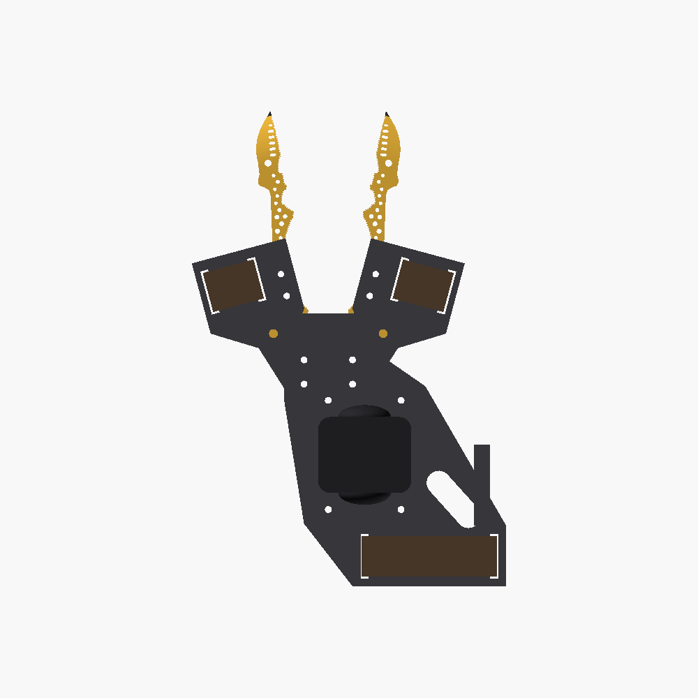

# Generalist Gripper · Generation 15: printable handheld

Jake (voice-492e118c): *"I'm happy with Gen 14. Let's move forward with making it printable. Gen 15: keep that, but
from the photos add the rest of it: the actual attachment mechanism and stuff, and the ability to attach a camera."*
Gen 14 is unchanged. The parts list, hardware and assembly steps are in **[BOM.md](BOM.md)**.

## What it is (from the photos, `cad/reference/generalist_gripper_gen6_*.png`)

| Part | What the photos show | Gen 15 |
|---|---|---|
| Fingers | Yellow, each one bolted into a dark block | Gen 14's, with the print changes below |
| Carriers | Dark blocks along the finger roots. Each rides on the thumb or the index finger with a strap (cup, side, top photos). | The carrier bolts onto the finger's top face through 2 of the finger's own holes. A lip hugs the finger's outer edge. The carrier holds the pivot nut, so the finger root isn't drilled. The digit sits under the carrier's outboard half, strapped through two 4 × 22 mm slots. |
| Pivot / linkage plate | Dark plate with screws over both finger roots (robot, target photos) | 6 mm plate holding both M4 pivots at Gen 14's ±27.137 mm, so the closed tips still meet exactly. |
| Hand mount | Frame on the back of the hand, wrist strap (side, cup photos) | Frame bolted on top of the pivot plate. It runs back over the back of the hand to two wrist-strap slots, with two rails that rest on the hand. |
| Camera | Insta360 upright on the back of the hand (camera, top, robot, side photos) | Cradle for an X4 or X5 (46.8 × 39 mm pocket), held by its own 1/4"-20 thread. It stands upright with the lenses facing forward and back. |

Everything sits **above** the hand (+Y). The thumb-index web under the pivot plate is checked empty over the whole
swing. Each finger is moved by its own digit, as in the photos. Nothing links the two fingers.
The thumb is on the right finger (+X) and the index finger is on the left.

## Finger changes, for printing only

The shape and the closed contact are Gen 14's. `check_geometry.py` reruns Gen 14's contact checks unchanged, and
they all pass: they touch over 0.24 mm at the point, the included angle is 6.9°, and the gap is within 0.08 mm of
Gen 14's target.

- **Tip thickness 1.6 → 2.0 mm** (`tip_thick`): 5 perimeters at the point instead of 4. This changes the side view
  only. The plan view and the contact are unchanged.
- **Walls ≥ 0.8 mm** (two 0.4 mm perimeters): grooves now stop 0.8 mm from holes (`ridge_wall`, was 0.6). The last
  slot near the beak, which came within 0.66 mm of the edge, is clipped to keep 0.8 mm. The thinnest wall is now
  0.80 mm (`check_device.py`).
- **Two honeycomb holes open to 3.2 mm** for the carrier's M3 bolts (they were 3.0 and 2.7 mm). The hole count
  stays 33 (`genus.py`).
- **The tip pad prints merged** with the finger. `exports/print/two_material/` keeps it separate for a yellow +
  TPU print.
- **Print orientation**: flat. The beak thins on both faces, so it needs supports under it from the build plate.
  The other option was a flat-bottomed beak, which would have changed the shape, so I didn't take it.

## Checks (all pass)

- `python3 export_models.py`: every placed and print STL is watertight and one body. Print STLs sit on the bed and
  fit a 220 mm bed. Also writes previews and `viewer_parts.json`.
- `python3 check_device.py`, at every degree from 0 to 30:
  - neither finger group (finger, carrier, strap) hits the pivot plate, frame, camera mount, camera or wrist strap;
  - the two sides never hit each other;
  - the thumb-index web box (x ±12, under the pivot plate, 60 mm back) stays empty. A positive control confirms the
    check can catch a hit.
  - At rest, the bolted parts touch without overlapping, the straps clear their slots, and the minimum wall is
    0.8 mm.
- `python3 check_geometry.py`: Gen 14's finger-contact checks. `python3 genus.py`: 33 through-holes.

## Limits

- **The hand is nominal**: 22.5 mm digits, a 60 × 44 mm wrist, the back of the hand ~12 mm below the frame. None of
  it is measured. The carrier's digit position, the rail height and the wrist-slot spacing are the values to
  adjust after a first fit.
- The device's pivot is near, not on, the knuckle (MCP joint), so the strap has to allow a little slip as the
  digit bends. The photos' device works the same way.
- The camera stands 124 mm above the frame, as in the side and robot photos. That's a lot of weight high on the
  hand.
- No spring, stop or sync between the fingers. Opening past 30° isn't checked.
- Plan-view scale is still assumed at 0.2 mm/px, as in Gens 7–14.
