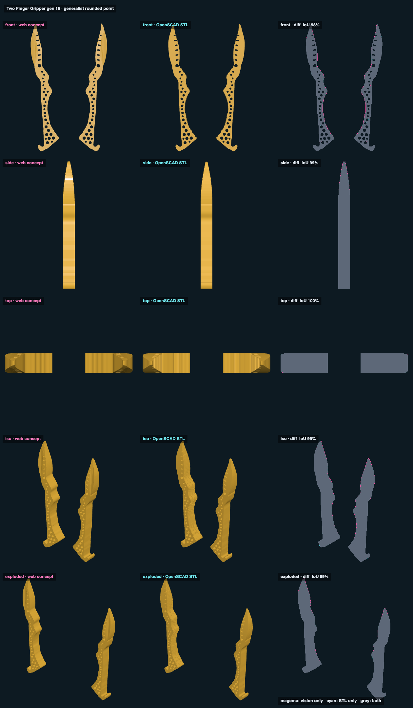

# Two Finger Gripper gen 16 · generalist rounded point · web vs STL

## Overlap

<!-- render_compare:begin -->
| View | Overlap (IoU) | Vision only px | STL only px |
|---|---|---|---|
| front | 98% | 406 | 27 |
| side | 100% | 64 | 0 |
| top | 100% | 8 | 0 |
| iso | 99% | 229 | 6 |
| exploded | 99% | 150 | 3 |

<!-- render_compare:end -->

## Differences and why

- Front 98%: the fringe along each inner edge is the 0.4 mm grooves and the 0.5 mm / 1.2 mm edge rounding, which only the
  STL has. The concept is the bare traced outline and holes; this is the expected gap.
- Side, top 100%: r2's parabola taper to the 2.4 mm tip matches; the STL's rounded nub at the very point is about a pixel.

## Fix list

- None. Regenerate with `Scripts/render_compare two-finger-gripper-v016-generalist-rounded-point` after `export_models.py`.
