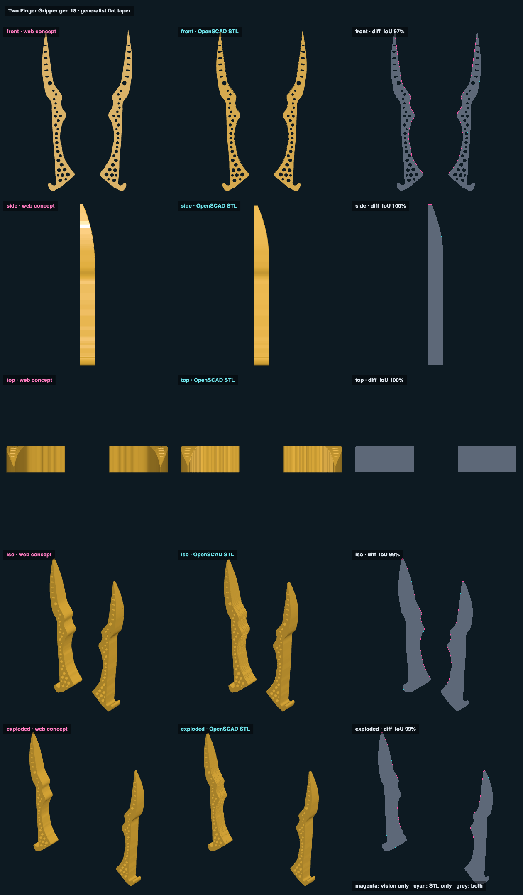

# Two Finger Gripper 1.18 · generalist flat taper · web vs STL

## Overlap

<!-- render_compare:begin -->
| View | Overlap (IoU) | Vision only px | STL only px |
|---|---|---|---|
| front | 97% | 418 | 12 |
| side | 100% | 26 | 14 |
| top | 100% | 0 | 0 |
| iso | 99% | 184 | 22 |
| exploded | 99% | 134 | 15 |

<!-- render_compare:end -->

## Differences and why

- Front 97%: the fringe along each inner edge is Gen 16's 0.4 mm grooves and edge rounding, which only the STL has.
- Side 100%: both show 1.18's taper: the ventral face one straight line to the point, the dorsal face dropping from the dot
  on the parabola to 2.4 mm. Top 100%.

## Fix list

- None. Regenerate with `Scripts/render_compare two-finger-gripper-v018-generalist-flat-taper` after `export_models.py`.
