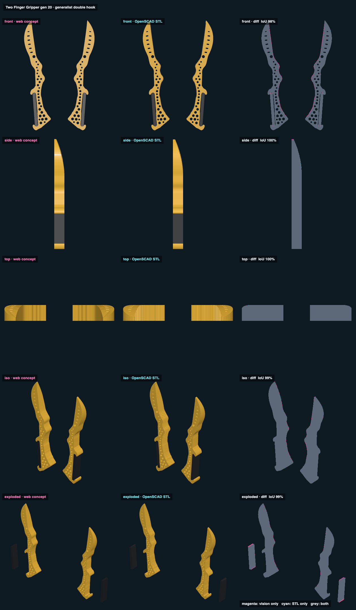

# Two Finger Gripper 1.20 · generalist double hook · web vs STL

## Overlap

<!-- render_compare:begin -->
| View | Overlap (IoU) | Vision only px | STL only px |
|---|---|---|---|
| front | 98% | 463 | 18 |
| side | 100% | 10 | 20 |
| top | 100% | 0 | 2 |
| iso | 99% | 154 | 17 |
| exploded | 99% | 260 | 12 |

<!-- render_compare:end -->

## Differences and why

- Front 98%: the fringe along each inner edge is Gen 16's 0.4 mm grooves and edge rounding, which only the STL has.
- 1.20: the handle blank is a plain box in the web render. In the STL, its two feet are trimmed to the notch shapes (0.2 mm
  clearance), a few pixels at each end.
- Side 100%: both show 1.18's taper (unchanged since): the ventral face one straight line to the point, the dorsal face dropping from the dot
  on the parabola to 2.4 mm. Top 100%.

## Fix list

- None. Regenerate with `Scripts/render_compare two-finger-gripper-v020-generalist-double-hook` after `export_models.py`.
