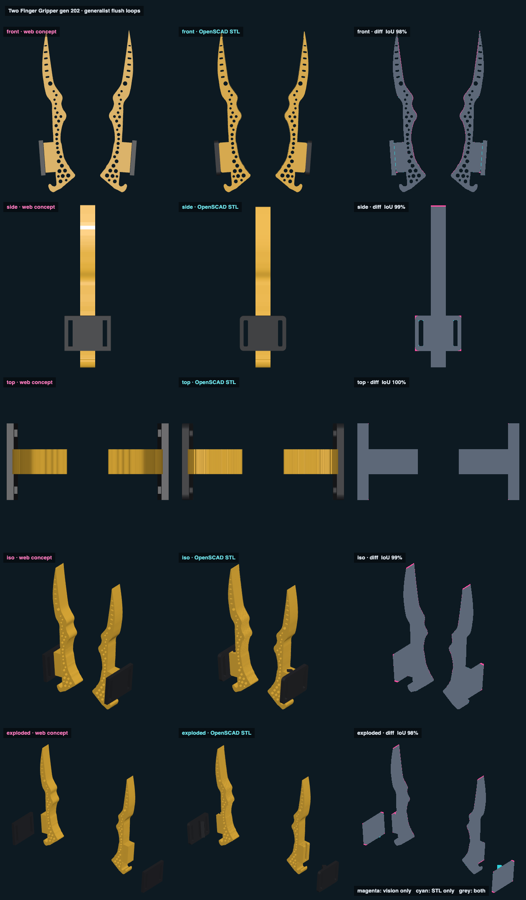

# Two Finger Gripper 2.2 · generalist flush loops · web vs STL

## Overlap

<!-- render_compare:begin -->
| View | Overlap (IoU) | Vision only px | STL only px |
|---|---|---|---|
| front | 98% | 438 | 82 |
| side | 99% | 189 | 16 |
| top | 100% | 8 | 0 |
| iso | 99% | 313 | 7 |
| exploded | 98% | 288 | 83 |

<!-- render_compare:end -->

## Differences and why

- Front 98%: the fringe along each inner edge is Gen 16's 0.4 mm grooves and edge rounding, and at the lug and slide
  corners the 1.5 / 3 mm rounding, all of which only the STL has. The concept is plain blocks and the traced outline.
- Side 99%, top 100%: both are the full 12 mm plate from base to point, as Jake asked (no taper).
- Exploded 98%: the cyan strip on each slide is its dovetail tongue. The concept leaves it out on purpose (the
  slide is drawn as a flat plate), so the STL alone shows it. 2.2's plate stands edge-on to this camera, so less of the
  tongue shows than in 2.1 (95%).

## Fix list

- None. Regenerate with `Scripts/render_compare two-finger-gripper-v202-generalist-flush-loops` after `export_models.py`.
