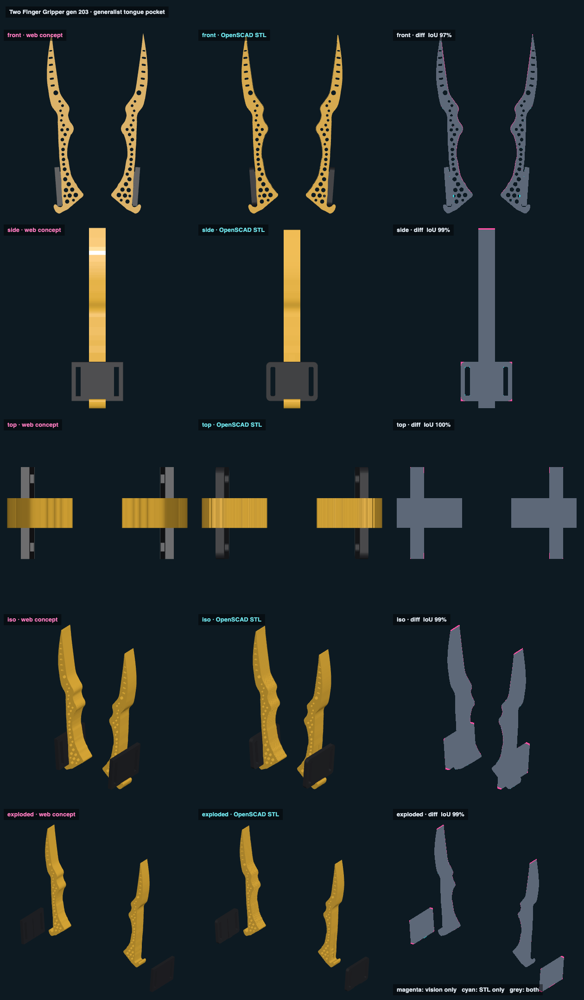

# Two Finger Gripper 2.3 · generalist tongue pocket · web vs STL

## Overlap

<!-- render_compare:begin -->
| View | Overlap (IoU) | Vision only px | STL only px |
|---|---|---|---|
| front | 97% | 420 | 40 |
| side | 99% | 190 | 16 |
| top | 100% | 60 | 0 |
| iso | 99% | 360 | 7 |
| exploded | 98% | 251 | 10 |

<!-- render_compare:end -->## Differences and why

- Front 97%: the fringe along each inner edge is Gen 16's 0.4 mm grooves and edge rounding, and the handle's 3 mm corner
  rounding, all of which only the STL has. The concept is plain blocks and the traced outline. The concept also draws the
  handle's full rectangle where the STL trims its foot to the hook's notch.
- Side 99%, top 100%: both are the full 12 mm plate from base to point, as Jake asked (no taper).
- Exploded 98%: the concept draws the tongue as a plain bar. The STL adds the dovetail head and cuts the keyhole pocket
  into the finger. The pocket is not drawn in the concept.

## Fix list

- None. Regenerate with `Scripts/render_compare two-finger-gripper-v203-generalist-tongue-pocket` after `export_models.py`.
