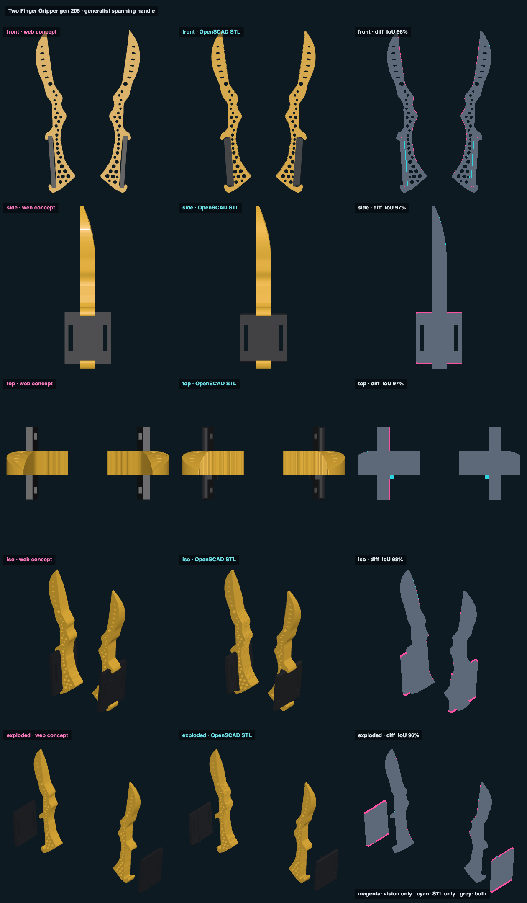

# Two Finger Gripper 2.5 · generalist spanning handle · web vs STL

## Overlap

<!-- render_compare:begin -->
| View | Overlap (IoU) | Vision only px | STL only px |
|---|---|---|---|
| front | 96% | 459 | 380 |
| side | 97% | 618 | 34 |
| top | 97% | 454 | 164 |
| iso | 98% | 543 | 12 |
| exploded | 96% | 909 | 19 |

<!-- render_compare:end -->

## Differences and why

- Front 96%: the fringe along each inner edge is the 0.4 mm grooves and edge rounding, which only the STL has. The cyan
  sliver along each handle is the stop strip on its inboard face (the concept leaves it out).
- Side and top 97%: the magenta bands at the plate's two ends are the concept's square plate corners; the STL rounds them
  (plate_corner_r 3) and trims the ends into feet. The cyan dot in top is the stop strip again.
- Iso and exploded 96-98%: the same plate corners.

## Fix list

- None. Regenerate with `Scripts/render_compare two-finger-gripper-v205-generalist-spanning-handle` after `export_models.py`.
