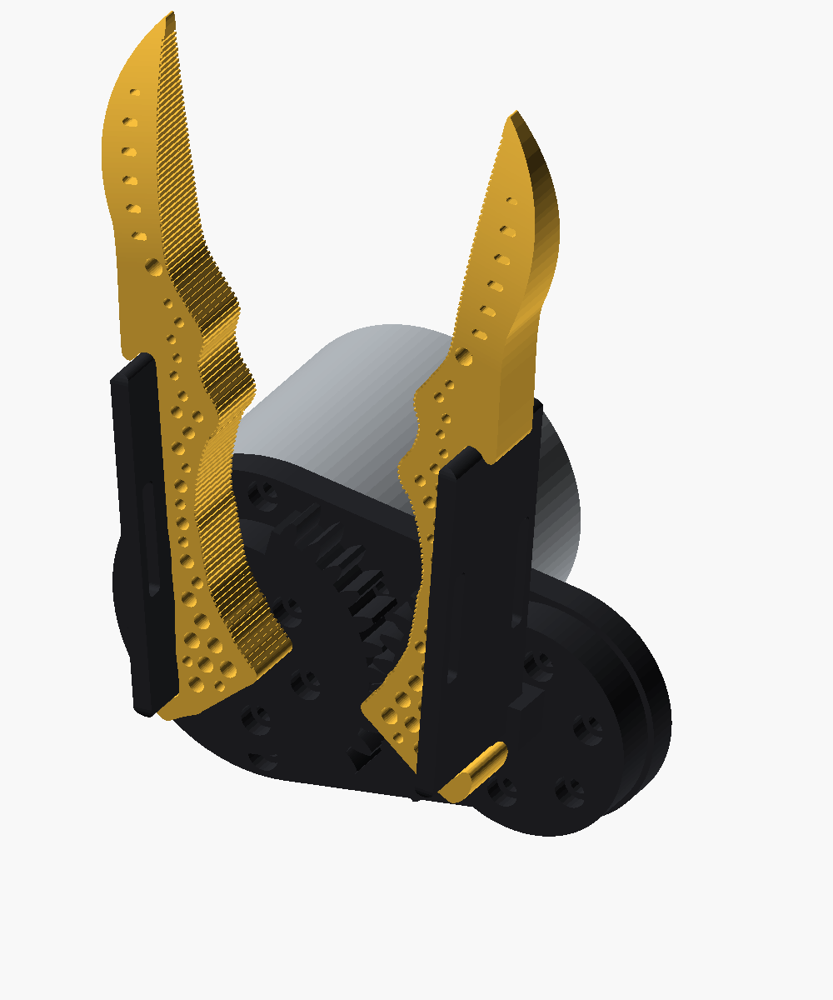

# Generalist Gripper · Version 3.2: simple (handles 2.6 shrunk, fingers 1.21)

voice-e3cd53d6. Jake: *"Simplify the whole 3.1 setup. It has to be much simpler: fewer parts and features, as little as
needed. Nothing should get in the way of the strap-loop slots; keep them completely clear. Shrink the handles part down."*

3.2 is 3.1 (`v301_generalist_base`) with everything that wasn't needed taken out. Still parametric (`params.json`, 99
params; the Tune panel slides them), still separable pieces, still one RobStride RS00 underneath.

## What changed from 3.1

- **Arms gone; gear + cup is one part.** 3.1 had an arm per side (channel round the handle, floor plate, hub, hex boss)
  screwed to a separate gear with two M3s. 3.2 merges them into a **driver**: the gear sector with a short **cup** on top
  that the handle plate's low end drops into. The cup is now the handle–base interface (`cup_len` 8, `cup_depth` 5,
  `cup_wall` 2.5). Gone with it: the hex boss/socket, the 4 interface screws, their counterbores and taps, and the
  "Handle-base interface" and "Arm" param groups (16 params).
- **Strap slots completely clear.** 3.1's arm channel and floor ran under the ventral strap slot. Now nothing but the
  handle itself comes within `strap_clear` (3 mm, new param) of either slot or the plate wall beside it, on either face, at
  any swing 0–30 deg. `check_geometry.py` checks exactly that (red boxes in `previews/strap_zones.png`), with a positive
  control (a cup long enough to reach the slots fails it). The cup stops `strap_clear` short of the slots (asserted), and
  the gears sit `strap_clear` below the plate's ventral edge.
- **Handle shrunk.** The plate is 29 mm across the finger (3.1: 37): `slot_wall` 2 (3), `slot_gap` 18 (24). The slots
  are still 3.5 x 21 mm and clear the 12 mm finger by 3 mm each side. Length (67.4 mm, hook to hook) is unchanged:
  it is set by the finger's two hooks.
- **Base: just two discs.** The plate is the hull of a 29 mm disc round the motor (3.1: 31) and a 21 mm disc round the
  left bushing (new `bush_r`). The wrist tab and its 4 holes are gone; the RS00's own back face (4 x M3 on 38 mm) is the
  wrist mount. The whole stack is 6.5 mm shorter (base underside y -31.8; 3.1: -38.3).

Parts: **7 printed** (2 fingers, 2 handles, 2 drivers, 1 base; 3.1: 9) + the motor. Screws: only the motor's (6 M3
flange + 6 M3 front ring; 3.1 also had 4 interface screws).

Assembly: base onto the motor's front ring; right driver bolted to the flange through the base, left driver dropped into
its bushing; each finger, with its handle already on, drops into its driver's cup from above.

## Parts

| Part | STL (assembled pose / print) |
|---|---|
| Right / left finger (1.21) | `exports/parts/right.stl`, `left.stl` / `exports/print/...` |
| Right / left handle (2.6, shrunk) | `right_slide.stl`, `left_slide.stl` |
| Right / left driver (gear + cup) | `right_driver.stl`, `left_driver.stl` |
| Base plate | `base.stl` |
| Motor (RS00, not printed) | `motor.stl` |

## Checks (all pass)

`python3 export_models.py && python3 genus.py && python3 check_geometry.py`: every 2.6 check, plus: gears mesh 0–30 deg
(and interfere half a tooth off); the cup clears its finger and handle, stops the handle sliding out, and lets the
finger-and-handle drop in; **the strap keep-outs are empty of everything but their handle 0–30 deg**; all six flange
bolts can be reached from above the right driver (this is why `cup_len` stops at ~8.5 mm); nothing that swings hits the
base or motor; the sides never collide; motor screws and dowels line up. Holes: driver 6, base 10.

## Not verified

Nothing printed, no RS00 in hand. The cup is a short (8 mm) 0.2 mm-fit grip: it drives the handle, which drives the
finger through its hooks; no load test. No wrist mount was designed: the RS00 back face is assumed to be it. 3.1's
other caveats stand: no finger pivot pin, nothing holds the left driver down axially, no swing stops.

---

3.1's README follows.

# Generalist Gripper · Version 3.1: base and drive (handles 2.6, fingers 1.21)

voice-5b59d3bf. Jake: *"The black handles extend back behind the yellow fingers, wrap around, and connect into a common
base. A single motor is mounted underneath that base; it spins and drives gears attached to the black handles, which opens
and closes the gripper."* Motor (Jake's correction): the **RobStride RS00**, the gripper motor of Seeed's reBot Arm
B601-RS (its LeRobot follower names the gripper `rs-00`), not the SO-101's STS3215 or the Damiao DM-J4310-2EC.

3.1 is the first 3.x version (gripper plus handles plus base). It is 2.6 (`v206_generalist_single_step`) unchanged, plus
four new kinds of part. Every one is its own module in `gripper.scad`, its own STL, and every dimension is in
`params.json` (112 params; 52 new, in five groups), so the Tune panel slides them.

## The drive, top to bottom (down the ventral side, -y)

- **Arm** (black, one per finger; `arm()`): the handle's root. A channel wraps the 2.x handle plate's ventral edge for
  `chan_len` (30 mm) from its low end, and a floor plate runs under it to a hub on the finger's pivot. The channel also
  stops the handle sliding back out the way it slid in, which only friction did in 2.5/2.6.
- **The handle-base interface** (`iface_*`): on each pivot axis, a 10 mm hex boss under the arm drops 4 mm into a hex socket
  in the top of that side's gear, held by two M3 screws on a 16 mm circle. This is the one joint every handle version and the
  base share. To fit another 2.x handle, print an arm from that version's handle params (rail, plate thickness, height and
  ends) with this same boss; the gears, base and motor do not change.
- **Gears** (`gear()`): two equal involute spur sectors (34-tooth circle, module 1.60, 20 deg, 8 mm wide, 120 deg of teeth).
  Pitch radius = the pivot half-spacing (27.25 mm), so they mesh on the centreline and the fingers counter-rotate 1:1. The
  left one is half a tooth out of phase. Each has a 35 mm spigot down into the base plate.
- **Base** (`base()`, black): one 6 mm plate across both pivots under the gears, plus a rear tab with four wrist holes.
- **Motor** (`motor()`, reference only): RS00, 57 mm x 51 mm, coaxial with the right pivot under the plate. Its front ring
  (6 x M3 on 50 mm, plus 2 dowels) bolts up to the plate; its output flange (6 x M3 on 27 mm) bolts the right gear's spigot
  through the plate. The left gear turns in its plate hole as a plain bushing and follows through the mesh. So the motor is
  off-centre, under the right finger (a centred motor would need an extra gear that turns the wrong way or an idler).

Assembly: base onto the motor; gears into their holes (right one bolted to the flange); each arm screwed to its gear; then
each finger, with its handle already on, drops into its arm's channel from above.

## Motor numbers and sources

All from RobStride's RS00 drawing ([Seeed 100083284](https://media-cdn.seeedstudio.com/media/wysiwyg/111-photo/100083284--01.png))
and [RS00.step](https://github.com/RobStride/Product_Information/blob/main/Product%20Literature/CAN2.0/RS00/RS00.step) (bbox
57 x 57 x 51.4): body 57 x 51 +-1, output boss 35 x 1, output 6 x M3 deep 5 on 27 +-0.1, front ring 6 x M3 on 50 +-0.1 at
30 deg, 2 x 3 mm dowels deep 5 at 15 deg, back 4 x M3 deep 4 on 38 +-0.1 at 45 deg. Manual: 5 N m rated, 14 N m peak,
315 rpm no-load, 24-60 V (48 V rated), CAN. Each is a param in the "Motor: RobStride RS00" group.

## Parts

| Part | STL (assembled pose / print) |
|---|---|
| Right / left finger (1.21) | `exports/parts/right.stl`, `left.stl` / `exports/print/...` |
| Right / left handle (2.6) | `right_slide.stl`, `left_slide.stl` |
| Right / left arm | `right_arm.stl`, `left_arm.stl` |
| Right / left gear | `right_gear.stl`, `left_gear.stl` |
| Base plate | `base.stl` |
| Motor (RS00, not printed) | `motor.stl` |

## Checks (all pass)

`python3 export_models.py && python3 genus.py && python3 check_geometry.py`: every 2.6 check, plus: the gears mesh without
touching at every degree 0-30 (and do touch when one is turned half a tooth); the arm clears its finger and handle, stops
the handle sliding out, and lets the finger-and-handle unit drop in; the hex boss clears its socket and drives the gear
(turned 10 deg it hits); nothing that swings hits the base or motor, and the two sides never meet, 0-30 deg; the motor's
screws and dowels line up with the gear and base holes. Hole counts: arm 2, gear 6, base 14.
`live_render.py` renders all ten parts for the Tune panel (~0.2 s); bad combinations show the assert's message.

## Not verified

Nothing printed, and no RS00 in hand: the numbers are the drawing's. The second dowel is assumed opposite the first.
Solids only: no tooth strength, loads or motor torque. The fingers have no pivot pin; each is held to its arm only through
its handle (hooks + channel), and the finger can still slide out dorsally against friction. Nothing holds the left gear
down axially, and its bushing is printed plastic. No swing stops: the motor's limits must keep it in 0-30 deg. The wrist
holes are placeholders; the B601 wrist connector is not measured.

---

2.6's README follows.

# Generalist Gripper · Version 2.6: single step (fingers 1.21)

voice-72840084. Jake (on 1.20 + 2.5): *"Extend the black piece where my finger rests all the way up to where the profile
starts to go out again. Where it goes out again, make it more of a single jump out: no double indent, just out and then
back in."*

2.6 is 2.5 (`v205_generalist_spanning_handle`) with the top hook moved up. Its fingers are **1.21** (gripper only = the
`right`/`left` finger STLs here; there is no separate 1.21 folder). Side by side, same camera: `previews/compare_v205.png`.

## What changed from 2.5

- **The outer edge runs straight up to where it used to go out** (1.21). 1.20's edge had the top hook notch at u 28.4, a
  ramp back in, a ~1 mm dip from u 36 to 56, then the blade-root S-curve climbing out: two indents. Now the edge is one
  straight line from the base hook to the top notch at u 54 (new param `top_notch_u`, replacing `top_hook_mirror_u`).
- **One step out.** At u 54 the mirrored J-hook curls out to its crest (6.6 mm out, same hook as 2.5), and the edge stays
  out there, nearly level (sags 0.3 mm), until the beak's outer edge comes back up to it at about u 77; then the beak
  carries on and rounds back in to the point. New param `top_step_back` (0) lets the back of the step dip and rejoin
  the edge sooner if the shoulder is too bulky. Ahead of the hook the finger is up to ~3 mm wider outboard than 1.20.
- **The handle is longer** (2.6). Same plate, feet, strap slots, stop strip and slide-in across the finger as 2.5, but
  floor to floor + `span_over` it is now **67.4 mm** (2.5: 41.8). The strap slots stay centred on it.

## Parts

| Part | STL (assembled pose / print) |
|---|---|
| Right finger (1.21) | `exports/parts/right.stl` / `exports/print/right.stl` |
| Left finger (mirror) | `exports/parts/left.stl` / `exports/print/left.stl` |
| Right handle | `exports/parts/right_slide.stl` / `exports/print/right_slide.stl` |
| Left handle | `exports/parts/left_slide.stl` / `exports/print/left_slide.stl` |

## Checks (all pass)

`python3 export_models.py && python3 genus.py && python3 check_geometry.py`: every 2.5 check (meshes watertight, 33
finger holes + 2 handle holes, fingers never collide 1-30 deg, point-only contact, taper, handle seats, slides in across the
finger without touching, held by both prongs, both floors and the stop strip).

## Not verified

Nothing printed. The wider shoulder ahead of the top hook isn't checked against a hand or anything the finger closes on.
2.5's caveats stand: only friction stops the handle sliding back out the way it came, the 0.2 mm fit is nominal, and
the prongs haven't been pull-tested.

---

2.5's README follows.

# Generalist Gripper · Version 2.5: spanning handle

voice-56f9d73f. Jake: *"Bring the handles down further, and make the handle piece extend higher up, so it spans between the
gripper's bottom and top hooks and slides in to be captured by both."*

2.5 is 2.4 (`v204_generalist_parametric`: every dimension in `params.json`, the Tune panel) on 1.20's fingers
(`v020_generalist_double_hook`: 1.19's wide beak, 1.18's flat-bottom taper, and a top hook mirroring the base J-hook).
The finger STL is byte-identical to 1.20's.

## What changed from 2.4

- **1.20's fingers.** `trace_photo.py` gains 1.20's `top_hook()`. `params.json` takes 1.19/1.20's values:
  `outer_lean_deg` 15, `outer_start_handle` 0.50, `outer_end_handle` 0.25, `outer_bow` 0.20, `tip_thick` 2.4, and
  `contact_back` 0.0005 (calibration). New outline param `top_hook_mirror_u` (8.5) slides the top hook along the edge.
- **One handle spans both hooks.** The black plate (3.5 mm, 37 mm across, two strap slots, as 2.2-2.4) now runs the whole
  straight outer edge, from the base notch floor to the top notch floor plus `span_over` (1 mm) at each end: 41.8 mm long
  (2.4: 28). That's lower at the bottom (its foot now reaches the base notch's floor, 2.4 stopped 0.8 mm short) and 13.8 mm
  higher at the top. The finger outline grown by `fit` trims each end into a foot that fills one notch.
  `slide_len` and `slide_u0` are gone: the plate's length follows the hooks.
- **It slides in across the finger.** The two hooks face each other, so nothing can slide in along the edge any more. So 2.3's
  tongue and keyhole pocket are gone (with their 10 params), and the hooks do their job: both hold the handle along the edge
  and against outboard pull. The handle slides on across the finger's thickness from the flat (ventral) side, like 1.20's
  blank. With no pocket, the finger no longer breaks into 4 honeycomb holes.
- **A stop strip.** New `stop_depth` (1.5) and `stop_width` (2): a strip on the plate's inboard face, along its ventral side.
  It trails the slide-in, and when the handle is home it butts against the ventral face, so the handle can't slide on
  through. `stop_depth` 0 removes it. In 1.20, only friction held the blank.

## Parts

| Part | STL (assembled pose / print) |
|---|---|
| Right finger | `exports/parts/right.stl` / `exports/print/right.stl` |
| Left finger (mirror) | `exports/parts/left.stl` / `exports/print/left.stl` |
| Right handle | `exports/parts/right_slide.stl` / `exports/print/right_slide.stl` |
| Left handle | `exports/parts/left_slide.stl` / `exports/print/left_slide.stl` |

`gripper.scad` `part=` adds `handle_sliding` (with `handle_slide` = mm still to go). Print the fingers flat on the ventral face.

## Checks (all pass)

`python3 export_models.py && python3 genus.py && python3 check_geometry.py`: every 2.4 / 1.20 finger check, plus:

- the seated handle clears the finger;
- it slides in from 26 mm out on the ventral side, in 1 mm steps, without touching;
- pushed 0.5 mm outboard it hits both prongs, toward either hook that notch's floor, and on through, the stop strip
  hits the ventral face;
- the finger has 33 through-holes (1.20's) and the handle has 2.

`live_render.py` with no overrides reproduces the exported STLs, and with `top_hook_mirror_u` changed it re-traces (~1 s).

## Not verified

Nothing has been printed. Only friction keeps the handle from sliding back out the way it came in. The 0.2 mm fit is
nominal, and the prongs (1.19 base-hook size, about 2.2 mm deep) haven't been pull-tested.
