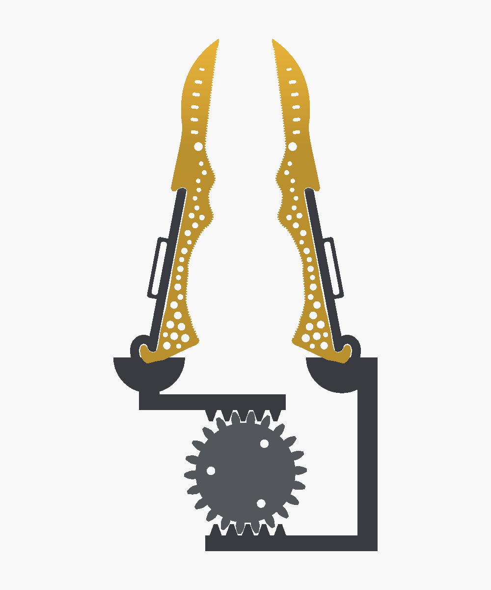
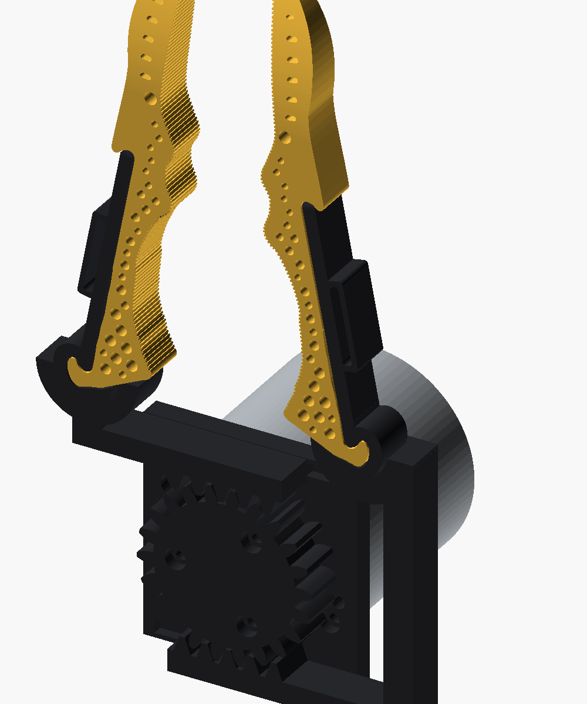

# Generalist Gripper · Base 5: single gear (Gripper 21, Handle 7)

voice-01ab1486. Jake: *"Look at the most recent design and see if you can come up with one that uses a single gear ...
open and close both fingers from the one RobStride RS00 using only one gear. Pick the simplest approach and briefly
explain why."*

Base 5 is Base 4 (`v304_generalist_one_piece_drive`) with its three gears (pinion, right gear, left gear) replaced by
**one pinion between two opposed racks**. It is still parametric (`params.json`, 108 params, which the Tune panel slides) and still runs on one
RobStride RS00, centred.

## Why one pinion and two racks

The pinion's top and bottom always move in opposite directions by exactly the same distance. So a rack along its top
(the right finger's) and a rack along its bottom (the left finger's) open and close the pair symmetrically, by
construction. Each rack is printed as one piece with its handle, the way Base 4 printed each handle with its gear.

- **Rejected: one gear driving the pivoting handles through a single rack.** A rack sliding along the centreline would push a
  pin in a slot on each handle. That is one more printed part than Base 4 (the rack), plus two pin-in-slot joints with
  play, and the pinion beside a centreline rack puts the motor off-centre.
- **Rejected: a cam or linkage.** A cam only pushes one way, so it needs a return spring. A crank on one centred motor
  doesn't move two mirror-image handles by the same amount, so the fingers would meet off-centre. A linkage adds links and pins.
- **Trade-off of the pick:** the fingers now **slide** (a parallel gripper) instead of swinging. Closed, they sit exactly
  where Base 4's did, so the point contact is unchanged. Open, the tips are **40 mm apart** (`stroke` 20 mm each,
  up to 25 on the slider). Base 4's 30° swing opened them about 125 mm.

## Piece count

| | Base 4 | Base 5 |
|---|---|---|
| Fingers | 2 | 2 |
| Handle + drive part | 2 handle-gears | 2 handle-racks |
| Pinion | 1 | 1 (the only gear) |
| Base | 1 | 1 |
| **Printed** | **6** | **6** |
| RS00 motor | 1 | 1 |
| M3 screws | 6 (3 pinion + 3 base) | **5** (3 pinion + 2 base) |
| **Total pieces** | **13** | **12** |
| Gears | 3 | **1** |

The drive chain from the fingers to the motor is the same length as Base 4's: finger, handle-rack, pinion, motor. The axles and bushings are gone. The
handle-racks are held in line by a groove in the base, not by turning in a bearing.

## What changed from Base 4

- **Pinion** (`pinion_teeth` 22, `gear_module` 2, `gear_w` 12): pitch radius 22 mm, on the RS00 flange with 3 M3 as in
  Base 4. Each finger moves 22 mm per radian, so the full 20 mm stroke is 52° of motor. At the RS00's 5 N·m rated torque
  that is about 230 N on each rack (14 N·m peak: about 640 N), at up to ~0.7 m/s.
- **Handle-racks.** Base 4's handle (plate, strap boss and tunnel, tail), its hub round the finger's base corner, and the
  floor the finger rests on are all kept. The gear teeth, fan and axle are gone. The **right** one carries the top rack, joined
  straight up into its hub (`arm_w`). Closed, that rack runs under the left hub, `rack_clear` below it. The **left** one
  carries the bottom rack and reaches it with a column up its outboard side, outside the top rack's travel.
- **Tongue and groove.** A 3 × 2.5 mm tongue under each rack (`key_w`, `key_h`) runs in a groove in the base plate. It
  takes the pinion's separating push and keeps the rack straight. **The groove ends are travel stops**, `base_clear`
  past closed and past open (Base 3 and 4 had none).
- **Base**: one plate, the hull of the motor disc and the band under both grooves, about 59 × 61 mm. It mounts on **2**
  of the front ring's 6 M3 holes (30° and 210°, clear of both grooves), and the two dowels still locate it. The bushings
  are gone.
- **The fingers slide.** `angle` is still the 0–30 slider; it opens each finger `stroke · sin(angle)/sin(30°)` mm. The
  gallery moves the parts with `slides` in `cad/mobile_gallery/poses.js` (no hinges). In mix-and-match, picking Base 5
  makes every part follow its slides.

Assembly: put the motor under the base (2 M3). Bolt the pinion to the flange through the base (3 M3). Drop each
handle-rack's tongue into its groove, meshing the pinion: right on top, left at the bottom. Then drop each finger into its
handle-rack from above.

## Parts

| Part | STL (assembled pose / print) |
|---|---|
| Right / left finger (Gripper 21) | `exports/parts/right.stl`, `left.stl` / `exports/print/...` |
| Right / left handle-rack (Handle 7 + rack) | `right_rack.stl`, `left_rack.stl` |
| Pinion | `pinion.stl` |
| Base plate | `base.stl` |
| Motor (RS00, not printed) | `motor.stl` |

## Checks (all 34 pass)

`python3 export_models.py && python3 genus.py && python3 check_geometry.py`. All of Base 4's finger and handle checks
still pass. The drive checks sweep the slider 0–30:
- the pinion meshes both racks without touching. Turned half a tooth, it hits them. With the right rack moved the wrong way, it hits;
- the pinion never touches a finger, and the two sides never touch each other;
- each handle-rack clears its seated finger. Each finger drops in from 20 mm above without touching. 0.3 mm lower, it
  hits the floor. Moved 0.5 mm either way, the handle-rack hits the finger, so it drives the finger both ways;
- the strap tunnel mouths stay clear of everything except their own handle over the whole travel;
- the flange bolts can be reached from above. Nothing that moves hits the base or motor; the tongues only touch the groove faces;
- 0.5 mm past open or past closed, each rack hits its groove end (the stops);
- the motor screws and dowels line up with the pinion and base holes.

Holes: handle-rack 1 (the strap tunnel), pinion 3, base 5 (motor boss hole, 2 screws, 2 dowels).

## Not verified

Nothing has been printed, and there is no RS00 in hand. The racks slide on printed plastic in printed grooves with
0.25 mm clearance. Nothing holds them down (+y), and only the finger's own fit holds the finger in its rack (as in Base 4).
The tooth load is an estimate only: about 640 N at peak torque on module-2, 12 mm wide teeth is a lot for PLA, so
limit the motor's torque. The 2-bolt base and 3-bolt pinion joints have not been tested. The smaller opening (40 mm
between the tips) has not been checked against what the gripper needs to pick up. The rack tooth is a plain 20° straight-sided
profile with `gear_backlash`; there is no tip relief.

---

Base 4's README follows.

# Generalist Gripper · Base 4: one-piece drive (Gripper 21, Handle 7)

voice-b7260e73. Jake: *"Simplify again: there are too many pieces. Focus especially on how the base links to the handle;
that connection has too many parts. Cut the part count wherever possible."*

Base 4 is Base 3 (`v303_generalist_inplane`) with the handle and its side gear printed as one part, and half the motor
screws. Still parametric (`params.json`, 103 params; the Tune panel slides them), still one RobStride RS00, centred.

## Piece count

| | Base 3 | Base 4 |
|---|---|---|
| Fingers | 2 | 2 |
| Handles | 2 | — (in the gears) |
| Side gears | 2 | 2 (each with its handle) |
| Pinion | 1 | 1 |
| Base | 1 | 1 |
| **Printed** | **8** | **6** |
| RS00 motor | 1 | 1 |
| M3 screws | 12 (6 flange, 6 front ring) | **6** (3 + 3) |
| **Total pieces** | **21** | **13** |

Handle-to-base chain. Base 3: finger, handle (tail + key), gear cradle (key notch), gear axle, base bushing.
Base 4: finger, handle-gear, base bushing.

## What changed from Base 3

- **Handle + side gear = one print.** The handle's tail runs straight into the gear hub. The finger's pocket is cut
  through both at once, `fit` off the finger. Gone: the key (`key_deg`, `key_w`, `key_r`), the key notch, the cradle's
  separate fit, and the handle as its own part.
- **The finger drops in from the dorsal side** (+y, moving −y). Its base hook goes between the handle's two feet and its
  base corner into the hub pocket, and it rests on the gear's web. The hooks and the hub drive it both ways. Turned 1°
  either way, the handle-gear hits it (checked).
- **The web is the stop, so Handle 7's stop strip is gone** (`stop_depth`, `stop_width` removed). The handle is exactly the
  finger's 12 mm edge-on: Handle 7's height, `handle_over` 0 (Base 3: 1.5, 15 mm). Plate, feet, strap tunnel and boss are
  Handle 7's.
- **3 bolts, not 6, at each motor joint.** New `motor_out_screws` (3): the pinion bolts through every other hole of the
  RS00's 6-hole output flange. New `motor_front_screws` (3): the base plate uses every other front-ring hole, and the
  two dowels still locate it. Estimate: 14 N·m peak at the 13.5 mm bolt radius is about 350 N of shear per M3. Not tested.
  Slide either one back to 6 to get Base 3's bolting.

Parts: **6 printed** (2 fingers, 2 handle-gears, 1 pinion, 1 base) + the RS00 + **6 M3**.

Assembly: put the motor under the base (3 M3). Bolt the pinion to the flange through the base (3 M3). Drop each
handle-gear's axle into its bushing. Then drop each finger into its handle-gear from above.

## Parts

| Part | STL (assembled pose / print) |
|---|---|
| Right / left finger (Gripper 21) | `exports/parts/right.stl`, `left.stl` / `exports/print/...` |
| Right / left handle-gear (Handle 7 + gear) | `right_gear.stl`, `left_gear.stl` |
| Pinion | `pinion.stl` |
| Base plate | `base.stl` |
| Motor (RS00, not printed) | `motor.stl` |

In the live preview's mix-and-match, the handle-gears count as Base parts (their names start "Right gear" / "Left gear").
Picking another Handle with Base 4 draws that handle over the one already on the gear.

## Checks (all 32 pass)

`python3 export_models.py && python3 genus.py && python3 check_geometry.py`. Everything from Base 3 still passes
(fingers, handle seat and prongs, gear and pinion mesh, strap tunnel keep-outs, bolt access, base/motor clearances), plus:
- the handle-gear clears its seated finger, and the finger drops in from 20 mm above in 0.5 mm steps without touching;
- the finger rests on the web: 0.3 mm lower, it hits;
- turned 1° open or closed, the handle-gear hits the finger, so it drives it both ways;
- handle and gear core overlap, so the print is one solid (each handle-gear is 1 component).

Holes: handle-gear 1 (the strap tunnel), pinion 3, base 8 (2 bushings, the motor boss, 3 screws, 2 dowels).

## Not verified

Nothing has been printed and there is no RS00 in hand. Only friction and gravity keep the finger in its handle-gear
(+y), as in Base 3. The handle-gear is a bigger print with more overhang: the teeth start 2 mm above the web, and the
strap boss stands out from the plate. Print orientation and supports aren't worked out. The 3-bolt joints are a shear
estimate only. Base 3's other caveats stand: the left gear has teeth only for 0–30°, there are no swing stops, nothing
holds the gears down axially, there is no finger pivot pin, and the RS00 back face is assumed to be the wrist mount.

---

Base 3's README follows.

# Generalist Gripper · Version 3.3: in-plane drive (fingers 1.21)

voice-3b311f32. Jake: *"Reduce the handle height again: just barely taller than the gripper fingers themselves. Rework how the
handle attaches to the base and gear system so it attaches much more smoothly. Put the gears in the same plane as the gripper
fingers (move the gears up), with a single motor centered there. The handle wraps around and connects into the gear system."*

3.3 is 3.2 (`v302_generalist_simple`) laid out again. Still parametric (`params.json`, 107 params; the Tune panel slides them),
still separable pieces, still one RobStride RS00.

## What changed from 3.2

- **Handle 15 mm tall** across the finger (3.2: 29; the finger is 12): new `handle_over` (1.5 mm past each face).
- **Strap tunnel instead of strap slots.** A 15 mm plate has no room for a slot beside the finger, so the strap runs
  through a tunnel: a boss on the plate's outer face (where the digit lies) with a 2.5 mm gap under it
  (`strap_slot_width`), open at both faces of the plate. The webbing goes in one face, out the other, and round the digit.
  `slot_gap` is gone. The handle is 4 mm thicker over the 24 mm boss (the digit sits that much further out there).
- **The handle wraps the finger's base.** Its **tail** is a band, `slide_t` thick, that follows the finger's outline
  `tail_gap` off it: from the plate over the base hook's prong, round the hook and under the finger (`tail_top_u`,
  `tail_reach`). A **key** (`key_deg`, `key_w`, `key_r`) sticks straight down out of the tail under the pivot.
- **Gears in the finger plane.** They are centred on the finger's mid-plane below the fingers (3.2: stacked under them).
  Each side gear's hub is a **cradle** cut to the finger and the tail (fit off them), with a notch for the key. The
  finger-and-handle unit drops straight down into it. The key's sides face along the swing, so the gear drives the handle
  both ways with about 1.5 deg of play (without the key it only pushed the handle open). A 3 mm web under the cradle
  reaches in to the pivot, which sits inside the finger's base corner, and a 12 mm axle under it turns in a plain bushing
  in the base. 3.2's cups and drivers are gone.
- **One RS00, centred.** A **pinion** (34 teeth, 1:1, `pinion_teeth`) on the motor's flange sits on the centreline,
  47 mm below the pivots, and meshes the **right** gear only. The right and left gears mesh each other, so the fingers still
  counter-rotate. A pinion meshing both gears would turn them the same way. Each side gear carries teeth only where its
  mates meet it over 0–30 deg (+`gear_extra`), so the left gear never reaches the pinion (checked).
- **Base**: the hull of the motor's disc (centred) and a disc round each bushing. The motor bolts up under its centre.

Parts: **8 printed** (2 fingers, 2 handles, 2 gears, 1 pinion, 1 base; 3.2: 7) + the motor. Screws: only the motor's
(6 M3 flange through the pinion + 6 M3 front ring).

Assembly: motor under the base; the pinion bolted to the flange through the base; each side gear's axle dropped into its
bushing; slide each handle onto its finger across the finger, from the ventral side, as in 2.5; then drop each finger and
handle unit into its gear's cradle from above.

## Parts

| Part | STL (assembled pose / print) |
|---|---|
| Right / left finger (1.21) | `exports/parts/right.stl`, `left.stl` / `exports/print/...` |
| Right / left handle | `right_slide.stl`, `left_slide.stl` |
| Right / left gear | `right_gear.stl`, `left_gear.stl` |
| Pinion | `pinion.stl` |
| Base plate | `base.stl` |
| Motor (RS00, not printed) | `motor.stl` |

## Checks (all 33 pass)

`python3 export_models.py && python3 genus.py && python3 check_geometry.py`: every 2.6 handle check on the new
handle: it seats, slides on across the finger, and is held by both prongs and the stop strip. Plus:
- the side gears mesh 0–30 deg, the pinion meshes the right gear 0–30 deg, and each pair interferes half a tooth off;
- the pinion never touches the left side or the right finger and handle;
- the cradle clears its finger and handle, the unit drops in from above, it rests on the web, and turned 2 deg either way the
  cradle hits the handle;
- the strap tunnel mouths stay clear of everything but their own handle 0–30 deg;
- the six flange bolts can be reached from above the pinion at every swing;
- nothing that swings hits the base or motor, the two sides never collide, and the motor screws and dowels line up.

Holes: handle 1 (the tunnel), gears 0, pinion 6, base 11.

## Not verified

Nothing printed, no RS00 in hand. The cradle is a 0.2 mm fit: the unit sits in it by gravity and friction, and nothing
stops it lifting out upward (+y). Both side gears turn in plain printed bushings, and nothing holds them down
axially. The left gear has teeth only for 0–30 deg, so driving it past that runs it off its teeth. There are no swing
stops; the motor's limits must keep it in range. The strap tunnel (2.5 mm gap for 1.5 mm webbing) is untested with real
webbing. 3.1's caveats stand: no finger pivot pin (the finger is held through its handle), no tooth strength or load
analysis, and the RS00's back face (4 x M3 on 38 mm) is assumed to be the wrist mount.

---

3.2's README follows.

# Generalist Gripper · Version 3.2: simple (handles 2.6 shrunk, fingers 1.21)

voice-e3cd53d6. Jake: *"Simplify the whole 3.1 setup. It has to be much simpler: fewer parts and features, as little as
needed. Nothing should get in the way of the strap-loop slots; keep them completely clear. Shrink the handles part down."*

3.2 is 3.1 (`v301_generalist_base`) with everything that wasn't needed taken out. Still parametric (`params.json`, 99
params; the Tune panel slides them), still separable pieces, still one RobStride RS00 underneath.

## What changed from 3.1

- **Arms gone; gear + cup is one part.** 3.1 had an arm per side (channel round the handle, floor plate, hub, hex boss)
  screwed to a separate gear with two M3s. 3.2 merges them into a **driver**: the gear sector with a short **cup** on top
  that the handle plate's low end drops into. The cup is now the handle–base interface (`cup_len` 8, `cup_depth` 5,
  `cup_wall` 2.5). Gone with it: the hex boss/socket, the 4 interface screws, their counterbores and taps, and the
  "Handle-base interface" and "Arm" param groups (16 params).
- **Strap slots completely clear.** 3.1's arm channel and floor ran under the ventral strap slot. Now nothing but the
  handle itself comes within `strap_clear` (3 mm, new param) of either slot or the plate wall beside it, on either face, at
  any swing 0–30 deg. `check_geometry.py` checks exactly that (red boxes in `previews/strap_zones.png`), with a positive
  control (a cup long enough to reach the slots fails it). The cup stops `strap_clear` short of the slots (asserted), and
  the gears sit `strap_clear` below the plate's ventral edge.
- **Handle shrunk.** The plate is 29 mm across the finger (3.1: 37): `slot_wall` 2 (3), `slot_gap` 18 (24). The slots
  are still 3.5 x 21 mm and clear the 12 mm finger by 3 mm each side. Length (67.4 mm, hook to hook) is unchanged:
  it is set by the finger's two hooks.
- **Base: just two discs.** The plate is the hull of a 29 mm disc round the motor (3.1: 31) and a 21 mm disc round the
  left bushing (new `bush_r`). The wrist tab and its 4 holes are gone; the RS00's own back face (4 x M3 on 38 mm) is the
  wrist mount. The whole stack is 6.5 mm shorter (base underside y -31.8; 3.1: -38.3).

Parts: **7 printed** (2 fingers, 2 handles, 2 drivers, 1 base; 3.1: 9) + the motor. Screws: only the motor's (6 M3
flange + 6 M3 front ring; 3.1 also had 4 interface screws).

Assembly: base onto the motor's front ring; right driver bolted to the flange through the base, left driver dropped into
its bushing; each finger, with its handle already on, drops into its driver's cup from above.

## Parts

| Part | STL (assembled pose / print) |
|---|---|
| Right / left finger (1.21) | `exports/parts/right.stl`, `left.stl` / `exports/print/...` |
| Right / left handle (2.6, shrunk) | `right_slide.stl`, `left_slide.stl` |
| Right / left driver (gear + cup) | `right_driver.stl`, `left_driver.stl` |
| Base plate | `base.stl` |
| Motor (RS00, not printed) | `motor.stl` |

## Checks (all pass)

`python3 export_models.py && python3 genus.py && python3 check_geometry.py`: every 2.6 check, plus: gears mesh 0–30 deg
(and interfere half a tooth off); the cup clears its finger and handle, stops the handle sliding out, and lets the
finger-and-handle drop in; **the strap keep-outs are empty of everything but their handle 0–30 deg**; all six flange
bolts can be reached from above the right driver (this is why `cup_len` stops at ~8.5 mm); nothing that swings hits the
base or motor; the sides never collide; motor screws and dowels line up. Holes: driver 6, base 10.

## Not verified

Nothing printed, no RS00 in hand. The cup is a short (8 mm) 0.2 mm-fit grip: it drives the handle, which drives the
finger through its hooks; no load test. No wrist mount was designed: the RS00 back face is assumed to be it. 3.1's
other caveats stand: no finger pivot pin, nothing holds the left driver down axially, no swing stops.

---

3.1's README follows.

# Generalist Gripper · Version 3.1: base and drive (handles 2.6, fingers 1.21)

voice-5b59d3bf. Jake: *"The black handles extend back behind the yellow fingers, wrap around, and connect into a common
base. A single motor is mounted underneath that base; it spins and drives gears attached to the black handles, which opens
and closes the gripper."* Motor (Jake's correction): the **RobStride RS00**, the gripper motor of Seeed's reBot Arm
B601-RS (its LeRobot follower names the gripper `rs-00`), not the SO-101's STS3215 or the Damiao DM-J4310-2EC.

3.1 is the first 3.x version (gripper plus handles plus base). It is 2.6 (`v206_generalist_single_step`) unchanged, plus
four new kinds of part. Every one is its own module in `gripper.scad`, its own STL, and every dimension is in
`params.json` (112 params; 52 new, in five groups), so the Tune panel slides them.

## The drive, top to bottom (down the ventral side, -y)

- **Arm** (black, one per finger; `arm()`): the handle's root. A channel wraps the 2.x handle plate's ventral edge for
  `chan_len` (30 mm) from its low end, and a floor plate runs under it to a hub on the finger's pivot. The channel also
  stops the handle sliding back out the way it slid in, which only friction did in 2.5/2.6.
- **The handle-base interface** (`iface_*`): on each pivot axis, a 10 mm hex boss under the arm drops 4 mm into a hex socket
  in the top of that side's gear, held by two M3 screws on a 16 mm circle. This is the one joint every handle version and the
  base share. To fit another 2.x handle, print an arm from that version's handle params (rail, plate thickness, height and
  ends) with this same boss; the gears, base and motor do not change.
- **Gears** (`gear()`): two equal involute spur sectors (34-tooth circle, module 1.60, 20 deg, 8 mm wide, 120 deg of teeth).
  Pitch radius = the pivot half-spacing (27.25 mm), so they mesh on the centreline and the fingers counter-rotate 1:1. The
  left one is half a tooth out of phase. Each has a 35 mm spigot down into the base plate.
- **Base** (`base()`, black): one 6 mm plate across both pivots under the gears, plus a rear tab with four wrist holes.
- **Motor** (`motor()`, reference only): RS00, 57 mm x 51 mm, coaxial with the right pivot under the plate. Its front ring
  (6 x M3 on 50 mm, plus 2 dowels) bolts up to the plate; its output flange (6 x M3 on 27 mm) bolts the right gear's spigot
  through the plate. The left gear turns in its plate hole as a plain bushing and follows through the mesh. So the motor is
  off-centre, under the right finger (a centred motor would need an extra gear that turns the wrong way or an idler).

Assembly: base onto the motor; gears into their holes (right one bolted to the flange); each arm screwed to its gear; then
each finger, with its handle already on, drops into its arm's channel from above.

## Motor numbers and sources

All from RobStride's RS00 drawing ([Seeed 100083284](https://media-cdn.seeedstudio.com/media/wysiwyg/111-photo/100083284--01.png))
and [RS00.step](https://github.com/RobStride/Product_Information/blob/main/Product%20Literature/CAN2.0/RS00/RS00.step) (bbox
57 x 57 x 51.4): body 57 x 51 +-1, output boss 35 x 1, output 6 x M3 deep 5 on 27 +-0.1, front ring 6 x M3 on 50 +-0.1 at
30 deg, 2 x 3 mm dowels deep 5 at 15 deg, back 4 x M3 deep 4 on 38 +-0.1 at 45 deg. Manual: 5 N m rated, 14 N m peak,
315 rpm no-load, 24-60 V (48 V rated), CAN. Each is a param in the "Motor: RobStride RS00" group.

## Parts

| Part | STL (assembled pose / print) |
|---|---|
| Right / left finger (1.21) | `exports/parts/right.stl`, `left.stl` / `exports/print/...` |
| Right / left handle (2.6) | `right_slide.stl`, `left_slide.stl` |
| Right / left arm | `right_arm.stl`, `left_arm.stl` |
| Right / left gear | `right_gear.stl`, `left_gear.stl` |
| Base plate | `base.stl` |
| Motor (RS00, not printed) | `motor.stl` |

## Checks (all pass)

`python3 export_models.py && python3 genus.py && python3 check_geometry.py`: every 2.6 check, plus: the gears mesh without
touching at every degree 0-30 (and do touch when one is turned half a tooth); the arm clears its finger and handle, stops
the handle sliding out, and lets the finger-and-handle unit drop in; the hex boss clears its socket and drives the gear
(turned 10 deg it hits); nothing that swings hits the base or motor, and the two sides never meet, 0-30 deg; the motor's
screws and dowels line up with the gear and base holes. Hole counts: arm 2, gear 6, base 14.
`live_render.py` renders all ten parts for the Tune panel (~0.2 s); bad combinations show the assert's message.

## Not verified

Nothing printed, and no RS00 in hand: the numbers are the drawing's. The second dowel is assumed opposite the first.
Solids only: no tooth strength, loads or motor torque. The fingers have no pivot pin; each is held to its arm only through
its handle (hooks + channel), and the finger can still slide out dorsally against friction. Nothing holds the left gear
down axially, and its bushing is printed plastic. No swing stops: the motor's limits must keep it in 0-30 deg. The wrist
holes are placeholders; the B601 wrist connector is not measured.

---

2.6's README follows.

# Generalist Gripper · Version 2.6: single step (fingers 1.21)

voice-72840084. Jake (on 1.20 + 2.5): *"Extend the black piece where my finger rests all the way up to where the profile
starts to go out again. Where it goes out again, make it more of a single jump out: no double indent, just out and then
back in."*

2.6 is 2.5 (`v205_generalist_spanning_handle`) with the top hook moved up. Its fingers are **1.21** (gripper only = the
`right`/`left` finger STLs here; there is no separate 1.21 folder). Side by side, same camera: `previews/compare_v205.png`.

## What changed from 2.5

- **The outer edge runs straight up to where it used to go out** (1.21). 1.20's edge had the top hook notch at u 28.4, a
  ramp back in, a ~1 mm dip from u 36 to 56, then the blade-root S-curve climbing out: two indents. Now the edge is one
  straight line from the base hook to the top notch at u 54 (new param `top_notch_u`, replacing `top_hook_mirror_u`).
- **One step out.** At u 54 the mirrored J-hook curls out to its crest (6.6 mm out, same hook as 2.5), and the edge stays
  out there, nearly level (sags 0.3 mm), until the beak's outer edge comes back up to it at about u 77; then the beak
  carries on and rounds back in to the point. New param `top_step_back` (0) lets the back of the step dip and rejoin
  the edge sooner if the shoulder is too bulky. Ahead of the hook the finger is up to ~3 mm wider outboard than 1.20.
- **The handle is longer** (2.6). Same plate, feet, strap slots, stop strip and slide-in across the finger as 2.5, but
  floor to floor + `span_over` it is now **67.4 mm** (2.5: 41.8). The strap slots stay centred on it.

## Parts

| Part | STL (assembled pose / print) |
|---|---|
| Right finger (1.21) | `exports/parts/right.stl` / `exports/print/right.stl` |
| Left finger (mirror) | `exports/parts/left.stl` / `exports/print/left.stl` |
| Right handle | `exports/parts/right_slide.stl` / `exports/print/right_slide.stl` |
| Left handle | `exports/parts/left_slide.stl` / `exports/print/left_slide.stl` |

## Checks (all pass)

`python3 export_models.py && python3 genus.py && python3 check_geometry.py`: every 2.5 check (meshes watertight, 33
finger holes + 2 handle holes, fingers never collide 1-30 deg, point-only contact, taper, handle seats, slides in across the
finger without touching, held by both prongs, both floors and the stop strip).

## Not verified

Nothing printed. The wider shoulder ahead of the top hook isn't checked against a hand or anything the finger closes on.
2.5's caveats stand: only friction stops the handle sliding back out the way it came, the 0.2 mm fit is nominal, and
the prongs haven't been pull-tested.

---

2.5's README follows.

# Generalist Gripper · Version 2.5: spanning handle

voice-56f9d73f. Jake: *"Bring the handles down further, and make the handle piece extend higher up, so it spans between the
gripper's bottom and top hooks and slides in to be captured by both."*

2.5 is 2.4 (`v204_generalist_parametric`: every dimension in `params.json`, the Tune panel) on 1.20's fingers
(`v020_generalist_double_hook`: 1.19's wide beak, 1.18's flat-bottom taper, and a top hook mirroring the base J-hook).
The finger STL is byte-identical to 1.20's.

## What changed from 2.4

- **1.20's fingers.** `trace_photo.py` gains 1.20's `top_hook()`. `params.json` takes 1.19/1.20's values:
  `outer_lean_deg` 15, `outer_start_handle` 0.50, `outer_end_handle` 0.25, `outer_bow` 0.20, `tip_thick` 2.4, and
  `contact_back` 0.0005 (calibration). New outline param `top_hook_mirror_u` (8.5) slides the top hook along the edge.
- **One handle spans both hooks.** The black plate (3.5 mm, 37 mm across, two strap slots, as 2.2-2.4) now runs the whole
  straight outer edge, from the base notch floor to the top notch floor plus `span_over` (1 mm) at each end: 41.8 mm long
  (2.4: 28). That's lower at the bottom (its foot now reaches the base notch's floor, 2.4 stopped 0.8 mm short) and 13.8 mm
  higher at the top. The finger outline grown by `fit` trims each end into a foot that fills one notch.
  `slide_len` and `slide_u0` are gone: the plate's length follows the hooks.
- **It slides in across the finger.** The two hooks face each other, so nothing can slide in along the edge any more. So 2.3's
  tongue and keyhole pocket are gone (with their 10 params), and the hooks do their job: both hold the handle along the edge
  and against outboard pull. The handle slides on across the finger's thickness from the flat (ventral) side, like 1.20's
  blank. With no pocket, the finger no longer breaks into 4 honeycomb holes.
- **A stop strip.** New `stop_depth` (1.5) and `stop_width` (2): a strip on the plate's inboard face, along its ventral side.
  It trails the slide-in, and when the handle is home it butts against the ventral face, so the handle can't slide on
  through. `stop_depth` 0 removes it. In 1.20, only friction held the blank.

## Parts

| Part | STL (assembled pose / print) |
|---|---|
| Right finger | `exports/parts/right.stl` / `exports/print/right.stl` |
| Left finger (mirror) | `exports/parts/left.stl` / `exports/print/left.stl` |
| Right handle | `exports/parts/right_slide.stl` / `exports/print/right_slide.stl` |
| Left handle | `exports/parts/left_slide.stl` / `exports/print/left_slide.stl` |

`gripper.scad` `part=` adds `handle_sliding` (with `handle_slide` = mm still to go). Print the fingers flat on the ventral face.

## Checks (all pass)

`python3 export_models.py && python3 genus.py && python3 check_geometry.py`: every 2.4 / 1.20 finger check, plus:

- the seated handle clears the finger;
- it slides in from 26 mm out on the ventral side, in 1 mm steps, without touching;
- pushed 0.5 mm outboard it hits both prongs, toward either hook that notch's floor, and on through, the stop strip
  hits the ventral face;
- the finger has 33 through-holes (1.20's) and the handle has 2.

`live_render.py` with no overrides reproduces the exported STLs, and with `top_hook_mirror_u` changed it re-traces (~1 s).

## Not verified

Nothing has been printed. Only friction keeps the handle from sliding back out the way it came in. The 0.2 mm fit is
nominal, and the prongs (1.19 base-hook size, about 2.2 mm deep) haven't been pull-tested.
