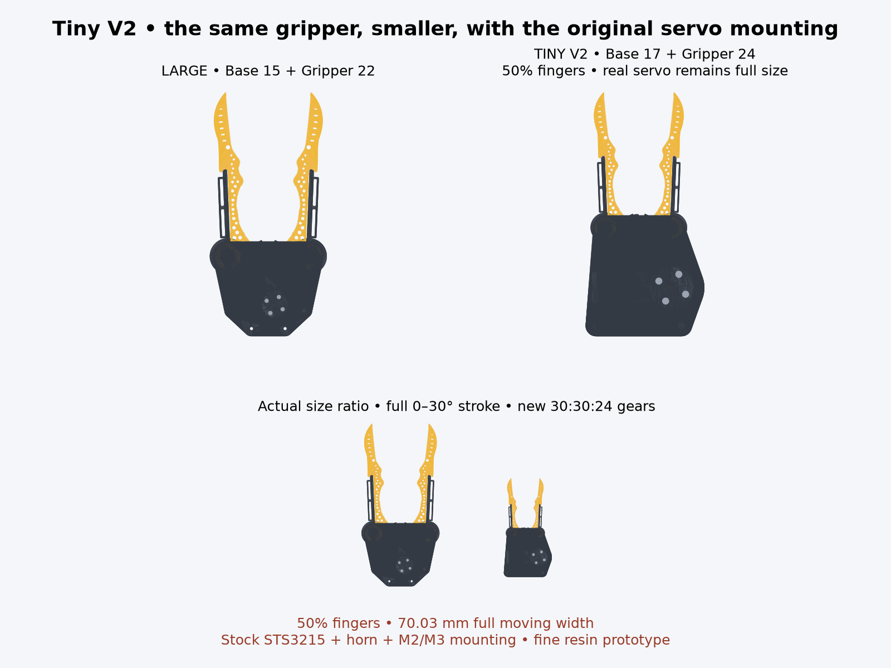

# Tiny V2 — Base 17 + Gripper 24

**Half-size recognizable large fingers, resized gears, actual servo mounting.** Builds explicitly on **Base 15 / Gripper 22** (`v316_generalist_post_cap`). Jake's latest messages on voice-44e6c4d2 revoke the width cap and original gear-size/ratio constraints. Tiny V1 (Base 16 / Gripper 23) and the large source are preserved.

The curved lattice finger outline and taper are reduced to **50%**. The separate handle-gears and pinion remain, now **30:30:24 teeth**, module **1.045 mm**, pressure angle 20°. The full original **0–30° jaw stroke** requires **0–37.5° servo travel**. Ratio is now **1.25:1**, versus 2.125:1 originally: less torque multiplication and more jaw travel per servo degree, untested under load.

The real STS3215 sits **sideways under the gearbox**. Its stock horn, four M3 horn screws, four M2 case-rail screws and working clearances stay full-size. The base mounts directly to the original rails and the pinion directly to its horn. No external adapter or invented miniature servo is used. The base is 4 mm thick; cap 3 mm; rear cap pillars Ø8, repositioned below the enlarged relative pinion. Two M3 retain the cap. The pinion screw access wells are reduced from the source's 5 mm to 0.3 mm recess, preserving actual countersink/head clearance. The original unused arm tab and two pilots are omitted; no Mount/arm or separate Handle compatibility is claimed.



## Measured envelope and limiting geometry

Over the entire intended continuous stroke, including the **real servo, screw probes and cable plug/bend clearance**:

**70.032 mm wide × 114.514 mm high × 62.900 mm deep.**

The printed base/cap plan is 55.760 mm wide. The fingers set the full moving width. The depth includes the 14 mm source cable clearance behind the real servo connectors; it is not only the printed mechanism thickness.

The unchanged lattice's smallest measured ventral-plan ligament is **0.404726 mm**. This delivery adopts **0.4 mm** as a **fine-resin prototype** minimum; it is not ordinary FDM geometry or a load rating. The full-size M3 countersinks leave **1.03375 mm** material to the pinion tooth roots, against a 1 mm requirement. These allowances are explicit parameters, not a universal manufacturing limit. The very small lattice margin requires print inspection; a stronger part or different process may need larger fingers or reinforced/omitted holes.

## Alternatives and bounded optimization

`compare_candidates.py` screens 20–100% scale at **1% increments**, and all integer side/pinion tooth counts **18–40**, requiring module ≥1 mm, screw rim ≥1 mm and lattice ligament ≥0.4 mm. It ranks passing candidates by scale, estimated envelope width, then pinion pitch radius. `candidate_comparison.json` records the search and alternatives. Only the selected design receives the complete exported-solid validation below.

| Candidate | Result |
| --- | --- |
| 90%, original 34:16 drive | Fits, but unnecessarily large once gear changes are authorized. |
| 50%, original 34:16 drive | Stock countersinks break the pinion root; module below adopted minimum. |
| 60%, resized 30:24 | Passes analytical screening; about 84.04 mm moving width. |
| **50%, resized 30:24** | **Selected; 70.032 mm measured width, real mounting verified in CAD.** |
| 49%, resized 28:24 | Hardware fits; unchanged lattice ligament only 0.39663 mm. |
| 40%, resized 22:24 | Hardware fits; unchanged lattice ligament only 0.32378 mm. |

This is the smallest passing scale **within that search, unchanged finger lattice and stated resin allowances**. It is not a global minimum across other finger reinforcements, manufacturing methods, horns or architectures. The continuous lattice lower bound is approximately 49.42%; 50% is the first whole-percent candidate.

## Source, hardware and Tune

`params.json` retains original source dimensions and adds scale and physical allowances. `params.py` emits actual-size servo/fastener interfaces, 0.25 mm radial post fit, 0.15 mm cap fit and 0.2 mm gear backlash by compensating before uniform output scaling. It also derives the base rim and rear pillar position from the chosen gear sizes. The stock horn neutral hole phase is **45°**, correcting the source's RS00-era 30° value; servo zero/assembly orientation must follow it.

`large_source.scad` keeps the actual original finger contour, lattice and taper modules, not a tweezer approximation. `trace_px.scad` is byte-identical to the large source. The loop's working clearance stays actual-size. Gear counts, pinion placement, local hardware seats, cap support layout and plate thicknesses change as authorized. Source statements and inactive old mount modules remain as historical context; the wrapper exports only this standalone assembly.

The preview publishes **Base 17** and **Gripper 24** independently, with Tiny V2 lineage, the real servo and correct finger/handle-gear/pinion pivots. Pinion pivot is [15.675, 0, −28.215] mm; finger pivots ±15.675 mm. Tune exposes uniform size from 50–100%; local hardware stays full-size. CAD and clearance certificates apply to the default selected design; a changed Tune size still needs full checks before manufacture. Full-size finger picks trigger the compatibility notice.

## Verification and remaining physical work

Use `cad/blender/.venv/bin/python` for analysis (trimesh, scipy, manifold3d, matplotlib, shapely); CAD export uses installed OpenSCAD.

```sh
python3 export_models.py
python3 genus.py
python3 check_geometry.py
python3 compare_candidates.py
python3 render_comparison.py
```

- All 14 individual mechanism STLs (seven assembled and seven print-oriented) are watertight, consistently wound, single components with positive volume. Finger genus 32, handle-gears 3, pinion 4, base 5, cap 3. The base loses the two unused wrist pilots.
- Finger outer contour/lattice/taper matches the scaled original vertices within 0.00001 mm outside the deliberately compensated loop bore. Regressions permit gear changes and guard retained finger geometry, full stroke, correct actual-size hardware and mounting.
- Analytic endpoint **and interior stationary extrema** of every exported vertex measure the full continuous moving X/Z envelope. There is no overall width cap.
- **7,986 pair/pose solid checks**: every pair of seven parts, servo, cable clearance and three screw-probe groups at 121 poses, 0–30° in 0.25° increments. No penetrating volume above 0.000001 mm³. Screw probes cover portions in/above printed parts; deliberate threaded engagement is omitted. This is sampled collision verification, **not continuous collision certification**.
- A wrong 4° pinion phase produces tooth interference; correct full motion does not. Raising the servo 0.5 mm intersects the base, and lowering the pinion 0.5 mm intersects its horn: positive controls verify actual seating rather than a servo drawn elsewhere.
- Six targeted regressions cover retained source fingers, adjustable gearing, candidate search, moving envelope, full-size hardware, Tune and catalog/mix compatibility.

**CAD-checked fine-resin prototype; not physically validated.** Measure purchased servo/horn/heads, confirm screw lengths and thread engagement, print/inspect thin ligaments, then test gear meshing, cap pull-out, force and wear before use. Candidate screw lengths below use the stated CAD thread-depth assumption; no strength rating is promised. Reference hardware is STEP-derived from the large source; no servo was in hand. No application build was run.

## Candidate stock fasteners

| Location | Candidate | CAD result / assumption |
| --- | --- | --- |
| Horn | 4 × M3×12 countersunk | 2.5 mm through the horn, 1.2 mm tip clearance to case. |
| Case rails | 4 × M2×6 cap head | 4 mm engagement; case thread depth **assumed**, must be measured. |
| Cap | 2 × M3×10 countersunk | 7 mm pillar bite, 0.3 mm pilot-bottom clearance. |

These lengths and head/shank envelopes are in `params.json`; calculations are in `geometry_checks.json`. Check real hardware before assembly.
