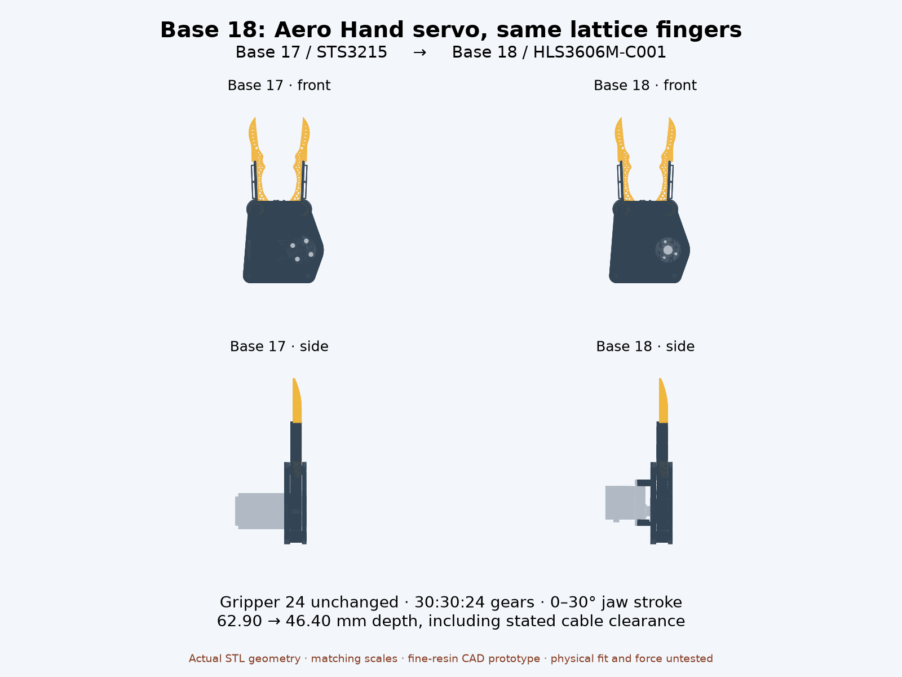

# Base 18 — Aero Hand servo drive, Gripper 24 unchanged

Builds on **Base 17 / Gripper 24**, `v318_generalist_tiny_v2`. Only the Base counter changes. The recognizable curved lattice fingers, separate handle-gears, pivot posts and cap are retained exactly. Base 17 and all older versions remain intact.



The **Feetech HLS3606M-C001 single-shaft** servo points toward the finger pivots underneath the gearbox. Its **purchased aluminum spline plate** replaces the STS3215 horn. A new pinion attaches using the same three holes as the Aero Hand cable spool, with **three M2×4 screws**. This design does not print or approximate a servo spline. The original M2.3×5 spline-retaining screw stays installed and accessible through the pinion's center bore; fit its plate first, then the pinion, side gears/fingers and cap.

Four **M2×6 self-tapping ear screws**, as used by the Aero Hand assembly guide, enter from below the ears into blind printed standoffs. There are no fictitious tapped servo-case holes. The slotted pilots cover the manufacturer's and upstream CAD's slightly different hole locations. Support the base's overhanging underside plate when printing; the supplied base print orientation puts the four standoff ends on the bed. Resin supports and drain/cleaning access need slicer review.

## What is measured and what is assumed

Sources are saved in `reference/`; every new designed dimension and placement is in `params.json`. The imported reference solids remain actual size; calibration fields describe their immutable dimensions, rather than resizing bought hardware. `prepare_reference.py` applies only rigid transforms to the extracted STEP solids. The scale slider is fixed at 50%, so Gripper 24 stays unchanged.

| Interface | Evidence / dimensions in mm |
| --- | --- |
| Variant | Manufacturer cover: HLS3606M-C001, single output. Aero STEP servo has the same single output and 32 × 12 × 31.9 overall envelope including ears/spline. No rear output modeled. |
| Body | Drawing: 23 × 12 × 27.5. Axis 5.71 from near body end; ear faces 20.5 and 22 above bottom. STEP agrees. |
| Ear mounting | Drawing: four Ø2.5 clearance holes, longitudinal offsets −8.21 / +19.79 from axis. STEP: −7.96 / +19.54, across-width spacing 7. Drawing omits that transverse dimension. The 1.7 mm pilots have 0.5 mm slot travel around STEP centers. The screws self-tap these pilots; physical pullout is untested. |
| Spline / center screw | Manufacturer page 4: 25T / Ø4.95 and M2.3×5. Reuse bought plate and original screw; STEP represents the spline envelope, not individual tooth flanks. No printed spline-fit claim. |
| Aluminum plate | Extracted solid 248: Ø18, overall axial height 4.5; face 11.1 above ear face; eight Ø2 modeled holes on Ø12.007619 PCD. Threads are not modeled. |
| Pinion plate screws | The original spool uses holes at native −90°, 45°, 135°. Pinion reuses these and the M2×4 BOM screws. Designed 2.2 clearance bores / 4.2 head wells. Seat-to-head grip 2.25; modeled engagement 1.75 in the plate's 2 mm disk. Actual threads and screw/head dimensions need measurement. |
| Case screws | M2×6 self-tapping, 1.5 through ears plus 4.5 into printed posts. Pilot depth 4.8 gives 0.3 tip allowance. Head envelope Ø4 × 2 assumed. Source STEP case-ear holes are open clearance bores. |
| Cable | Native STEP omits the harness. Reserved corridor 8 wide × 10 deep, starts 4.5 beyond far body end and extends another 18. This is an explicit service-envelope assumption, not a verified plug/bend radius. Route loose leads under the base toward the fingers. |

## Envelope and gearing

**70.032 wide × 114.514 high × 46.400 deep**, including actual servo, plate, external screw probes and assumed cable corridor over the full 0–30° jaw stroke. Base 17 was **70.032 × 114.514 × 62.900** with its own cable clearance. Depth improves **16.500 mm (26.2%)**; the difference includes the changed cable routing, not only motor dimensions.

The inherited **30:30:24** gears, module **1.045**, yield **1.25:1 servo/jaw travel**, or **37.5° servo travel** across 30° per jaw. No force, payload or holding-current rating is inferred. The finger lattice's minimum measured web remains **0.404726 mm**: a **fine-resin prototype**, not ordinary FDM geometry or a proven load-bearing part. Reducing the fingers further would break Base 17's stated 0.4 mm ligament allowance; this pass keeps Gripper 24 intact. No global smallest-design claim.

## Checks

Run from this folder, with the repository's analysis environment where shown:

```sh
../../../cad/build123d/.venv/bin/python prepare_reference.py
python3 export_models.py
../../../cad/blender/.venv/bin/python genus.py
../../../cad/blender/.venv/bin/python check_geometry.py
../../../cad/blender/.venv/bin/python render_comparison.py
```


`geometry_checks.json` records:

- All 14 individual printed STLs watertight, consistently wound, positive-volume single bodies, at bed Z=0 in print orientation.
- Exact vertex agreement with Base 17 for both fingers, both handle-gears and cap. Finger genus 32, handle-gears 3, pinion 4, base 1 (four ear pilots now blind), cap 3.
- Continuous analytical endpoint and stationary extrema of all exported vertices for swept width/height.
- **11,011 solid pair checks**: 14 bodies/probes, all 91 pairs at 121 poses, every 0.25° over 0–30°. No pair exclusions. No overlap above **0.0001 mm³**; this numeric tolerance accommodates STL rounding at seated faces. The center-screw probe covers its exposed head; intended thread/spline engagement is omitted from screw probes. Cable corridor is checked as an occupied volume.
- Positive controls: raising the servo 0.5 hits its mounting posts, lowering the pinion 0.5 hits the actual bought plate, and a 4° pinion phase error hits gear teeth. Actual reference extents guard against inadvertently scaling hardware.

Collision checks are sampled, not continuous collision certification. Tight lattice webs, self-tapped post pullout, printed tooth durability, purchased plate threads, spline fit, harness routing and real screw/tool access still need physical assembly checks. No motor was connected or actuated. This is a standalone assembly: no separate Handle or wrist bracket fit is claimed.

## Reference provenance

Aero Hand Open by **TetherIA / Chestnut Robotics**, pinned commit `7bb2f23485a7d440960c21046da642de132b7745`:

- [Left STEP assembly](https://github.com/chestnut-robotics/aero-hand-open/blob/7bb2f23485a7d440960c21046da642de132b7745/hardware/CAD/Aero_Hand_Open_Left.stp): 307 solids; extracted native zero-based solids 304 (servo), 248 (purchased aluminum plate), 61 (printed cable spool for interface comparison). The imported STEP reader reported one unresolved reference; the extracted solids exported successfully. Raw servo/spool tessellations contain seam defects; OpenSCAD Manifold import resolves the servo seams, and the exported motor and plate meshes used by collision checks are watertight. See `reference/provenance.json`. Original STEP shape labels are generic and identify neither SKU nor thread details; matching body geometry and the BOM/assembly instructions support these identifications.
- [BOM](https://github.com/chestnut-robotics/aero-hand-open/blob/7bb2f23485a7d440960c21046da642de132b7745/hardware/Assembly/BOM.csv), local `aero_BOM.csv`. Local assembly guide `third_party/aero_hand/guide/aero_guide_original.pdf`, “Servo Spools” and “Servo Frame” sections.
- [Feetech specification](https://www.feetechrc.com/Data/feetechrc/upload/file/20240807/6385862508379674057566108.pdf), edition A/0, 2024-04-22; saved unchanged as `HLS3606M-C001.pdf`. See pages 4 and 6. Page 7 says no accessories; obtain the Aero Hand aluminum plate separately if the purchased servo does not include it.

Extracted Aero CAD and derivatives use **CC BY-NC-SA 4.0**, copied to `reference/LICENSE`. This source does not establish which exact purchased production revision Jake has; confirm the physical servo against the selected C001 drawing and plate before printing.
