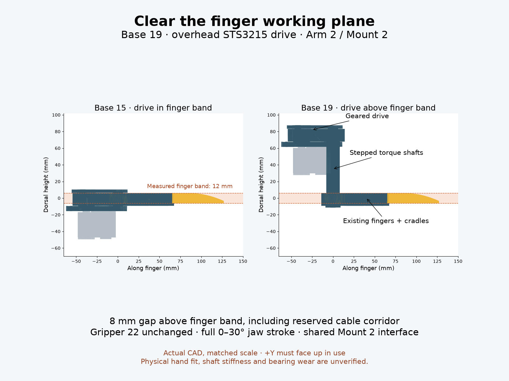

# Base 19 — overhead geared drive on SO-101

Builds on **Base 15** (`v316_generalist_post_cap`), the newest full-size wrist-compatible source. Bases 16–18 are separate miniature studies without the full-size wrist interface. **Gripper 22, Arm 2 and Mount 2 remain unchanged.** Only the Base counter advances. No separate Handle interface is introduced; the two strap cradles are Base components.



## Arrangement and working plane

Coordinates are X across the fingers, Z along their reach, **+Y dorsal / above the operator's hand**. Set the arm's wrist orientation accordingly; this is not a gravity-following mechanism. The actual untapered finger slab is **Y −6 to +6 mm**, not an assumed 10–20 mm band. The human hand's envelope has not been measured.

The unchanged STS3215, pinion, side sectors, rail seat and cap move **77.1 mm in +Y**. Lift derives from the original servo depth, connectors and 14 mm cable-service corridor, plus the finger half-thickness and **8 mm `overhead_gap`**. This keeps the cable corridor at least 8 mm above the finger band; the motor body is higher. Routing and bend radius are inherited assumptions, not measured harness fit.

Two **Ø16 mm rotating shafts** descend from the overhead sectors. Each steps to Ø12 through the original finger loop, then to a 12 mm circumscribed hex in the lower cradle's 3 mm web. The Ø16 shoulder retains the finger loop from above; the original cradle supports it below, with nominal 0.2 mm clearance each side. A separate Ø18 × 2 mm countersunk washer spans the hex socket below; **M3×12** retains the cradle into a Ø2.5 blind axial pilot. Approximate screw bite is 9.8 mm, with a 12 mm pilot; these are printed self-tapping joints, not rated threads. Hex radial clearance 0.15 mm and journal clearance 0.25 mm are tunable.

The old fixed posts are deleted. The base has bored Ø16.5 journals; the unchanged cap captures the shafts' Ø12 upper tips in blind sockets. Bearings are printed sliding surfaces. The long shafts are supported across the overhead base/cap, with the hand-plane ends cantilevered below. Shaft bending, runout, printed layer orientation, friction and torsional compliance must be tested. No torque or payload rating is claimed.

Only the original thin strap cradles, local pivot loops/shafts and retention washers remain near the finger band. The sector webs/teeth, cross plate, cap, servo and cable corridor leave it. This does not make the entire band empty or establish clearance for a particular person's thumb/index finger.

## Actuation, arm and actual interfaces

Original **34:34:16 involute sectors/pinion**, 2.125:1 servo/jaw travel ratio, full **0–30° per jaw** (63.75° servo travel). Closed shape and useful opening are inherited exactly from Gripper 22. No extra mechanical travel stops are added.

The servo and interfaces are full size, inherited from the repository's STEP-derived STS3215 seat: stock Ø20 horn, **4 M3 on Ø14**, and **4 M2 case-rail screws**. The horn-hole phase is corrected to **45°**, matching the STEP-derived correction already used by Base 17. Use the stock horn, not a printed spline. Countersunk head envelopes and case thread depth still need measurement against purchased hardware. The pinion seats directly on the horn.

**Mount 2's hub and Mount 1's tool plate geometry and location are retained.** The Base's extended wrist bracket joins the raised base tab to the original tool plate below and behind the working fingers. The extra reach is in the bracket foot, not in a moved or revised Mount. Arm 2's stock jaw remains removed. The live mixed assembly therefore uses its existing Arm 2 / Mount 2 picks with Gripper 22 and Base 19. The large foot increases wrist moment; this needs physical validation.

## Assembly and service access

1. Fit the stock servo horn and center retaining screw. Bolt the servo to the overhead base's original rail seat using four M2 screws; confirm actual thread depth. These screws are serviced with the cap and shaft gears removed.
2. Insert each sector/shaft from above through its bored base journal. Install the pinion on the horn with four M3 countersunk screws. The retained cap aperture leaves all four horn-screw tool paths open at the exported pose (checked in CAD).
3. Slide each original finger loop onto its shaft from below, then the keyed cradle. Fit its separate washer and M3×12 from below. This assembly order avoids trapping a closed finger loop between integral collars. The hex shoulders carry torque; the screw/washer provide axial retention.
4. Fit the cap using the original two pillar screws. Cap heads are exposed on the dorsal face. Remove the cap before withdrawing shafts or servicing the case rails. Shaft retention heads are directly reachable from below.
5. Screw the extended bracket to the base tab (two M3), attach the unchanged tool plate, slip it over Mount 2 and secure the three radial M3. The original bracket leg/gussets and lower mounting screw locations are preserved. Cable exits toward the reserved overhead corridor; use the original zip-tie slots. Confirm plug insertion, strain relief and actual hex-key access on the purchased hardware.

Fourteen printed components: two unchanged fingers, two overhead shaft/sectors, two lower cradles, two washers, pinion, base, cap, extended bracket, tool plate and hub. The extra moving parts enable disassembly without changing the fingers. Hardware references are not print files. Print exports are bed-zero orientations, **not support-free certifications**; the tall sector/shaft and extended bracket need process/slicer review. Do not assume Base 15's flat-print claims still apply.

## Reproduce and Tune

Every new dimension/clearance is in `params.json`. `params.py` generates `params.scad`. `source.scad` preserves Base 15's modules with its dispatcher disabled; `so_hub.scad` preserves Mount 2's hub. New architecture is in the wrapper; no bought hardware is scaled. Tune exposes the new gap/shaft/key/washer dimensions. Changing parameters requires rerunning geometry checks; the default checks do not certify every slider combination.

From the repository root:

```sh
cad/blender/.venv/bin/python 'Two Finger Gripper/versions/v320_generalist_overhead_drive/export_models.py'
cad/blender/.venv/bin/python 'Two Finger Gripper/versions/v320_generalist_overhead_drive/genus.py'
cad/blender/.venv/bin/python 'Two Finger Gripper/versions/v320_generalist_overhead_drive/check_geometry.py'
cad/blender/.venv/bin/python 'Two Finger Gripper/versions/v320_generalist_overhead_drive/render_comparison.py'
```

`geometry_checks.json` records all print/assembled mesh checks, unchanged finger vertices, measured band/overhead gaps, continuous vertex envelope extrema and sampled solid intersections every 0.25° across the entire jaw stroke, including the servo, cable-service and exposed retention-screw envelopes. There are no pair exclusions; intentional screw/thread engagement inside the shafts is omitted from the screw probes. A wrong pinion phase is a positive collision control. Four horn tool cylinders are checked against the assembled mechanism at 15°. Whole-arm joint motion, arbitrary hand shape and universal in-place screw access are not certified by this test.

**CAD prototype only.** No physical print, servo actuation, load, fatigue, pinch ergonomics or strength test has been performed. The side comparison is actual exported geometry at the same scale, highlighting the measured finger band; review it in the live preview before deciding whether this much overhead height is comfortable.
