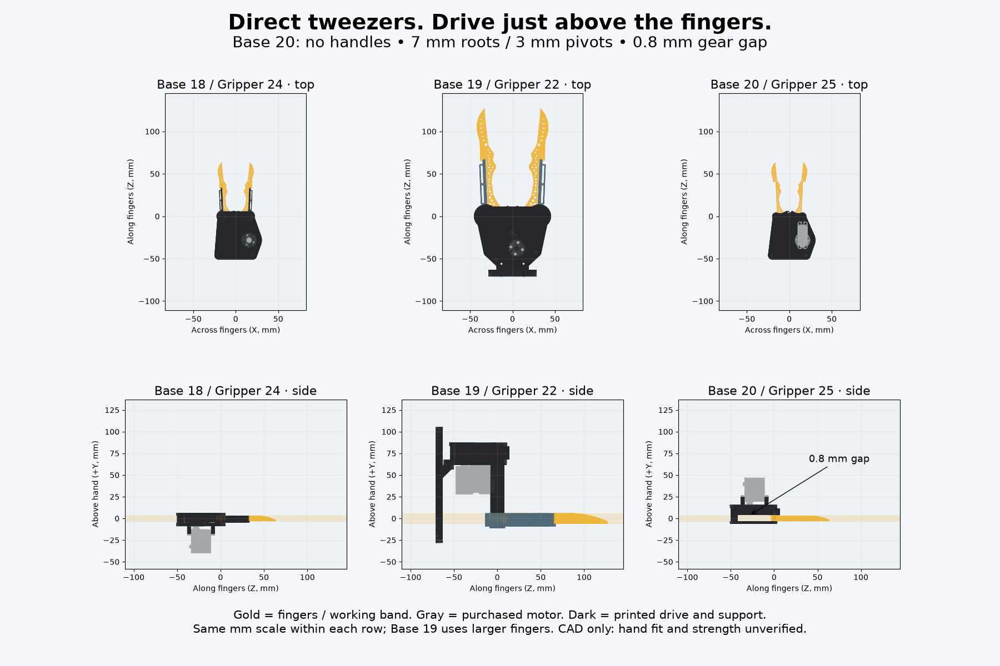
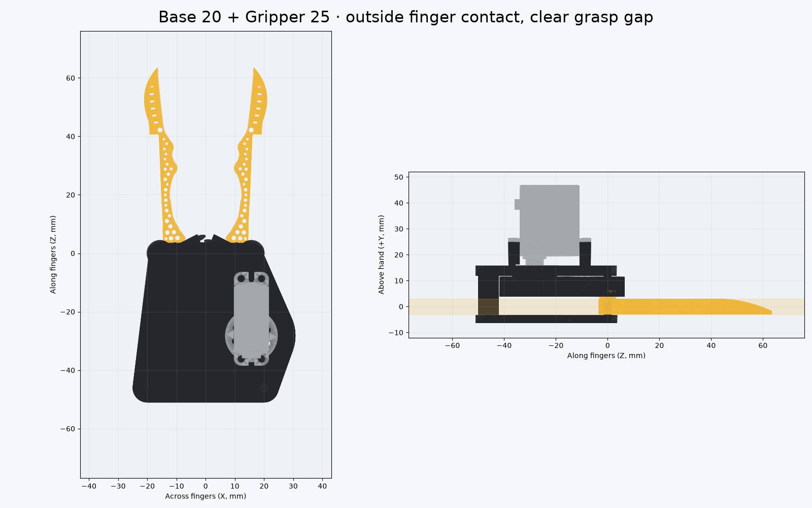

# Base 20 + Gripper 25 — direct tweezers, compact overhead drive

**Base 20 builds on Base 18; Gripper 25 builds on Gripper 24.** Latest steering on voice-550038ca supersedes the original full-size SO-101 requirement: use the compact fingers, remove handles and their interface, put the motor on the opposite axial side immediately above the fingers. This is a **hand-held HLS3606M-C001 prototype, with no Mount 2 / SO-101 attachment**. Historic versions are untouched. Arm and Mount counters do not change.





## Mechanism

The large strap cradles, strap slots and finger hook protrusions are removed. Thumb and index contact the opposing **outside** finger edges directly; the space between the working blades remains for the object. No replacement strap, saddle or hand model is included.

Gripper 25 retains Gripper 24's half-size curved lattice working blade and taper. The root diameter falls from **10 to 7 mm**, the fixed printed pivot post from **6 to 3 mm**, and the gear's central hub from **14 to 9 mm**. The root's original bore interface is retired. Finger roots turn on a **3.5 mm bore**, leaving **1.75 mm radial root wall**. A short integral hex boss (circumradius 3.3 mm) enters each separate overhead gear by **2.5 mm**, with 0.15 mm radial fit allowance and 0.2 mm tip clearance. Minimum boss wall to its bore is **1.108 mm**. This is a new small resin interface, not a strength-qualified replacement for the original axle.

The 30:30:24 involute sectors/pinion and purchased servo/plate are retained at actual size. The servo and its mounting structure are inverted across Y. Gear teeth occupy **Y=3.8…11.5 mm** above the **Y=−3…3 mm** working blade band: **0.8 mm axial air gap**. This is a manufacturing/motion allowance, not a measured hand clearance. There is no separately elevated drivetrain, long drive shaft, shaft washer or retaining screw. The hex bosses carry torque directly; the base and cap capture the finger/gear stack axially. Fixed pivot posts and two corner pillars remain as bearing/cap supports, rather than a remote overhead tower.

**Seven printed parts:** two fingers, two sector gears, pinion, base, cap. The old cap is now below the finger plane; it covers the rear gearbox, ending near the pivots, not between the working blades. The servo is above and behind those pivots at the hand's edge. No motor was powered or moved physically.

## Measured envelope and motion

| Measurement | Base 18 | Base 20 |
| --- | ---: | ---: |
| Blade working band (Y) | 6 mm | 6 mm |
| Gear-to-band air gap | teeth share band | 0.8 mm |
| Total Y stack, including cable reserve | 46.400 mm | 53.200 mm |
| Continuous swept X width | 70.032 mm | 70.032 mm |
| Continuous swept length along fingers (Z) | 114.514 mm | 114.514 mm |
| Root / printed pivot diameter | 10 / 6 mm | 7 / 3 mm |

The 53.2 mm stack is **not** a 53.2 mm overhead gap: its lower cap is at −6.3 mm and motor top at +46.9 mm. It grows 6.8 mm from Base 18 to move the teeth fully above the band. Base 19 used larger Gripper 22 fingers and a 77.1 mm lift; it is included in the matched-scale picture for context, not treated as an equivalent-sized mechanism. Side panels show +Y upward; top panels look down Y. Plotted STLs use the common exported 15° pose.

Jaw stroke remains **0–30° per side**, requiring **37.5° servo travel** (1.25:1). The inherited closed tip gap is approximately 0.002 mm in tessellated CAD. Removing the handles does not shrink the curved blades' swept width. No torque, grip-force, payload or back-drive effort rating is inferred.

## Hardware assembly and access

The original purchased aluminum spline plate and its M2.3×5 center screw remain; **no printed servo spline**. Pinion uses the original **three M2×4** spool holes: modeled 2.25 mm grip and **1.75 mm thread engagement** in the purchased plate's 2 mm disk. Mount the motor ears with **four M2×6 self-tapping screws** into the printed pilots: 1.5 mm ears plus **4.5 mm engagement**, **0.3 mm pilot tip allowance**. Two original M3 countersunk cap screws remain. Hardware dimensions and provenance are inherited from Base 18; `reference/` contains its pinned STEP-derived meshes, drawing, BOM and CC BY-NC-SA license. Do not substitute the STS3215 interface.

Assembly order: seat servo against the ear supports and install ear screws; fit purchased plate and center screw; fit pinion and its three screws; seat the two keyed fingers/gears on their posts; install the lower cap. The two far ear screws have straight access. **Two screws at the output end do not have straight driver access**: the motor housing overhang intersects a 2.5 mm straight shaft by 5.304 mm³. A shaft tilted **10° away from the overhang** clears in CAD. This assumes a PH0 driver can engage the supplied screw at that angle; actual engagement and tool-handle room remain **unverified assembly risks**. Use the documented angled access or revise ear fastening if the real screw/driver cannot engage; do not claim proven physical assembly.

`geometry_checks.json` records the straight-access failure as well as the tilted-path check; it is not hidden by excluding the motor. Plate, center-screw and cap straight-shaft paths also clear the modeled geometry. Driver envelopes are Ø2.5 × 45 mm, excluding the hand/tool handle. The source's cable corridor (8 × 10 mm, 18 mm continuation starting 4.5 mm past body) remains an **assumed service volume**, inverted with the motor, clear of the working blade band. Actual cable and bend radius are absent from the STEP and must be checked physically.

## Verification and tuning

From this folder:

```sh
python3 export_models.py
../../../cad/blender/.venv/bin/python genus.py
../../../cad/blender/.venv/bin/python check_geometry.py
../../../cad/blender/.venv/bin/python render_comparison.py
```

All 14 part/print meshes must be watertight, consistently wound, single bodies with positive volume, bed Z=0. Genus: fingers 33, gears 1, pinion 4, base 1, cap 3. The new finger root changes topology; distal vertices are checked against the old blade **surfaces**, allowing triangulation changes. Its minimum lattice ligament remains approximately **0.405 mm**; the clipping of old hook protrusions does not justify an ordinary FDM or strength claim.

The checker samples 121 poses at 0.25° over the full stroke: 14 bodies/probes, 91 pairs, **11,011 solid intersections**, no pair exclusions. Thread/spline engagement is intentionally absent from screw probes. Additional driver/part probes run at the same poses. A deliberately wrong pinion phase must collide; shifted servo/plate seating must collide. Continuous endpoint and stationary-point extrema of every STL vertex determine the swept X/Z envelope; collision freedom itself is sampled, not continuous proof.

`params.json` owns every new dimension. Tune's **Gear to finger clearance** slider regenerates real geometry in an isolated temporary folder; it does not just copy stale exports. Other new interface/hardware dimensions are calibration fields until physically measured. A 1.2 mm gap Tune smoke check verifies a 0.4 mm increase from the default 0.8 mm, with bought motor dimensions unchanged. A changed slider is not a new physical clearance or load certification.

## Hand-fit handoff (voice-3f6ae8e1)

This CAD item owns the version registry, publisher, pose map and exported meshes. The separate fit-study item owns the human overlay and ergonomics; it should consume **Base 20 + Gripper 25**, not independently edit the shared catalog. No fit-study worker pane was active during this pass; Jake's explicit ownership steering is the coordination contract. The fit item was not edited here.

Coordinate contract: mm, +Y above the hand; original blade band Y=−3…3; pivot centers X=±15.675, Z=0; exported at 15°; right hinge +1 and left −1 about Y; pinion/plate hinge X=15.675, Z=−28.215 at −1.25× jaw swing. Thumb/index belong on OUTSIDE blade faces, away from the inner grasp gap. Relevant actual meshes are `exports/parts/left.stl`, `right.stl`, `base.stl`, `motor.stl` and gear/cap meshes. The 70.032 × 53.200 × 114.514 mm swept CAD envelope does not establish human comfort, finger pressure, safe pinch clearance or useful grip force.

Open Live Preview with **Base 20 + Gripper 25**, Arm/Mount off. The Handle row says **No handle interface**. Selecting Mount 2 must flag the missing wrist bracket; pairing old Grippers must flag the changed finger interface. Physical fit, tilted driver engagement, printed-post bending, key wear/pullout, lattice strength, printer supports and back-drive effort remain unverified.
