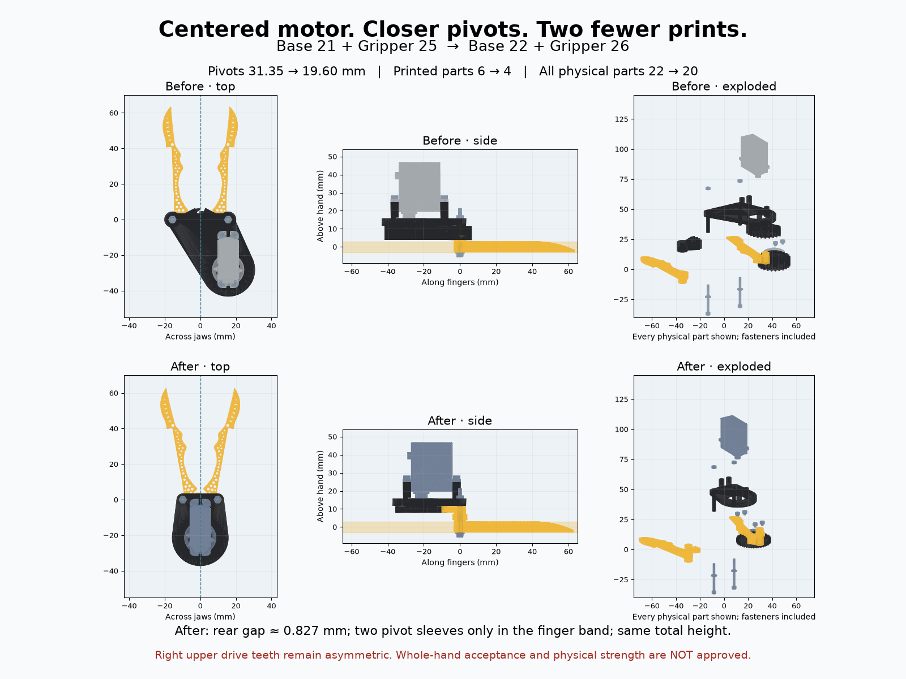

# Base 22 + Gripper 26 — centered compact drive

**Base 22 builds on Base 21; Gripper 26 builds on Gripper 25.** This is the compact, hand-held HLS3606M-C001 branch requested in subsequent voice-550038ca feedback. Prior versions remain intact. It has no SO-101/Mount 2 wrist bracket or Handle interface.

The two separate keyed jaw gears are deleted. Each new finger and its stepped sector are one continuous printed solid, joined through a circular neck. Four printed pieces remain: left jaw, right jaw, pinion, overhead base. The motor output, motor case mid-width and mounting-hole pair centers sit on X=0. The working fingers mirror in Y=-3..3 mm; sampled mirror-surface error is below 0.000002 mm.

The motor is the same **unscaled, purchased HLS3606M-C001**, with its original aluminum spline plate and fasteners. Its output is offset along the body's longitudinal Z direction; case details, three-hole rotating plate, actual wire routing and the right-only upper drive sector are not mirror-exact. Centering the motor must not be read as claiming every hardware surface is symmetric.

## Transmission and spacing

The inherited 7.7 mm overhead tooth slab now has two working levels, without increasing the total stack:

- Y=3.8..7.3 mm: opposing 30-tooth jaw sectors counter-rotate.
- Y=7.3..7.9 mm: 0.6 mm axial separation.
- Y=7.9..11.5 mm: the centered 42-tooth pinion drives the right jaw's upper sector. The left jaw has only its small neck at this height, so the pinion cannot drive both jaws in the same direction.

All connecting support remains overhead. Only two 3 mm OD sleeves, reinforced with M2 steel bolts, cross the 6 mm working band. Projected in-band stationary material stays **12.799 mm²**, separate from the fingers and their gears. Local washers and bolt heads remain below it. The first teeth start **0.8 mm above** the working band.

Pivot spacing falls **31.35 → 19.60 mm**. The traced blade/lattice outline stays unchanged in each finger's local frame; the new toe angle and 0.2 mm nominal closed-tip allowance accommodate the closer pivots. A continuous rear-outline extremum check over 0–30° finds **0.8265 mm minimum rear gap at closed**, between the inward rear shoulders near closed X=±0.4133, Z=4.198 mm. The declared 0.8 mm budget comprises 0.3 mm manufacturing allowance plus 0.5 mm deflection reserve; these are assumptions, not measured deflections.

Actual re-exports at 19.0 / 19.4 / 19.5 mm leave 0.316 / 0.656 / 0.741 mm respectively and fail that budget. 19.6 mm is the first passing 0.1 mm pitch in this bracket for the inherited working outline. No global minimum over redesigned fingers is claimed. See `spacing_search.json` and `search_spacing.py`.

The continuous swept envelope including the cable reserve changes from **70.03 × 52.60 × 106.76 mm** to **72.60 × 52.60 × 100.72 mm** (X/Y/Z). Although the pivot roots are closer, the open tips sweep about 2.57 mm wider because of the new toe angle. Height above the hand is unchanged.

Jaw travel remains 0–30° per jaw. The 30:42 drive ratio needs **21.43° servo travel**, versus 37.5° previously. Ideal mechanical advantage is 0.714 rather than 1.25, about **43% lower torque multiplication** before losses; grip force is unverified. Module is 0.6533 mm, suitable only as a fine-resin prototype pending tooth/neck strength and printing tests.

## Actual parts and assembly

| Physical item | Before: Base 21 / Gripper 25 | After: Base 22 / Gripper 26 |
| --- | ---: | ---: |
| Printed jaw bodies | 2 | 2, including sectors |
| Separate printed jaw gears | 2 | 0 |
| Printed pinion and base | 2 | 2 |
| Motor + purchased spline plate | 2 | 2 |
| Plate screws / ear screws / center screw | 3 / 4 / 1 | 3 / 4 / 1 |
| Pivot M2×25 bolts / washers / nuts | 2 / 2 / 2 | 2 / 2 / 2 |
| **Printed / all discrete parts** | **6 / 22** | **4 / 20** |

The comparison draws every physical BOM item in both assemblies, including screws omitted by the older preview manifest. The new preview manifest also includes every item. A one-piece purchased servo is counted once, without counting its internal gears. Cable clearance reserves and driver probes are not physical BOM items.

Retention uses the previous M2×25 bolts, 5×2.2×0.5 mm washers and M2 nuts, with the same supplier/nominal hardware assumptions documented in Base 21. Washers overlap each 3.5 mm finger bore by 0.75 mm radially. Lower axial gap is 0.2 mm; the overhead base stops upward escape with a 0.5 mm total endplay budget. The integral sectors remove the old slipping/axially disengaging hex joint. Positive 1 mm downward escape controls hit both washers. Nuts have full 1.6 mm axial engagement and about 3.9 mm exposed thread.

Install the motor on the base with all four M2 ear screws. Seat the bought plate and its center screw before the pinion; bolt the pinion to the original three plate holes. Install the jaws with their teeth in the exported phase over the smooth sleeves; finish with washers/bolts from below and nuts above. Turn through the full stroke by hand before any powered trial. Do not clamp rotating jaw faces: bolts clamp the stationary sleeve stack.

The load path is integral jaw/sector → smooth sleeve and steel bolt core → overhead base. Washers/head provide downward capture; base provides upward capture. The 0.4 mm sleeve walls, neck bending, tooth shear, washer crushing, nut locking, wear and clamp preload still need physical tests. No strength or grip-force rating is asserted. Printed sectors need supports/process review; this is not a support-free FDM design.

## Verification and hand fit

`export_models.py`, `genus.py`, `search_spacing.py` and `check_geometry.py` reproduce exports and checks. Four printed parts are watertight single bodies. The checker tests 121 motion poses with all 78 body pairs, every driver/body pair, 726 outside contact approaches and retention/incorrect-phase controls. It does not exempt meshing gears. Body collision tests are sampled; only rear-outline clearance and swept vertex extents use continuous extrema. Two near-ear screws retain the 10° driver tilt requirement: shaft envelopes clear, but physical PH0 engagement and tool handles are unverified. Real cable routing/bend remains unverified.

**Whole-hand acceptance FAILS.** With the shared WebXR hand and fixed-wrist outside-contact solver, the 181.1 / 193.3 mm reference hands miss contact by up to **25.76 / 27.89 mm**, and actual skin vertices enter jaw solids at **3/13 / 2/13** poses. This is worse reach than the saved prior run, not an ergonomic improvement claim. Solver cost uses conservative full-part boxes, which are particularly broad for integral jaw/gears; a solver miss does not establish anatomical impossibility. Actual-solid containment is screened separately. The narrow reference hand is not Jake's measured hand; surface/vertex sampling can miss edge crossings and does not model pressure.

Open `centered_acceptance.html` in the published gallery for complete wrist/palm/five-digit motion and Copy fit report. It reuses `human_hand.js` unchanged. Contact rays use actual finger triangles inside Y=-3..3 so integral upper gears do not move the ray above the working band; full physical meshes remain in every collision check. The normal gallery hand overlay has not been adapted to integral-gear bounds; use this acceptance page for the complete-hand study.

### Contract for hand-study voice-3f6ae8e1

No other HelpingHands CAD/hand worker was active in tmux before shared registry edits. This item owns CAD/catalog; no other pebble or anatomical solver was edited. The hand study should import `cad/mobile_gallery/centered_case.js` rather than recreate anatomy/contact selection. Units mm; +Y above hand; band -3..3; jaw pivots ±9.8 X, Z=0; exported 15°, stroke 0–30°, right +1 / left -1 about Y. Pinion, plate, plate screws and center screw pivot [0,0,-21.3811131611], ratio -30/42. Outside contact station 50%, 8 mm pad assumption; full-hand wrist locked from the first pose. Saved hashes/poses and human-fit failures live in `cad/validation/voice-550038ca-centered/`.
