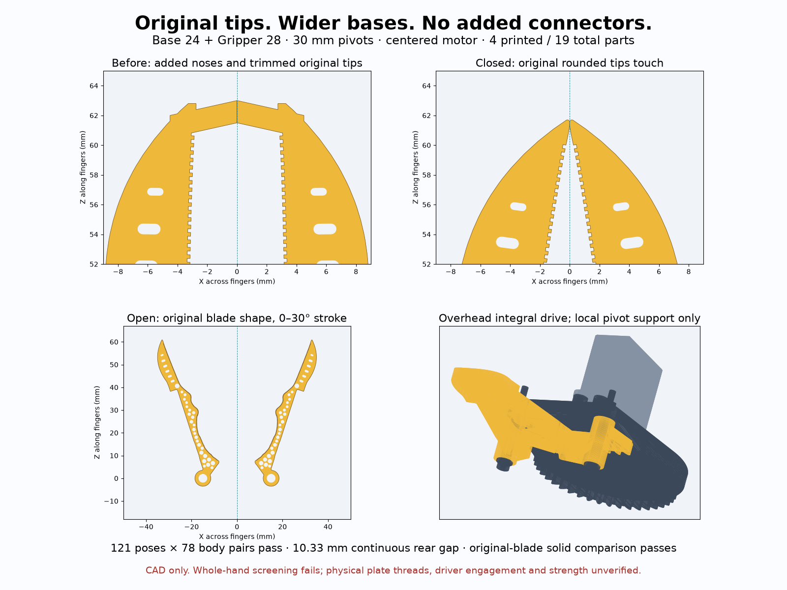

# Base 24 + Gripper 28 — original tips, wider bases

Base 24 builds on Base 23; Gripper 28 builds on Gripper 27. This is the current compact HLS3606M-C001 hand-held branch. Historical versions remain. No SO-101/Mount 2 or legacy Handle interface is claimed.

The added distal noses and original-tip trimming are removed completely. `direct_finger()` now uses the original `finger()` solid. Pivot spacing grows from 20 to 30 mm and blade toe becomes approximately +1.2765 degrees. Original rounded tips meet at closure; no connectors, extensions, tabs, pads or gap-filling material. An independent original-blade export is compared by symmetric volume difference beyond the pivot region, proving rigid placement preserves the blade solid. The only root difference from the standalone blade is its existing axle bore.

30 mm was selected from a rigid-outline search: at 20 mm the middle blade contacts first, at 24.56 mm only 0.223 mm middle clearance remains, and at 28.88 mm it is about 0.992 mm. 30 mm provides a modest clearance reserve with sharper convergence. This is not a global minimum or strength optimization. `closure_toe_adjust` corrects the traced-point toe formula by -0.002020104 degrees using the actual rounded mesh.

The wider pivots grow gear module from 0.667 to 1 mm and move the centered motor axis back from Z=-21.817 to -32.726 mm. Centered motor, integral split-level sectors, 30:30:42 teeth, 0–30 degree jaw stroke and 21.43 degree servo motion remain. Four prints /19 total parts. Only two 3 mm pivot sleeves cross the 6 mm finger band; support projection remains 12.799 mm²; first teeth are 0.8 mm overhead. The pinion trimming cutter now follows the actual pinion envelope, avoiding an uncut skirt at this larger radius. Print solids are grounded and single-body, genus 33/33/3/3.

## CAD checks

`geometry_checks.json` checks 121 poses ×78 body pairs without pair exclusions, driver shafts, 726 outside-contact approaches, sleeve retention and wrong-phase controls. Continuous rear-outline clearance is 10.330 mm. Whole-body collision checks are sampled, not continuous proof. `closure_checks.json` checks original rounded-tip contact, positive separation on opening, middle-blade separation and a rejected -0.1 degree overclose control. Numerical intersection tolerance is 0.0001 mm³. `motion_limits.json` is a calibration contract, not executable motor control; no servo was actuated. Physical force/current-limited contact teaching is required. Feetech specifies no internal mechanical stop; do not blindly use absolute encoder ticks or force past contact.

## Servo attachment retained and rechecked

`check_hardware.py` re-measures the copied pinned HLS3606M-C001 and metal plate STEP sources. Feetech drawing A/0 2024-04-22 pp4/6/7 identifies a 25T /Ø4.95 output and M2.3×5 center screw. The CAD models a smooth Ø4.93 spline envelope, not actual teeth. The bought metal spline plate remains: eight modeled Ø2 holes on Ø12.007619 PCD, two opposed M2×4 screws used with nominal 1.75 mm engagement in the 2 mm disk. This is separate from four motor-case ear holes and four M2×6 self-tapping screws. The source CAD/drawing longitudinal hole discrepancy is 0.25 mm, accommodated by inherited 0.5 mm pilot slots. A wrong Ø14 STS3215 pattern is rejected.

The inherited integral 1 mm pinion capture web seats the M2.3×5 center screw with 2.8 mm modeled engagement and 0.2 mm floor clearance. The old uncaptured stack bottoms out by 0.8 mm in the negative control. No added adapter. Actual Jake plate revision, hole threads/pitch, supplied screw/head dimensions, spline fit and blind thread depth remain unmeasured. CAD does not establish physical fit. Two near-ear driver shafts require 10 degree tilt; the guide specifies flanged Torx, so real drive engagement and tool handles must be checked. Sleeve wall is 0.4 mm; resin fit, clamping, tooth/neck/axle strength, wear and real cable routing are unqualified.

## Review and reproduce

Live Preview: Base 24 + Gripper 28, Arm/Mount/Handles off. `cad/mobile_gallery/original_tip_acceptance.html` reuses the same complete WebXR hand/contact solver, with the new axes; Copy fit report works in Chrome. Reference hand lengths 181.1/193.3 mm are generic, narrow and not Jake measurements. Whole-hand screening still FAILS reach/skin acceptance; this is not ergonomic approval. See `cad/validation/voice-550038ca-original-tip`.

From this folder run `python3 export_models.py`, `../../../cad/build123d/.venv/bin/python check_hardware.py`, then `../../../cad/blender/.venv/bin/python check_geometry.py`, `check_closure.py`, `genus.py`. From repo root run `PYTHONPATH=Scripts cad/blender/.venv/bin/python -m unittest Scripts.test_original_tip_closure Scripts.test_closed_tips Scripts.test_centered_gripper Scripts.test_compact_overhead Scripts.test_gallery.ModelTests Scripts.test_publish_designs -v`, then `python3 Scripts/publish_designs.py --no-build` (exports only, no app build).

Sources: unchanged `reference/provenance.json`, `reference/HLS3606M-C001.pdf`, `reference/servo.step`, `reference/stock_plate.step`, copied from Base 23. Hardware licensing/attribution retained. Actual STEP dimensions are rechecked locally; no new supplier or production-revision assumption.
