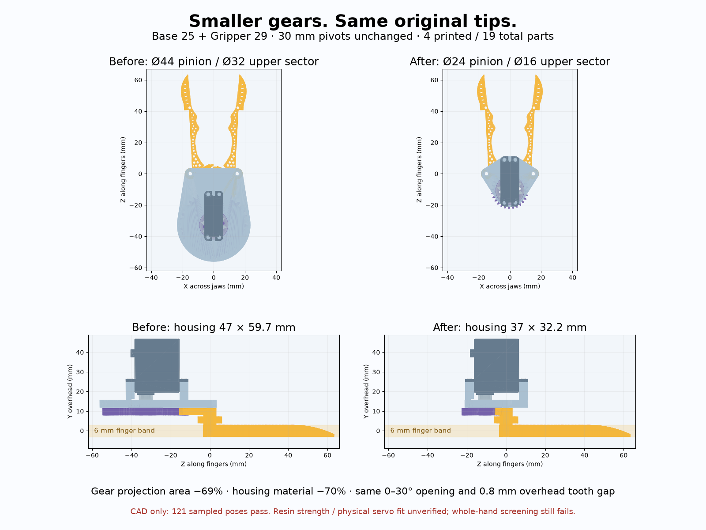

# Base 25 + Gripper 29 — smaller independent upper gears

Base 25 builds on Base 24; Gripper 29 builds on Gripper 28. Latest compact HLS3606M-C001 hand-held branch. Historical designs stay intact. No SO-101/Mount 2 or legacy Handle interface.

## Geometry and transmission

The upper jaw sector now has its **own module and tooth count**, independent of the lower counter-rotation sectors and jaw spacing. Smaller upper gears put the centered motor much closer to the pivots. Integral sectors remain part of each jaw: four printed solids, 19 physical parts including all hardware, no additional idler or adapter.

| Dimension | Base 24 / Gripper 28 | Base 25 / Gripper 29 |
|---|---:|---:|
| Jaw pivot spacing | 30 mm | 30 mm |
| Lower jaw gears, virtual full count / module / addendum diameter | 30 / 1 / 32 mm | unchanged |
| Upper jaw sector, count / module / addendum diameter | 30 / 1 / 32 mm | 18 / 0.8 / 16 mm |
| Pinion count / module / addendum diameter | 42 / 1 / 44 mm | 28 / 0.8 / 24 mm |
| Servo angle per jaw angle | 30/42 | 18/28 |
| Servo travel for 0–30° jaw stroke | 21.429° | 19.286° |
| Centered servo axis Z | −32.726 mm | −10.656 mm |
| Gear-only projected bounds at jaw15° | 44.0 × 61.0 mm | 36.6 × 28.9 mm |
| Continuous gear-only X/Y/Z envelope | 44.00 × 7.70 × 64.34 mm | 36.60 × 7.70 × 32.27 mm |
| Gear projected material area at jaw15° | 1604.1 mm² | 492.5 mm² (−69.3%) |
| Housing X/Z bounds | 47 × 59.73 mm | 37 × 32.19 mm |
| Housing volume | 8979.1 mm³ | 2650.7 mm³ (−70.5%) |
| Continuous full assembly X/Y/Z envelope incl. cable assumption | 69.86 × 52.60 × 119.69 mm | 69.86 × 52.60 × 86.12 mm |

The **entire finger band is volume-identical** to Gripper 28 at the same pose. Original rounded tips meet at X0/Z61.55045; no additions or trimming. Continuous rear-outline clearance stays10.330 mm. Only the two bored3 mm sleeves cross Y=−3..3, with12.799 mm² projected support material. Teeth start0.8 mm overhead; stack thickness is unchanged.

The lower32 mm addendum diameter is a concrete consequence of directly counter-rotating pivots30 mm apart at module1. Reducing their pitch diameters would need another transmission path/part, rather than narrowing the roots again. The upper stage is decoupled, so it shrinks without that compromise.

## Limits, process and load screen

`gear_checks.json` records analytical involute dimensions plus actual finite-sector STL gap at121 poses. Both contact ratios exceed1.58. Minimum unshifted20° count is ceil(2/sin²20°)=18; the upper sector uses18. This selects a small unshifted gear, not a global optimum over custom tooth forms or extra transmission parts. See [KHK gear dimensions](https://khkgears.net/gear-knowledge/gear-technical-reference/calculation-gear-dimensions/) and [KHK undercut discussion](https://khkgears.us/media/e5hdctid/gear-solutions_khk_addendum-modification-and-undercut.pdf).

The original18 mm metal plate is not scaled. Pinion root diameter20.4 leaves1.2 mm radial material outside its envelope; reducing28 to27 teeth at module0.8 would leave0.8 mm and fail our1.2 mm assumed minimum. The upper sector has about1.093 mm root chord and0.323 mm tip chord after actual0.2 mm backlash. These are **fine-resin prototype screens**, not measured material/printer limits. FDM, fillets, wear and fatigue are unqualified. The inherited0.4 mm pivot-sleeve wall still needs trials. Housing rim1.2 mm is in `params.json` with a Tune range; verified tooth counts/module are fixed calibration entries.

At an illustrative **1 N on each original tip**, the ideal servo torque is0.1915 N·m, before friction, versus0.1723 N·m before. The manufacturer's continuous6 V rating is1.5 kg·cm =0.1471 N·m (p4 of the retained PDF). Thus1 N per tip is **not a continuous grip rating**, even at100% efficiency. Ideal continuous upper bound is roughly0.77 N per tip, lower with losses. The simple Lewis screen gives about18.3 MPa at that1 N example, using3.6 mm upper face and Y=0.484−2.87/18; no dynamic factors, root stress concentrations or resin allowable are established. Do not substitute stall torque for a working rating. No physical servo was actuated.

## Actual servo attachment and assembly access

Unchanged pinned HLS3606M-C001 motor/metal-plate STEP, STL and drawing are under `reference/`. `check_hardware.py` re-measures eight modeledØ2 holes onØ12.007619 PCD, four separateØ2.5 case-ear holes, manufacturer25T/Ø4.95 spline and M2.3×5 center screw. The STEP spline is smoothØ4.93, not tooth geometry. Retain the bought spline plate; no printed spline.

Two M2×4 plate screws now use the existing opposed0/180° holes rather than45/225°, avoiding the closed-jaw driver obstruction. Nominal engagement stays1.75 mm in the2 mm disk. The integral1 mm pinion center-capture web preserves2.8 mm engagement and0.2 mm bore-floor clearance. Four M2×6 self-tapping case screws, two M2×25 reinforced pivot sleeves, local5 mm washers and nuts remain. Actual plate production revision, threads/pitch, supplied head/length tolerance and bore depth need measurement. The wrongØ14 STS pattern and bottomed old center stack remain negative controls.

121-pose shaft access passes, including10° tilt at two near-ear screws; actual Torx bit engagement and tool handles remain unverified. Fit pinion to the bought plate, fit plate and center screws, seat the integral jaws on sleeves, then install local washers/pivot bolts/nuts; inspect free motion and endplay before power. Nominal motion limits require force/current-limited phase/contact teaching; they are not executable calibrated servo commands. Feetech specifies no physical end stop.

## Validation and review

`geometry_checks.json`:121 poses ×78 body pairs, no excluded pairs; tools, retention, outside finger approaches, wrong-phase controls and watertight grounded single-body print meshes pass. `closure_checks.json`: original-tip contact, body clearance, release on opening, and rejected overclose. `gear_checks.json`: analytical dimensions/load screen and finite-sector engagement. Four print genera are33/33/3/3. Sampling does not prove continuous whole-body clearance or measured strength.

Live Preview: **Base 25 + Gripper 29**, Arm/Mount/Handles off. `small_drive_acceptance.html` reuses the existing full-hand solver. Whole-hand screening still FAILS: generic181.1/193.3 mm reference hands miss contacts by about25.3 mm and have sampled skin containment at4/3 of13 poses. No comfort or ergonomic approval. Browser playback and Copy fit report are checked separately at13 poses. Generic narrow hand mesh is not Jake's measured anatomy.

The shared hand-check CLI previously copied the selected case module but imported the default. This pass corrects that import; saved new results use the actual small-drive contract. Historical results are preserved, not silently requalified.

Reproduce from this folder: `python3 export_models.py`, then `../../../cad/build123d/.venv/bin/python check_hardware.py`, then with `../../../cad/blender/.venv/bin/python` run `check_geometry.py`, `check_closure.py`, `check_gears.py`, `genus.py` in that order. Root tests: `PYTHONPATH=Scripts cad/blender/.venv/bin/python -m unittest Scripts.test_smaller_gear_train Scripts.test_original_tip_closure Scripts.test_closed_tips Scripts.test_centered_gripper Scripts.test_compact_overhead Scripts.test_gallery.ModelTests Scripts.test_publish_designs -v`. Publish ready exports with `python3 Scripts/publish_designs.py --no-build`; no app build.
