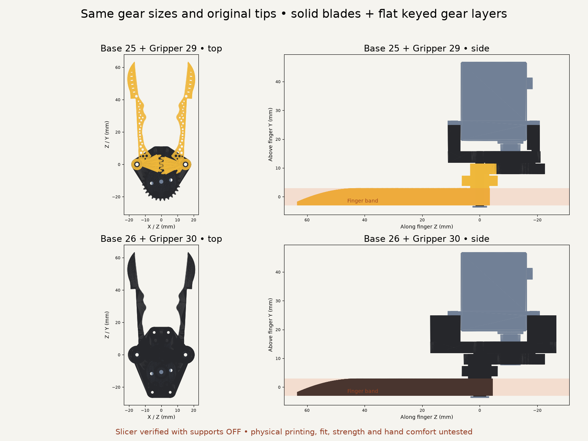
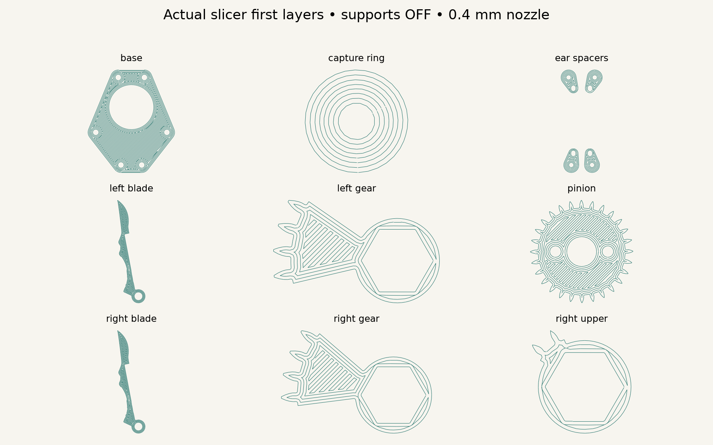

# Base 26 + Gripper 30 — support-free FDM

Base 26 builds on Base 25; Gripper 30 builds on Gripper 29. This continues the latest HLS3606M hand-held branch. It has **no SO-101/Mount 2 or legacy Handle interface**. Historical versions remain intact. **Base 25 / Gripper 29 is not support-free print-ready.**

The old exported jaw orientations begin gear/blade ledges in midair: the layer screen detects approximately 86 mm² and 148 mm² of unsupported additions. Their lattice has 0.405 mm ligaments; their printed pivot sleeves have 0.4 mm walls. See `baseline_manufacturing_checks.json`. These resin assumptions were unsuitable for the requested ordinary FDM process.

The new version fills the lattice, retains the original blade outline, surface grooves, taper and rounded meeting tips, and separates each gear level from the blade. Flat gears fit the blade's integral hex shaft. Only the enlarged pivot roots change the finger outline locally. Pivot spacing remains 30 mm; no distal connectors, extensions or trimming. Lower gears remain 30:30/module 1; upper drive remains 18:28/module 0.8, 16/24 mm full addendum diameters, 19.286° servo travel for 0–30° jaw stroke. Motor remains centered overhead, with 0.8 mm tooth-to-finger gap.

## Print plate and orientations

Open [the arranged 3MF](exports/print_plate.3mf) in Bambu Studio. All twelve pieces are arranged with their flat build faces down; the 3MF contains disconnected solids in one arranged model (use Split to objects if individual control is wanted). Do not auto-orient. `exports/print_plate.stl` is the same arrangement. **The G-code is inspection evidence from a generic PrusaSlicer profile, not a machine-qualified X1 print job. Select the real printer/material profile and reslice the 3MF.**

| Export in `exports/print/` | Quantity | Supplied Z=0 bed face |
| --- | ---: | --- |
| `left_blade.stl`, `right_blade.stl` | 1 each | Original flat blade face down; hex shaft grows upward |
| `left_gear.stl`, `right_gear.stl` | 1 each | Flat lower sector face down; hex opening vertical |
| `right_upper.stl` | 1 | Flat upper sector face down; hex opening vertical |
| `pinion.stl` | 1 | Broad toothed face down; smaller hub grows upward |
| `capture_ring.stl` | 1 | Flat 1 mm ring down; bore vertical |
| `base.stl` | 1 | Broad back face down; two sleeves upward |
| `ear_spacers.stl` | 4 | Four separate pill-shaped feet down; both pilots through |

Saved local Bambu configuration identifies **X1 Carbon, 0.4 mm nozzle, eSUN PLA+**, previously using 0.20 mm Standard. For these small gears the supplied screening profile uses **0.10 mm layers, 0.20 mm first layer, 0.45 mm nominal width, Arachne, four perimeters, 100% rectilinear infill, 210/60°C, cooling after first layer, supports/raft/brim OFF**, external perimeters 20 mm/s. Temperatures and adhesion require actual filament/bed calibration. No printer was run.

Installed **PrusaSlicer 2.9.4** sliced every actual export with supports OFF. The final G-code contains **zero support, bridge-infill or overhang-perimeter paths**. Earlier pinion counterbore/capture roofs produced floating circular perimeters despite short spans; those roofs were deleted. Straight plate holes plus external screws/washers and a separate flat capture ring remove them. Geometry sections separately screen unsupported additions every 0.1 mm with 45° growth allowance. First layers and actual paths are saved under `slicing/`; `slicer_checks.json` hashes them, and `manufacturing_checks.json` hashes the meshes. This verifies the supplied orientations and slicer paths, **not successful physical printing**.

## Material, walls and part-count tradeoff

Twelve prints replace four: two blades, three sectors, pinion, capture ring, base, four spacers. There are **33 physical parts including all bought hardware**, previously 19. Splitting removes large unsupported ledges rather than adding disposable support. Four extra screws attach the split spacers; two added metal washers accompany the longer plate screws. No extra screws fasten the keyed gear layers.

Actual mesh sections test the critical bearing/key/socket/pilot/pocket walls: nominal 1.1 mm sleeve walls, at least 1.2 mm blade-key and gear-socket ligaments, about 1.25 mm around top screw heads. The sleeve mesh's faceted minimum is about 1.097 mm. The upper gear retains its 1.093 mm root chord and ~0.323 mm tip chord. Arachne resolves the exported teeth, but bead placement, wear, fatigue and material strength remain unmeasured. No load rating follows from slicing.

Two 4.4 mm OD / 2.2 mm ID sleeves, reinforced with the retained M2 steel bolts, are the only fixed support crossing the 6 mm finger slab. Their actual projected material rises **12.799 → 29.046 mm²** to remove the old fragile sleeves. No connecting plate enters that slab. The hex shafts use 0.12 mm radial socket allowance; print and measure a fit coupon before assembling. Nominal washer gap is 0.2 mm and total axial endplay budget is 0.5 mm. These fits need calibration; do not clamp the jaws solid or force tight keys.

## Hardware and assembly

The purchased HLS3606M-C001 and aluminum spline plate remain actual-size pinned source CAD in `reference/`. `check_hardware.py` remeasures eight modeled Ø2 holes on Ø12.007619 PCD, four case-ear holes and the original center-screw stack. The plate's STEP has smooth holes, **not verified production threads**. Manufacturer 25T/Ø4.95 spline versus smooth STEP Ø4.93 is retained; no printed spline.

1. Attach the four printed motor spacers to the base from the gear side using **four M2×5 DIN 912 / ISO 4762 socket screws** in the outward holes. Their Ø3.8 × 2 mm heads sit in Ø4.3 mm pockets. Nominal pilot engagement is 3 mm. Both spacer pilots are through holes, with the near holes reserved for the motor ears.
2. Attach the motor ears using the retained **four M2×6 self-tapping screws** in the near pilots. Nominal opposing screw tips remain separated by 1.3 mm in depth. The earlier source-CAD access constraint remains: two ear drivers need a 10° tilt. Actual Torx engagement, head dimensions, thread forming and pullout are unverified.
3. Put the flat **printed capture ring** into the pinion's motor-side pocket. Keep the original **M2.3×5 center screw** and purchased plate. Its head seat is unchanged: modeled 2.8 mm thread engagement and 0.2 mm bore-floor clearance. Ring OD9/ID2.6/thickness1 mm; its pocket allows radial clearance. This ring replaces the integral roof, not the purchased metal spline plate.
4. Use **two M2×8 DIN 912 socket screws plus two Ø5 / ID2.2 / 0.3 mm metal washers** through the pinion's straight holes into the original opposed plate holes. The old M2×4 screws are too short here. Modeled grip is 6.2 mm, engagement 1.8 mm in the 2 mm plate. Measure actual screws, washers and plate threads before tightening; never bottom screws into the servo.
5. Seat the blade/hex-shaft and separate gear layers on the two sleeves, following the closed-pose CAD tooth/key orientation. Retain them using **two M2×25 bolts, two metal washers OD≥6.4 mm with suitable M2 bore, and two M2 nuts**, as modeled. Check free rotation, axial retention and full manual stroke before power. Purchased lower washer dimensions and lock method still need physical confirmation.

New socket screw dimensions: [Accu M2×8 DIN912](https://www.accu.co.uk/metric-cap-head-screws/3793-SSCF-M2-8-A2), [PTS M2×5](https://www.pts-uk.com/products/socket-screws/socket-cap-screws/metric-a2/A9120205). Washer dimensions: [Westfield Form A datasheet](https://www.westfieldfasteners.co.uk/Datasheets/Washer_FormA_M.pdf). Select actual 0.3 mm washers; vendor revisions differ. Existing servo drawing/BOM provenance and discrepancies remain in `hardware_checks.json` and `reference/`.

## Checks, preview and limits

`geometry_checks.json` checks **121 poses ×190 body pairs**, with no pair exclusions, plus driver shafts, outside finger approaches, wrong-phase controls, axial escape controls, centered motor, mesh components and analytic vertex envelopes. Intentional thread/spline engagement is omitted from reference solids. `closure_checks.json` checks original-tip contact, body/rear clearance, opening release and rejected overclose. `gear_checks.json` checks finite-sector engagement and analytical contact ratios. `Scripts/test_support_free_gripper.py` checks actual critical mesh walls, unchanged distal silhouette, key/spacer screw stack, report hashes and publisher lineage.

At 1 N per tip the unchanged ideal servo requirement is about 0.1915 N·m before losses, above the manufacturer's 0.1471 N·m continuous 6 V rating. No grip-force rating, print strength, wear or physical actuation is established. Printed key backlash and axial endplay require physical evaluation; CAD nominal closure is not calibrated servo control.

Live Preview: **Base 26 + Gripper 30**, Arm/Mount/Handles off. `support_free_acceptance.html` animates the unchanged complete-hand solver against this version and offers Copy fit report. Whole-hand reach/skin screening **still fails**; this manufacturing fix does not establish comfortable fit. Generic 181.1/193.3 mm hands are not Jake's measured hand. See `cad/validation/voice-550038ca-support-free/whole-hand.json`.

Coordination: no other HelpingHands CAD worker was active when registry/catalog edits were made. Surgical-reference item `voice-ef49247b` was already in the human lane and was not edited. Any subsequent surgical redesign should build on Base 26 / Gripper 30 and rerun these manufacturing constraints, preserving historical designs.

Reproduce: `python3 export_models.py`; build123d venv `check_hardware.py`; blender venv `check_geometry.py`, `check_closure.py`, `check_gears.py`, `genus.py`, `slice_prints.py`, `inspect_slices.py`; from repo root run `cad/blender/.venv/bin/python Scripts/check_support_free_prints.py 'Two Finger Gripper/versions/v327_generalist_support_free'` and `PYTHONPATH=. cad/blender/.venv/bin/python -m unittest Scripts.test_support_free_gripper`. `python3 Scripts/publish_designs.py --no-build` stages existing exports without an application build.
