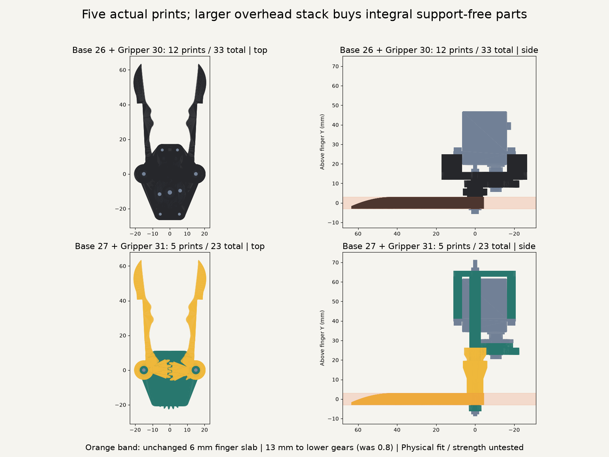
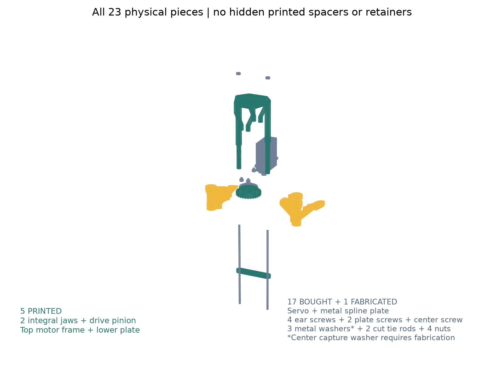
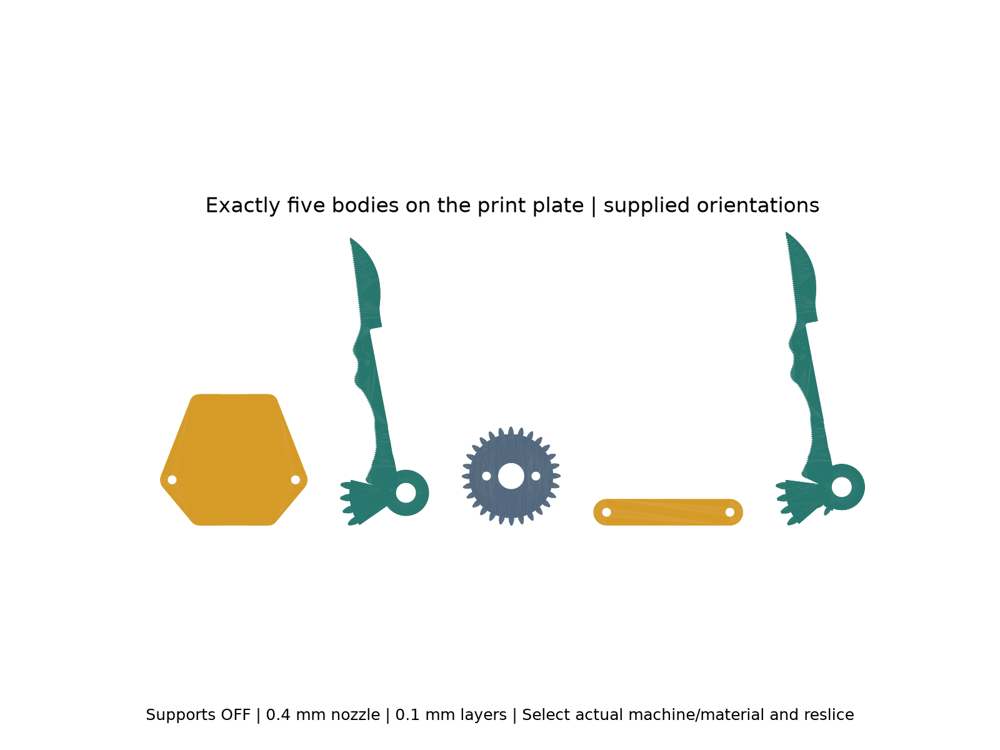
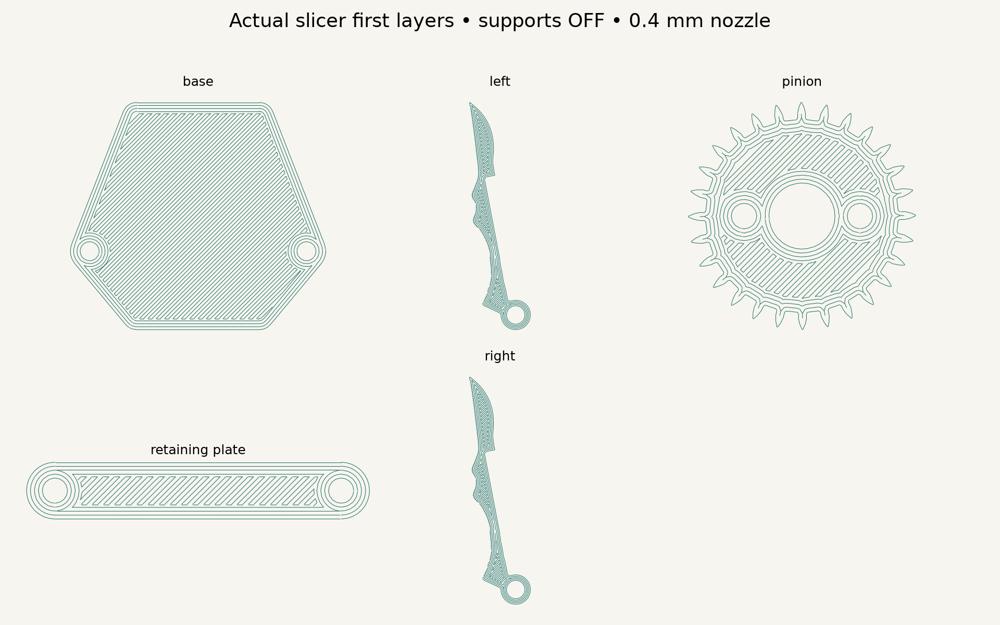

# Base 27 + Gripper 31: five printed pieces

Base 27 builds on Base 26; Gripper 31 builds on Gripper 30. Earlier versions are preserved. This is the latest **HLS3606M-C001 handheld branch**, with no SO-101 / Mount 2 or Handle interface. It is a CAD and slicer prototype, not physically print-tested or mechanically qualified.

The five prints are **one drive pinion, two integral geared jaws, one upper motor frame, and one lower retaining plate**. Every exported print contains exactly one connected solid. The split sectors, four separate motor spacers, four spacer screws and two pivot washers are deleted. No separate printed part is hidden in a group, mesh or exploded view.

The original blades, rounded meeting tips, 30 mm pivots, centered servo, involute profiles, 18:28 upper drive, 30:30 lower drive and 0–30° jaw stroke remain. Integral tapered roots replace keyed joints. Their expanding silhouettes support the teeth as they print upward from the blade's flat face. The right upper sector grows from the lower hub. No distal tip additions or connectors.

**The price of this particular five-piece layout is height:** lower teeth begin **13 mm** above the unchanged 6 mm finger band, previously 0.8 mm. The upper stage adds another 2.6 mm. A broad frame behind the motor supports four routed ear pillars and two long pivot journals; collars on those journals stop each jaw moving upward. The lower plate stops downward escape and ties the journal ends together. It sits Y = −6.2 to −3.2 mm, outside the nominal finger slab, but its broad underside can still affect the hand. Only the two sleeves/bolts cross that slab. The full continuous vertex envelope including assumed cable is about **69.86 × 80.00 × 86.12 mm** (X/Y/Z), versus 69.86 × 52.60 × 86.12 mm. This meets the printed-count target at a substantial stack-height cost; it does not establish comfortable hand fit. Do not infer a lower bound for every possible five-part mechanism from this example.

## Every physical piece

| Component | Count | Details |
| --- | ---: | --- |
| Integral left/right jaws | 2 | Printed; lower gear on each, upper gear integral to right |
| Pinion | 1 | Printed; no printed spline |
| Upper motor frame | 1 | Printed; four routed ear pillars, two journals and axial collars integral |
| Lower retaining plate | 1 | Printed; flat bridge, two through bores |
| HLS3606M-C001 | 1 | Original purchased servo; not STS3215 |
| Original aluminum spline plate | 1 | Purchased; STEP has eight smooth Ø2 holes on Ø12.007619 PCD |
| Motor-ear screws | 4 | M2×6 self-tapping, 1.5 mm ear + 4.5 mm engagement in a 5 mm printed pilot; reversed insertion from gear side |
| Plate screws | 2 | M2×8 DIN912; unchanged nominal 1.8 mm plate engagement |
| Plate washers | 2 | M2, OD5 / ID2.2 / 0.3 mm, as Base26 |
| Spline center screw | 1 | Original M2.3×5; nominal 2.8 mm engagement / 0.2 mm bore-floor margin |
| Center capture washer | 1 | **Fabricated steel washer Ø9 / ID2.6 / 1 mm**, replaces printed ring; must be cut/drilled/deburred or sourced to these dimensions, not an assumed standard M2 washer |
| Tie rods | 2 | M2 threaded stock, cut/deburr to 80 mm; no unsourced M2×80 bolt assumed |
| Tie-rod nuts | 4 | M2 DIN934; one at each end of each rod |
| **Total** | **23** | **5 printed + 17 purchased + 1 fabricated metal washer**, previously 12 printed / 33 total |

There are seven screws, two cut rods, four nuts and three washers; servo/plate internals are bought subassemblies, not dismantled BOM entries. Washer fabrication is an extra operation, explicitly not a sixth print. If the aim is five prints **and only off-the-shelf hardware**, that constraint is not yet met. Purchased steel capture washer properties/availability and actual retained screw heads/threads are unmeasured.

[Accu's threaded-rod range](https://www.accu.co.uk/shop/precision-components/precision-screws/threaded-rods) lists M2 stock; cut and finish the rods rather than assuming a long socket screw exists. Source interface verification is in `hardware_checks.json`, with pinned STEP and manufacturer PDF in `reference/`. The four servo-ear holes are distinct from the spline plate's eight modeled holes and two selected mounting screws. The actual plate's production threads/revision are still unverified. Original manufacturer drawing is [Feetech HLS3606M-C001 A/0](https://www.feetech.cn/Data/feetechrc/upload/file/20240807/6385862508379674057566108.pdf).

## Assembly and retention

1. Cut/deburr the two M2 rods to 80 mm. Fit one nut on each upper end. Pass them down the frame journals. Keep the rods inside the printed sleeves so jaws run on printed journals rather than threads.
2. Attach the motor to the frame **before the spline plate/pinion or jaws**. Four original ear screws now insert from the gear side into the four pilots. Straight shaft access is tested in this assembly state; the old tilted-driver requirement is removed. Actual self-tapping engagement and tool handles need physical checks.
3. Use the fabricated steel capture washer with the original center screw and metal spline plate, preserving the old seat plane. Two M2×8 screws and their 0.3 mm washers attach the pinion to the opposed plate holes. The original M2×4 screws cannot span this stack.
4. Slide the complete jaws onto the journals in the closed tooth phase. The upper/lower sectors are part of the jaws, so no gear-key assembly remains. Mount the lower plate and two lower nuts. The frame journals butt the lower plate; tighten against the journals, not the rotating jaws. Nominal lower running gap is 0.2 mm; upper collar gaps are 0.2 mm each. The physical collar/journal/plate fit needs calibration.
5. Check free manual 0–30° motion and original-tip closure before applying limited servo torque. Nuts need a verified locking method; no extra lock washers/nuts are silently counted. Do not overclose to compensate for backlash.

The two sleeves have 4.4 mm OD / 2.2 mm ID (nominal 1.1 mm walls), 0.25 mm radial jaw clearance. Steel rods reinforce them. They are long columns; printed creep, flexure, buckling, torsion, pilot pullout, bearing wear and jaw tooth/root strength are **unqualified**. The earlier ideal 1 N-per-tip example already exceeded the servo's continuous 6 V rating; no grip-force rating is claimed.

## Print and inspect

Open [`exports/print_plate.3mf`](exports/print_plate.3mf) in Bambu Studio; select the actual X1 Carbon / 0.4 nozzle / eSUN PLA+ profile and reslice. The arranged model is a portable five-solid plate, not a qualified X1 G-code job. Use the supplied orientations, not auto-orient:

| Print STL | Orientation |
| --- | --- |
| left / right | Original flat blade face on bed; integral tapered roots/gears grow upward |
| pinion | Broad toothed face down; hub above, holes open vertically |
| base | Broad motor-back plate down; all routed pillars/journals grow upward |
| retaining_plate | Broad flat plate face down; two bores vertical |

Screening uses installed PrusaSlicer 2.9.4, supports/raft/brim OFF, Arachne, 0.10 mm layers / 0.20 mm first layer, 0.45 mm nominal width, four perimeters, 100% infill, 210/60°C, external perimeters 20 mm/s. These are inspection settings, not calibrated material instructions. Slicer role counts and hashes are in `slicer_checks.json`; independent 0.1 mm section checks are in `manufacturing_checks.json`. Tall narrow pillars may require adhesion/cooling tuning even when geometry passes. No printer was run.

## Evidence and reproducibility

`geometry_checks.json` tests 121 poses × all physical body-export pairs, with no collision pair exemptions, original rear clearance, centered motor, axial capture/escape controls, rod/nut stack and explicit installation tool order. Threads/spline engagement are omitted from bought probes intentionally. `closure_checks.json` measures original-tip contact and overclose rejection. `gear_checks.json` measures finite-sector gaps throughout motion and rejects wrong gear phases. Reports do not prove continuous-body collision freedom, gear strength or physical fits.

CGAL exports the integral jaws/frame; tiny independently rounded binary-STL vertices on jaws are welded within **0.00002 mm** with a strict volume-change bound, removing only duplicate-index faces. No hole filling or approximate replacement mesh is used. Tests still require watertight, one-body actual exports.

From repo root, use `cad/blender/.venv/bin/python` for `export_models.py`, `check_geometry.py`, `check_closure.py`, `check_gears.py`, `slice_prints.py`, `inspect_slices.py`, `render_review.py`, and `Scripts/check_support_free_prints.py <version-folder>`. Use `cad/build123d/.venv/bin/python` for `check_hardware.py`. Run the repository regression `Scripts.test_five_piece_gripper`. `export_models.py --reuse` only rebuilds metadata/assembly and normalizes already-exported parts; omit it after geometry changes.

Live Preview: **Base 27 + Gripper 31**, Arm/Mount/Handles off, with honest exploded hardware and full-stroke animation. Geometry Tune changes are unqualified until all checks rerun. Compare top/side images at the same scale before printing. Whole-hand screening failed on the prior design; it has not been requalified for this taller layout. Physical print, ergonomics, strength, cable routing and loaded actuation remain untested.

Coordination: no other HelpingHands CAD worker was active; reference-exploration voice-ef49247b was in the human lane and was not edited. Later reference work should use this newest manufacturing iteration and retain its part-count, no-support and original-tip constraints. No other pebble was touched; no application build was run.
