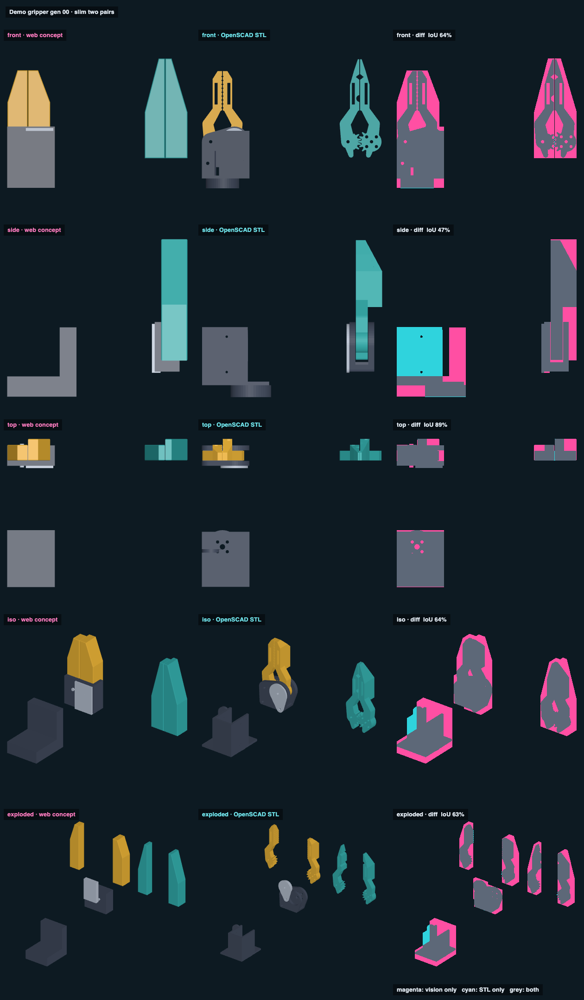

# Demo gripper gen 00 · slim two pairs · web vs STL

## Overlap

<!-- render_compare:begin -->
| View | Overlap (IoU) | Vision only px | STL only px |
|---|---|---|---|
| front | 64% | 14042 | 88 |
| side | 47% | 9861 | 10536 |
| top | 89% | 2367 | 25 |
| iso | 64% | 11590 | 863 |
| exploded | 63% | 8187 | 492 |

<!-- render_compare:end -->

## Differences and why

- **Jaws (front).** The STL jaws are linkage-shaped (pivot bosses, gear teeth at the root, a waist above the hub); the vision draws them as solid slabs. The magenta around every jaw is that missing waist and the cut-outs: material the print deliberately doesn't have (the slim pass took it from 75 to 43 cm³).
- **Crow pair B (front, iso).** Both are tapered to a point at Z=84 and line up; B's gated recess and rod seat exist only in the STL.
- **Hub, insert, cradle (side IoU 47%).** Same placeholder boxes as gen_01's concept; the STL cradle's raised servo seat shows cyan.

## Fix list

- gen_00 is superseded by gen_01; no print changes. If gen_00 is revisited, give its concept the jaw waist so the diff stops flagging deliberate lightening as a difference.
