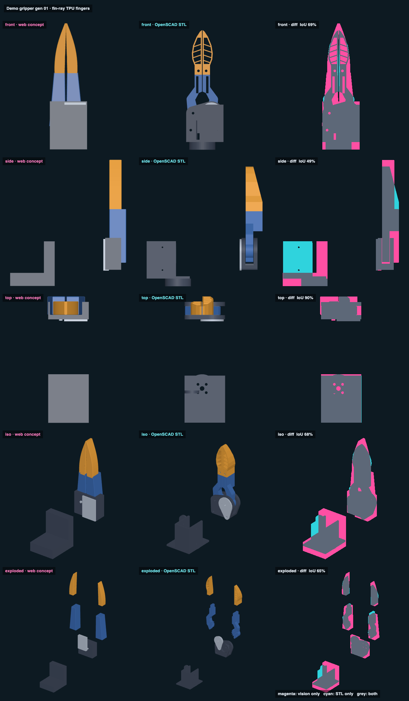

# Demo gripper gen 01 · fin-ray TPU fingers · web vs STL

## Overlap

<!-- render_compare:begin -->
| View | Overlap (IoU) | Vision only px | STL only px |
|---|---|---|---|
| front | 69% | 9204 | 584 |
| side | 49% | 8453 | 9455 |
| top | 90% | 2615 | 145 |
| iso | 68% | 8681 | 1170 |
| exploded | 65% | 5066 | 694 |

<!-- render_compare:end -->

## Differences and why

- **Fingers (front, iso).** The vision's fin-ray fingers are 4-5 mm wider at the base and run up to Z≈116 with a bulged outer wall; the STL's stop at Z=108 with a straight taper. Why: the print keeps gen_00's 22 x 3 mm strap slot and a 6 x 10 mm tongue, which fixes the finger base, and tip_z = 108 was set to clear the hub's 30° stops. Magenta here is mostly the vision being greedier than the print can be.
- **Visible ribs (front).** The STL shows the five slanted 1.2 mm ribs through open cells; the vision draws the finger as a closed shell. The STL is right: open cells are what make a fin-ray wrap. The concept should show them.
- **Roots (front, exploded).** The STL root has the gear sector, link and pivot bosses; the vision draws a plain tapered block. Missing detail in the vision, not a print problem.
- **Hub and cradle (side, iso).** The STL hub is a rounded profile with the servo horn boss on its face; the cradle is an L with a raised servo seat. The vision's boxes over-cover both (side IoU 49%), and the vision's cradle sits forward of the real one. Vision is out of date.
- **Pivot insert.** Vision: a plate on the front face. STL: a rounded teardrop insert. Printable truth wins.

## Fix list

- Concept (`web/gen_01.js`): draw the five open fin-ray cells; take the finger base and tip from params (tip_z 108, 16 / 22 mm widths) so the shapes only differ where the look is meant to.
- Concept: replace the hub, cradle and insert boxes with their real outlines (or load the gen_01 hub STL as a ghost) so side/iso IoU measures the fingers, not placeholder blocks.
- Print, open question for Jake: is 108 mm long enough for the UMI look, or should gen_02 push the tip to ~116 mm? The vision says longer; the print says it fits now.
