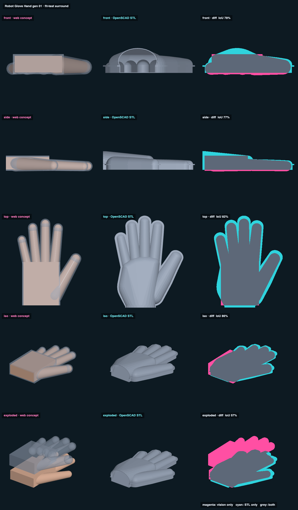

# Robot Glove Hand gen 01 · fit-test surround · web vs STL

## Overlap

<!-- render_compare:begin -->
| View | Overlap (IoU) | Vision only px | STL only px |
|---|---|---|---|
| front | 78% | 2706 | 4180 |
| side | 77% | 1962 | 3400 |
| top | 82% | 166 | 13724 |
| iso | 86% | 1507 | 3176 |
| exploded | 57% | 16487 | 4079 |

<!-- render_compare:end -->

## Differences and why

- **Palm (top, iso).** The concept's palm is a plain box. The STL has the hull of the knuckles, the wrist, and the pinky-side heel, so cyan shows on the heel and the thumb web. The STL is the truth here, and the box is the concept being lazy.
- **Height (front, side cyan).** The STL's back is taller at the wrist (38 mm guessed wrist thickness vs the concept's flat 28 mm palm) and has the flange at the split. Expected.
- **Exploded (57%).** The concept lifts the shell off the hand. The STL pieces have no explode offsets (no parts.json yet), so they stay put. Not a defect.
- **Fingers (top ~match).** Both use the jake_hand.scad numbers and the same try-on splay, so the finger sleeves line up.

## Fix list

- Thicknesses are guesses until the side photo: wrist 38, palm 28, fingers 20 → 14 mm. Update jake_hand.scad from it, then re-export (the glove follows on its own).
- Concept: give the palm the knuckle/heel hull instead of a box.
- Back piece: the flat roof over the back of the hand is a ~60 mm bridge rim-down; it needs slicer supports under the roof (outside the hand, so they peel off).
- After the try-on: tune `clearance_*`, `tip_room` per where it pinches.
