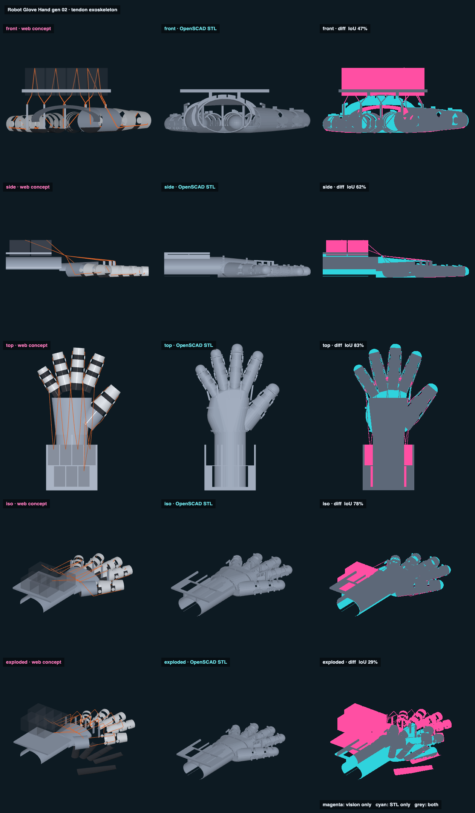

# Robot Glove Hand gen 02 · tendon exoskeleton · web vs STL

## Overlap

<!-- render_compare:begin -->
| View | Overlap (IoU) | Vision only px | STL only px |
|---|---|---|---|
| front | 47% | 16157 | 6806 |
| side | 62% | 4139 | 4277 |
| top | 83% | 3900 | 4472 |
| iso | 78% | 3799 | 2296 |
| exploded | 29% | 19389 | 8358 |

<!-- render_compare:end -->

## Differences and why

- **Servos and cords (magenta, front/side/iso).** The concept draws the seven STS3215 envelopes and the cord loops; neither is printed, so the STL has no servos and no cords. Expected, and most of the front view's 47%.
- **Forearm and deck (cyan, iso/side).** The STL's forearm saddle runs the full deck length and the deck stands on two ribs; the concept draws a short arm sleeve and a bare plate. The STL is the truth.
- **Saddle ends (cyan at the tips, top).** The STL's tip saddle wraps the whole fingertip; the concept stops at an open tube. The STL is right: the tip cap is where the cord crosses over.
- **Exploded (29%).** The concept lifts its five groups apart; the glove_hand family has no parts.json, so the STL pieces stay put. Not a defect.
- **Fingers line up (top 83%).** Both build from jake_hand.scad in the gen_02 pose (splay 22/4/-14/-32, thumb 40), so the fingers and the web posts land in the same places.

## Fix list

- MCP for robot-only use: the exo has no MCP hardware (Jake's own knuckle is the joint), so a robot core must supply one, or gen_03 adds a dorsal self-aligning hinge.
- Thumb: the CMC is locked at 40 deg and only the thumb-flex cord is routed; the thumb-tendon and abduction servos have windows but no cords yet.
- Seven STS3215s make the deck 113 x 100 mm and heavy on a forearm. Try Bowden cables to servos on the arm, or smaller servos.
- The wrist is locked: back plate and deck are one part, so cord lengths don't change with wrist bend.
- Spools, elastic return and the pad-to-saddle joint (glue or stitch) are not modelled.
- Thicknesses in jake_hand.scad are still the guesses; the side photo's ~30-35 mm knuckle and 14-16 mm finger reads should go in, then re-check collisions (README).
