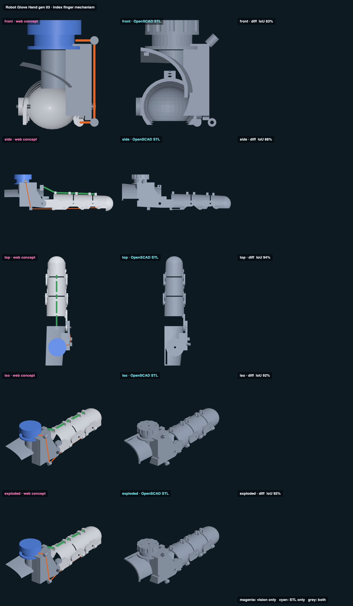

# Robot Glove Hand gen 03 · index finger mechanism · web vs STL

## Overlap

<!-- render_compare:begin -->
| View | Overlap (IoU) | Vision only px | STL only px |
|---|---|---|---|
| front | 84% | 10107 | 4231 |
| side | 88% | 1665 | 1409 |
| top | 94% | 1335 | 136 |
| iso | 92% | 1382 | 1390 |
| exploded | 92% | 1382 | 1390 |

<!-- render_compare:end -->

## Differences and why

- **The spool knob (cyan, front/iso).** The STL's knob has grip notches and horn holes. The JavaScript model has plain discs. It's cosmetic.
- **Base shell (cyan, front).** The STL's shell is the real palm shell from `jake_hand.scad`, cut around the finger at every MCP angle. The JavaScript model has a tapered arc, so the curvature differs.
- **Side walls.** The JavaScript model uses flat plates with the same V cut. The STL walls follow the finger's ellipse. Expect a few pixels at every saddle edge.
- **Line, elastic, pins (magenta).** They're drawn in the JavaScript model only. They aren't printed.
- **Exploded = iso.** This is one assembly in both models, so nothing explodes.

The JavaScript model moves (sliders in the Designs workbench: curl, each joint, robot-only, show the finger). The STL pane always shows the print pose, straight. The OpenSCAD posed views are in `../render/gen_03_poses.png` (0 / half / full curl) and `part = "assembly"` with `bend = [MCP, PIP, DIP]`.

The diff column renders blank in headless Chrome on this Mac, for gen_02 too and with the old viewer, but the overlap numbers above are still measured.

## Mechanism checks

`python3 check_gen_03.py` (output saved in `gen_03_check.md`). It intersects every pair of parts, each part with the comfort volume (finger + palm, grown 1.5 mm), and the line with every part, at 6 poses, and finds each hard stop to the degree. **All in-range poses: 0 mm³.**

| Stop | Designed | Measured |
|---|---|---|
| PIP flexion | 100 | 102 |
| DIP flexion | 70 | 71 |
| PIP / DIP hyperextension | about 5 | 6 / 7 |
| MCP hyperextension | about 4 | 5 |
| MCP flexion | none (the spool's travel limits it) | none |

Line wound in: half curl 20 mm, full curl 44.5 mm (283° of the r = 9 spool). Elastic stretch at full curl: 53 mm.

## Fix list (before or after the first print)

- **Neighbours.** With fingers together, the ulnar PIP/DIP lugs hit the middle finger (1415 mm³). They clear only around 16 to 20° of spread. The radial MCP plate sits in the thumb web: it hits the thumb at the photo pose (yaw 22), and clears from about yaw 50 to 60. For the single-finger test, spread them. For the glove: radial-only hinges at PIP and DIP, or a slimmer ulnar lug.
- **Robot-only joint order.** The model predicts PIP and DIP close first and the MCP stays straight until they hit their stops. The elastic's lever at the MCP (hook high over the knuckle, about 20 mm) is about 3x the line's (7 mm). Lower the MCP hook, or give the MCP its own weaker elastic, if the robot should close MCP-first.
- **No MCP flexion stop.** Limit the spool (servo limit or a stop pin on the spool).
- **Spool holding.** The knob doesn't lock. The first test holds it by hand or with a spring scale on the line.
- **Servo horn hole pattern is a GUESS.**
- **Thicknesses in `jake_hand.scad` are still guesses (voice-0c526dc0).** Re-run `check_gen_03.py` after they change.
