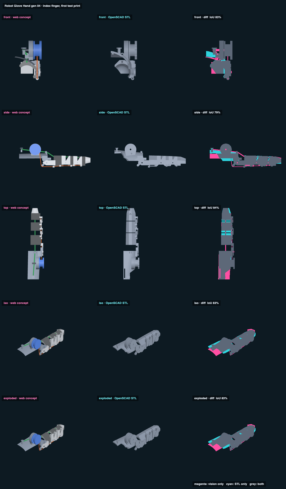

# Robot Glove Hand gen 04 · index finger, first test print · web vs STL

## Overlap

<!-- render_compare:begin -->
| View | Overlap (IoU) | Vision only px | STL only px |
|---|---|---|---|
| front | 83% | 990 | 1090 |
| side | 78% | 1670 | 1561 |
| top | 84% | 1398 | 1091 |
| iso | 83% | 1171 | 832 |
| exploded | 83% | 1171 | 832 |

<!-- render_compare:end -->

## Differences and why

- **Base pad (magenta at the back, top/iso).** The JavaScript pad is a plain arc the full width all the way back. The STL's pad narrows behind the drum, out of the thumb's web, and has the thumb's comfort volume cut out of it.
- **Saddle walls below the axis (side).** The JavaScript model shortens the lower wall by the V at mid-depth. The STL cuts a true V and squares off the lip under the radial wall, so a few pixels differ at every joint.
- **Fingertip nose.** The JavaScript nose is a tapered box. The STL hulls the end section into a shrunken copy and cuts its underside flat at `nose_floor`.
- **Line, elastic, pins, bolts (magenta).** These are drawn in the JavaScript model only. They aren't printed.
- **Exploded = iso.** It's one assembly, so nothing explodes.

The JavaScript model moves. Its sliders are curl, each joint, robot-only, Jake's finger, and "Middle finger and thumb (yaw 45°)" to show the neighbours. The STL pane is always straight.

## Checks (`check_gen_04.py`, full output in `gen_04_check.md`): PASS

- **Interference:** 28 poses (every MCP 0/45/90 × PIP 0/50/98 × DIP 0/35/68, plus 3° hyperextension). Every pair of printed parts, every part against the finger-and-palm comfort volume, and the line against everything: all 0 mm³.
- **Stops (measured):** MCP flexion 95° (the tail hits the block), PIP 100°, DIP 71°, hyperextension 4 / 5 / 5°.
- **Middle finger** (skin, fingers together at splay 0): 5 index poses × 5 middle poses, against all printed parts and the line: all 0. Nothing rigid is past Jake's own index width on the ulnar side, so this doesn't depend on spreading the fingers.
- **Thumb** (skin): clear from yaw 35° to 80°, straight and curled [30, 30]. It still hits at 22° (the fingers-together photo) and at 30°. That's the documented wearing pose: thumb out at least 35° from the index.
- **Line:** 43 mm at full curl, 44.7 mm with all three joints on their stops = 301° of the r = 8.5 drum (one layer, under one turn). It locks every 20° = 3 mm of line.
- **Elastic:** 139 mm of free run. Cut it 121 mm between knots (15 % pre-stretch). At full curl the strain is 61 %. Past about half curl it lies on the MCP and PIP knuckle skin (it's a dorsal elastic).

## Print checks (`print_gen_04.py`, `../print/gen_04/report.md`): PASS

Every part is closed, consistently oriented and one body (the coupon is three on purpose). The saddles sit on their flat tops (113 to 209 mm² on the bed). The base prints upright on supports. Not sliced here: both local slicers fail from the command line (see the script).

## Fix list (after the first print tells us)

- **Pin and slot fit:** set `pin_fix`, `pin_run`, `lug_c` from the coupon, then re-run both scripts.
- **Thumb:** the coaxial MCP hinge needs room beside the knuckle, so an adducted thumb (yaw under 35°) hits the plate. For the full glove that needs a different MCP answer (a remote-centre hinge, or a dorsal linkage).
- **Elastic on the skin** at the MCP and PIP near full curl. If it pinches, raise `top_t` or add a guide over the PIP.
- **Base needs supports** under its pad, and its pad touches skin where the supports were. Sand it, or add a liner.
- **Thicknesses in `jake_hand.scad` are still GUESSES** (voice-0c526dc0). Re-run both checks after they change.
- **Middle saddle has no strap slot:** it's too short between its guides. Add a band there if it lifts off.
