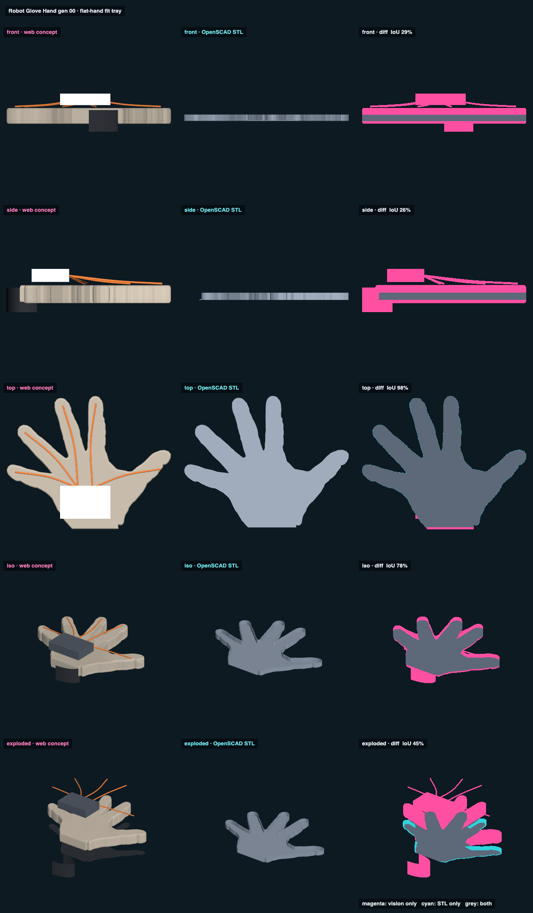

# Your hand · measured model · web vs STL

## Overlap

<!-- render_compare:begin -->
| View | Overlap (IoU) | Vision only px | STL only px |
|---|---|---|---|
| front | 99% | 209 | 38 |
| side | 100% | 13 | 8 |
| top | 100% | 177 | 0 |
| iso | 100% | 9 | 10 |
| exploded | 100% | 9 | 10 |

<!-- render_compare:end -->

## Differences and why

- (not written yet)

## Fix list

- (not written yet)
