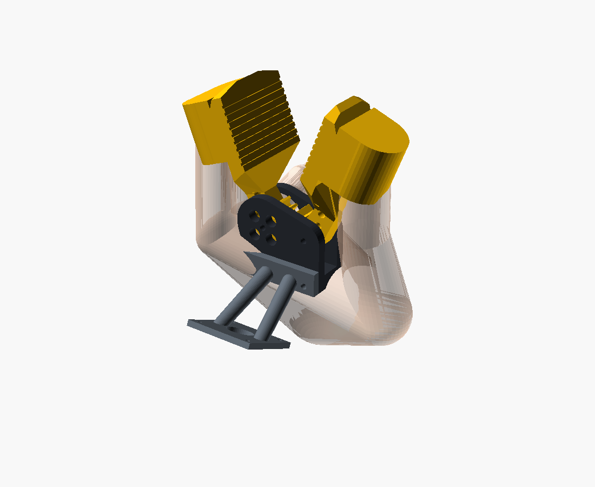
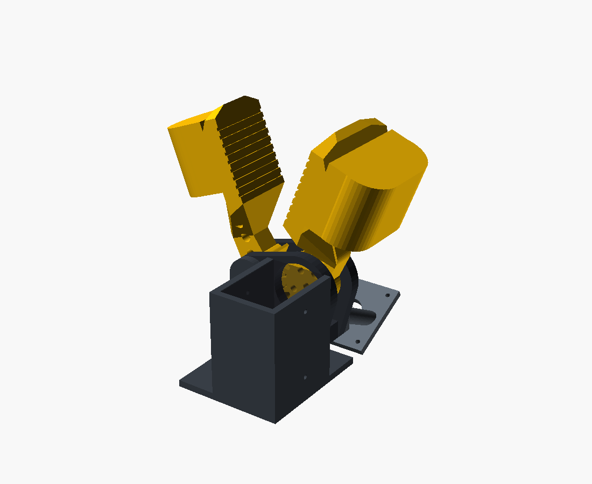

# Hand gripper: two Generalist-style jaws and a camera

Two yellow jaws on a small hub, plus a camera bracket. Your fingertips go in
sleeves on the **outer faces of the jaws**, right behind the gripping faces, so
closing the jaws is the same motion as pinching a sheet of paper. The same jaws,
hub and camera bolt onto an SO-101 through one extra part. That means the camera
sees the jaws from the same place in your hand and on the robot
(voice-6d8b9fd8, third pass).




## Pieces

| piece | file | notes |
|---|---|---|
| hub | `export/hub.stl` | two cheeks and a bridge. Two M3 pivots, 24 mm apart. A Ø24.5 horn hole in the -Y cheek and screwdriver holes in the +Y cheek, used on the arm |
| finger jaw | `export/jaw_finger.stl` | index + middle sleeve, gear sector, SO-101 horn pattern (4 × M3 on a 9.9 mm square) |
| thumb jaw | `export/jaw_thumb.stl` | thumb sleeve, gear sector half a tooth round |
| camera bracket | `export/camera.stl` | plate on the +Y cheek, held by the two bridge bolts; a 32 mm UVC board (M2, 28 mm square) aimed at the middle of the gripping faces |
| SO-101 mount (arm only) | `export/so101_mount.stl` | cradle for the STS3215 gripper servo on the -Y side, plus the stock wrist_roll horn pattern (Ø24 × 6 recess, 4 × M3, centre bore) on a puck underneath |

**In the hand:** hub, both jaws and the camera. An M3 bolt through each pivot
holds it together, and the gears keep the jaws mirrored.

**On the arm:** add the mount and the servo. The servo horn bolts to the finger
jaw through the hub's horn hole, and the gears drive the thumb jaw. The mount
bolts to the hub with the -X bridge bolt and the thumb pivot bolt. Its puck
bolts to wrist_roll (ID 5) with the stock pattern, so the arm side doesn't
change.

Every STL is exported in its assembled position, so loading them all into one
scene rebuilds the gripper. That's how the app's single 3D view with the
Explode / Assemble toggle works. `export/parts.json` comes from the `PARTS`
table. Print the jaws in PETG on their sides. If you want grippier faces, print
them in TPU.

## Numbers

- Jaws swing 30° each before the stop tabs meet, which gives **56 mm** between
  the gripping faces. Closed, the faces touch.
- Gripping face: 32 mm long. The finger jaw's face is 45 mm wide and the thumb
  jaw's is 29 mm wide. It has 0.8 mm ribs and narrows to a point above the
  sleeves.
- Sleeves are 28 mm deep (fingertip to past the last joint), open at the back
  and capped at the front. They're sized from `hand = S | M | L`.

```bash
./build.sh                                        # STLs + parts.json + PNGs + checks
openscad hand_gripper.scad                        # assembled, 40 mm gape
openscad -D 'part="in_hand"' hand_gripper.scad    # with a ghost hand
openscad -D 'part="on_arm"' hand_gripper.scad     # with the mount and servo
openscad -D 'hand="L"' hand_gripper.scad          # S / M / L sleeves
```

## Checks `build.sh` runs

- The jaws (without their teeth) never touch each other, the hub, the camera,
  the mount or the servo, for 0–29.5° at S, M and L.
- The hub, camera, mount and servo don't overlap.
- The stop tabs collide past 30°.
- The full jaws, teeth included, clear at 0–29.5°. They jam if one is turned
  3° past the other, so the gears are engaged.

## Not verified — nothing has been printed

- **STS3215 dimensions are a guess:** 45.2 × 24.7 × 35, shaft 11 mm from the
  end, horn 5.6 mm proud of the case. Measure your servo before printing the
  mount. The two servo-retaining screw holes are placeholders.
- **The wrist_roll axis sits 8 mm off the pinch line**, toward the servo. The
  stock gripper is also off-axis, but the calibration will differ.
- **Hand fit is a guess.** The hub sits in the web between thumb and index
  finger. With a small hand or a wide grip, the bottom of the hub may press
  on the web.
- **In the hand, the finger jaw's pivot is held from one side only.** The other
  cheek has the horn hole. The gears keep it in line, but expect some wobble.
- Gear teeth are straight-sided, not involute.
- There's no encoder in the hand version. The gape comes from the camera image.
