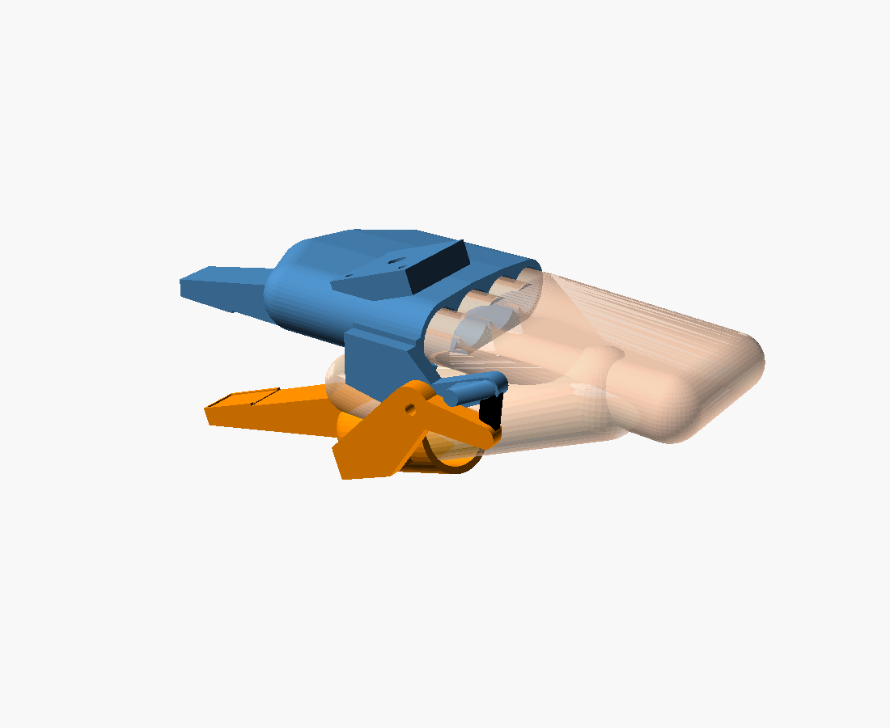

# Hand gripper — a handheld gripper you wear

Four fingers go into one jaw, your thumb into the other, and you pinch to close
it (voice-6d8b9fd8). It's for capturing demonstrations UMI-style: the jaws stick
out past your fingertips, a camera sits on the back of your hand looking at the
tips, and a band springs it open when you relax.



```bash
./build.sh                                     # STLs + PNGs + the interference sweep
openscad hand_gripper.scad                     # the assembly, closed
openscad -D 'opening=40' hand_gripper.scad     # 40 mm between the tip pads
openscad -D 'hand="L"' hand_gripper.scad       # S / M / L presets
openscad -D 'handed="left"' hand_gripper.scad  # mirrors everything
```

## How it works

- **Upper jaw = finger sleeve (fixed).** Your four fingers lie flat, palm down,
  in a tunnel with one channel per finger. Neighbouring channels overlap by
  `web`, which leaves a low ridge between fingers, so the sleeve follows the
  shape of your hand and doesn't let it roll. The channels are capped, so your
  fingertips bottom out in them.
- **Lower jaw = thumb cup (moving).** Your thumb sits in a capped tube under
  the index/middle fingers, like a sock puppet. It swings on one M4 pivot that
  is outboard of the index knuckle.
- **Squeeze to close, relax to open.** A rubber band runs between two posts
  behind the pivot and holds the jaw open. A pin on the upper ear stops the
  thumb jaw at **28°**, which gives a **61 mm gape** at the tips (M hand). Your
  thumb travels 23 mm. The closed stop is the two TPU tip pads meeting. The
  blades are relieved 1 mm behind the pads, so only the pads touch.
- **Same topology as the SO-101 gripper:** one fixed jaw plus one jaw on a single
  pivot. The tip radius is different (126 mm here vs ~84 mm on the arm), so
  record **gape** rather than angle. Seeing both pads in the camera, as UMI does,
  gives you gape directly.
- **Camera:** there's a wedge on the back of the hand, tilted so it aims at the
  tips. It has a captive 1/4"-20 nut for a standard camera screw and two M3 holes
  24 mm apart.

| part | file | print |
|---|---|---|
| finger sleeve + upper jaw + camera wedge | `export/upper.stl` | PETG, stand it on its open rear face, supports outside only |
| thumb cup + lower jaw | `export/lower.stl` | PETG, stand it on the cup's open rear, supports under the ear |
| tip pads ×2 | `export/pads.stl` | TPU 95A, glue into the pockets |
| hardware | | M4×20 bolt + nyloc (or an M4 shoulder bolt), one #32 rubber band, 1/4"-20 nut |

## Hand size

Measure your own hand. The numbers you need are at the top of
`hand_gripper.scad`: finger diameters across the middle knuckle, finger lengths
from the knuckle line, thumb diameter, and where your thumb tip lands under your
fingers (`thumb_x`). `S`/`L` just scale `M` by 0.9/1.1. Every finger and thumb
diameter gets `clear` (1.6 mm) added.

## Checks `build.sh` runs

- **Interference.** The two arms are intersected at 0.1–27° for S, M and L, and
  the result must be empty.
- **The open stop catches.** One degree past the stop (29°), the arms must
  collide.

## Not verified yet — it hasn't been printed

- **Fit.** The default hand is generic. The worst risk is the thumb's path from
  the cup back to the palm, near the pivot ear. Print `lower.stl` first at 30%
  infill and try it on.
- **Fingers are modelled straight.** A slight curl might be more comfortable
  over a long session. A `finger_curl` parameter is the obvious next knob.
- **The camera is a placeholder.** The 1/4"-20 nut suits a GoPro-style or USB
  camera on a mini ball head. Measure the actual camera and reposition `cam_x`
  until both pads are in frame.
- **Band preload is a guess.** Try a #32 band first and double it if the jaw
  doesn't spring open briskly.
