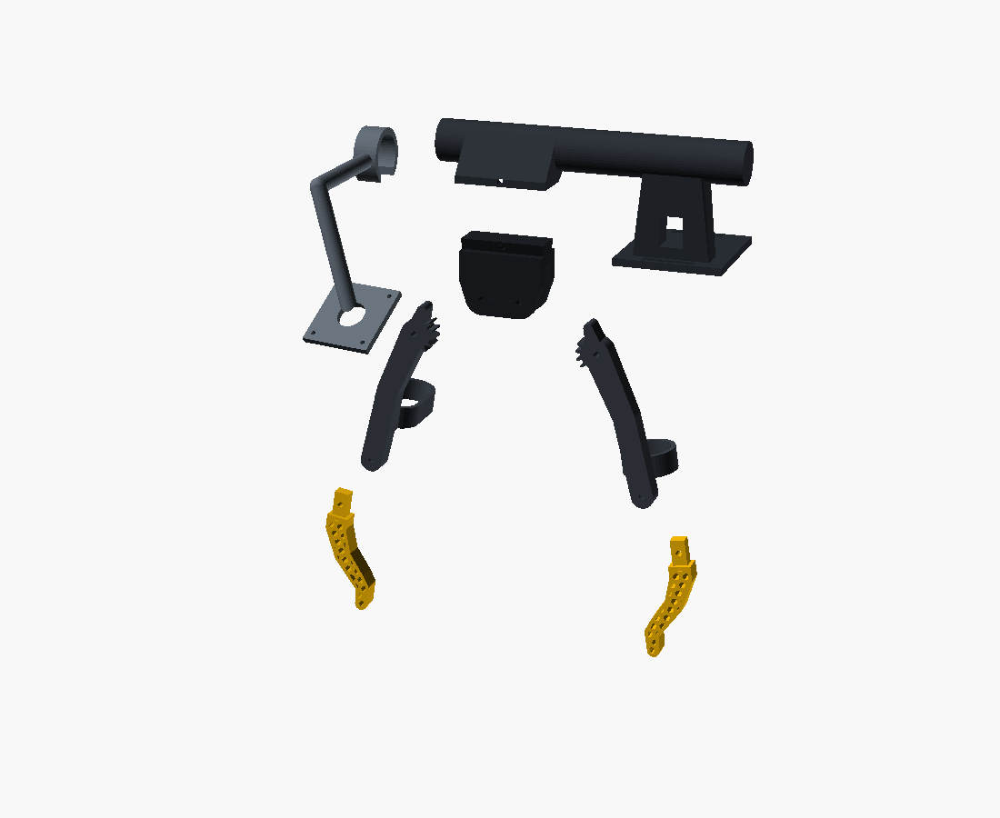

# Hand gripper — a wearable pincer, after Generalist AI's data-collection gripper

You wear it on the back of your hand. Index and middle finger ride in a loop
on the front jaw, your thumb in a loop on the rear jaw. Pinch to close it and
spread to open it; both directions are driven, so there's no spring
(voice-6d8b9fd8). It's for capturing demonstrations UMI-style, and the layout
copies Generalist's human gripper.



## What it copies from Generalist

Generalist hasn't published drawings. Everything here was read off a photo of a
data collector wearing two of them
([x.com/DominiqueCAPaul/status/2040765175779778585](https://x.com/DominiqueCAPaul/status/2040765175779778585))
and off their robot-side twins in the GEN-1 "box folding, handheld" videos
(generalistai.com/blog/gen-1):

- a black **bar** strapped along the back of the hand,
- a **hub** under its front end that both fingers pivot from, with a fiducial
  marker on it,
- two rigid **links** hanging down with a strap or loop for the digits, so the
  hand drives the jaws directly,
- swappable **yellow lattice tips** that curve inward to a point.

Not copied, because we couldn't see it: their sensors, their electronics, and
where their camera sits. The camera clip and the gear sync here are our own
choices.

## Seven pieces, each its own print

| piece | file | what it does on its own | joins with |
|---|---|---|---|
| spine + strap pad | `export/spine.stl` | a bar you strap on; a camera handle | hub (dovetail + M3 lock pin), camera clip (snaps on the bar) |
| hub | `export/hub.stl` | holds the two pivots; fiducial pocket on the camera side | spine (dovetail), links (2 × M3 × 25 pivot bolts) |
| finger link | `export/link_front.stl` | loop for index + middle, gear sector, tip socket | hub, finger tip |
| thumb link | `export/link_thumb.stl` | loop for the thumb, gear sector, tip socket | hub, thumb tip |
| finger tip, thumb tip | `export/tip_*.stl` | TPU lattice tips; swap in other shapes | link socket (tongue + M3 cross-pin) |
| camera clip | `export/camera.stl` | C-clip on the bar with a plate for a 32 mm UVC board (M2, 28 mm square) | spine (snaps anywhere along the bar) |

Pull the hub off the spine and the hub, links and tips make a plain hand pincer.

Every STL is exported **in its assembled position**, so dropping them all into
one scene rebuilds the gripper. The app does exactly that: it draws every piece
in one viewport with an Explode / Assemble toggle. `export/parts.json` (written
by `build.sh` from the `PARTS` table in the .scad) holds each piece's label,
colour and explode offset. In the slicer, lay each piece flat on its largest
face. Print the tips in TPU 95A and everything else in PETG.

## How it works

- **The pivots are under the bar**, 20 mm apart, axis across the hand. The jaws
  open and close front-to-back, the same as a pinch.
- **A gear sector on each link** (module 1.25, straight flanks) meshes with the
  other link's, so the two jaws always mirror each other, like a parallel robot
  gripper. You can't open one jaw without the other.
- **Stop tabs** above the pivots meet at **22° per jaw**, which gives a
  **96 mm gape** at the tips. The closed stop is the tips touching.
- **The camera looks from the thumb side**, so it sees both tips in profile.
  You read the gape off the image, and the hub's fiducial gives the pose.

```bash
./build.sh                                        # STLs + parts.json + PNGs + checks
openscad hand_gripper.scad                        # assembled, 40 mm gape
openscad -D 'part="exploded"' hand_gripper.scad   # the pieces pulled apart
openscad -D 'part="in_hand"' hand_gripper.scad    # with a ghost hand
openscad -D 'hand="L"' hand_gripper.scad          # S / M / L
openscad -D 'handed="left"' hand_gripper.scad     # mirrored
```

## Checks `build.sh` runs

- **Jaws vs jaws and jaws vs hub.** The intersection must be empty at 0–21.5°
  for S, M and L. Gears are excluded from this check.
- **The stop catches.** At 23° the tabs must collide.
- **The gears mesh.** The full links, teeth included, must clear each other at
  0–21.5°. Turning one jaw 3° past the other must jam them, which proves the
  teeth are engaged and the backlash is under 3°.

## Not verified yet — nothing has been printed

- **Fit.** The hand numbers are generic M. The loops ride 22 mm either side of
  the pivot midline, and the pivots are about 25 mm above your knuckles. That
  offset means your fingers slide a little in the loop as the jaws swing.
- **The gear teeth are straight-sided**, not involute. That's fine for a hand
  tool, but expect a little backlash and some roughness.
- **No sensors.** A jaw-angle encoder (an AS5600 magnet on a pivot) and an IMU
  in the bar are the obvious next pieces.
