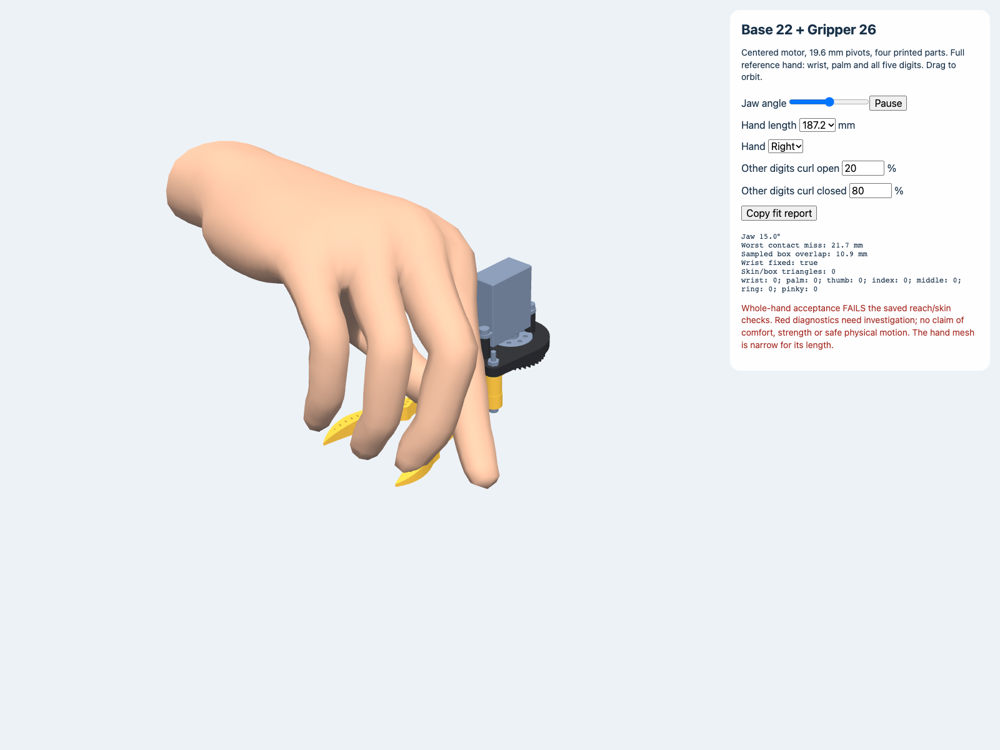

# Centered compact revision — voice-550038ca

**Base 22 (from Base 21) + Gripper 26 (from Gripper 25). CAD passes; whole-hand acceptance FAILS.**




The tests-first baseline checks found an off-center output axis (+15.675 mm), six printed parts and 31.35 mm pivots. New axes/part-count/spacing tests were established before copying the design. The physical change integrates the two removable sectors into their jaws, centers the existing actual-size HLS3606M servo, and reduces pivot spacing to 19.6 mm. There are four printed parts, 20 total discrete parts including all hardware (previously six / 22). The comparison adds the older omitted screw meshes for an honest before/after count; no historical source/manifest was edited.

Rear clearance is 0.8265 mm at closed, limited by the inward rear shoulders at X=±0.4133, Z≈4.198 mm. This exceeds the assumed 0.3 mm manufacturing + 0.5 mm deflection reserve. Actual 19.5 mm re-export leaves 0.7412 mm and fails. A continuous vertex-extrema check covers the inherited rear outline throughout the 0–30° stroke; 121 sampled full-body poses cover all 78 body pairs, plus driver probes and 726 direct outside-contact approaches. No gear/body pair is excluded. Wrong-phase pinion and jaw controls intersect at 0/15/30°, demonstrating both transmission meshes remain present. Retention, local support, mirrored finger band, grounded print meshes and genus checks pass.

The lower jaw sectors counter-rotate; only the right jaw has upper pinion teeth. This deliberately asymmetric transmission permits a centered motor without adding an idler or height. Working fingers mirror to <0.000002 mm surface error. The same purchased servo/plate and fastening pattern remain. The finer 30:42 drive needs 21.43° motor travel but has ~43% less ideal torque multiplication. Whole swept width increases 70.03→72.60 mm while longitudinal extent decreases 106.76→100.72 mm; Y stack stays 52.60 mm. Strength, bearing wear, 0.4 mm sleeve-wall crushing, nut locking, real cable routing, print process and tilted PH0 engagement remain physical tests.

## Reproduce

From repository root:

```sh
cd 'Two Finger Gripper/versions/v323_generalist_centered_drive'
python3 export_models.py
../../../cad/blender/.venv/bin/python search_spacing.py
../../../cad/blender/.venv/bin/python check_geometry.py
../../../cad/blender/.venv/bin/python genus.py
```

Then from repository root:

```sh
PYTHONPATH=Scripts cad/blender/.venv/bin/python -m unittest Scripts.test_centered_gripper Scripts.test_compact_overhead Scripts.test_gallery.ModelTests Scripts.test_publish_designs -v
cad/blender/.venv/bin/python -m Scripts.check_centered_hand
cad/blender/.venv/bin/python cad/validation/voice-550038ca-centered/render_evidence.py
python3 Scripts/publish_designs.py --no-build
```

The regression suite has 30 passing tests, including catalog/picker motion, every actual BOM mesh, current source/mesh hash verification and isolated Tune gap export with an unchanged real-size motor. The CAD checker exits 0; the whole-hand checker must currently exit 1. No application build or physical actuation was run.

## Complete-hand screening remains failed

`whole-hand.json` stores the actual closed-mesh containment screen for two narrow generic WebXR right hands, uniformly scaled to lengths 181.1 / 193.3 mm. At 50% outside contact, 8 mm pads and a fixed wrist, worst misses are **25.76 / 27.89 mm**; actual skin vertices enter jaw solids at **3/13 / 2/13** poses. This is worse reach than the prior saved 12 mm result, not accepted ergonomics. Conservative full-part boxes affect the IK cost, especially with integral jaw/gears. The sampler tests real CAD solids separately but can miss crossings between skin vertices. The mesh is not Jake's measured hand; no pressure/comfort or strength claim follows from it.

`centered_acceptance.html` in the published gallery shows the same complete wrist/palm/all-digit hand and all physical BOM items, with motion, adjustable hand length and Copy fit report. Contact rays are drawn from actual triangles in the working band so integrated overhead gears do not raise the rays. All collision solids remain complete. This page imports the unchanged shared `human_hand.js` solver through `centered_case.js`; it creates no second anatomy solver. The normal gallery's generic hand overlay does not yet select the band of integral jaw/gears; use this dedicated acceptance page.

`browser-smoke.json` records Chrome desktop screenshots/13 poses and a successful clipboard Copy report. The saved browser animation is 187.2 mm; separate solid screening uses 181.1/193.3 mm. `whole-hand-motion.gif` opens and closes; `hand-frames.json` contains deformed skin at 0/15/30°. There was no phone or physical human trial.

## Hand-study coordination

No other HelpingHands CAD/hand worker was active in tmux before registry edits. No other pebble, hand anatomy solver or existing design was changed. The hand study voice-3f6ae8e1 should consume `cad/mobile_gallery/centered_case.js` for this case: mm, Y=-3..3 band, ±9.8 X jaw axes, export 15°, 0–30° stroke, right +1 / left -1. Motor rotor / pinion / plate / plate screws / center screw axis [0,0,-21.3811131611], ratio -30/42. The Python screen reads this contract from the JS case output. Main version README documents assembly, load path, parts and mechanical limitations.
