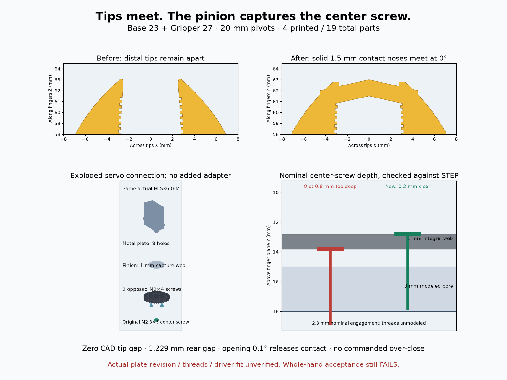
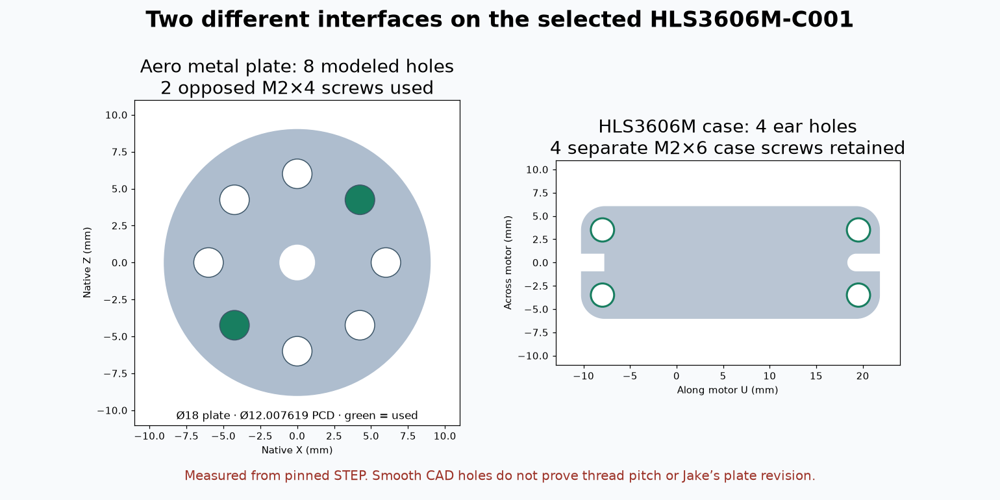

# Contact-close revision — voice-550038ca

**Base 23 (from Base 22) + Gripper 27 (from Gripper 26). CAD closure passes; physical fit and whole-hand ergonomics are not accepted.**




The red-first closure test found **4.78 mm distal separation** on Base 22. Its middle blade approached before the ends; deleting the nominal 0.2 mm gap would not fix that. The new version adds solid integral 1.5 mm contact noses, trims original corners behind the contacting distal end, and uses 20 mm pivots instead of 19.6. It retains one-piece jaw/gears and four printed pieces. New tests check the actual distal end, not merely any contact along the blade. The first nose candidate left a 0.128 mm sliver; adding the nose solid after lattice/ridge cuts restores **0.4047 mm** minimum plan ligament.

`closure_checks.json` reports zero nominal tip gap, only 3.8e-8 mm³ numerical closed-jaw overlap, 0.2147 mm separation after opening 0.1°, 0.6 mm nominal middle-blade clearance and **1.2291 mm continuous rear clearance** through the full stroke. A -0.1° CAD-only control detects interference and is never a commanded pose. All 121 full-body poses ×78 pairs, driver paths, 726 outside approaches, retention, mirrored finger band and wrong-phase controls pass. Four print meshes are single-body/watertight and grounded; genus 33/33/3/3. The full assembly volume matches every physical BOM mesh.

The proposed `motion_limits.json` contains no executable motor control. Feetech specifies no internal mechanical angle limit. Neutral 180°/2048 ticks is the nominal closed reference; integer opening tick1805 rounds inward to 29.9004° jaw opening, with 158.6426° electronic wrap margin. Physical phase/contact teaching with limited force/current remains required; do not blindly use those absolute ticks or command negative jaw angles. Print uncertainty ±0.3 mm per side, encoder half-step (~0.135 mm at the tips) and up-to-0.5° servo backlash mean rigid CAD contact is not a physical closure guarantee. There is no qualified compliance/contact-force model.

## Hardware source check and simplification

`check_hardware.py` reads cylinder axes/depths from the pinned STEP with OpenCascade, then compares actual parametric placement and exported head seats. The selected HLS3606M-C001 has a 25T/Ø4.95 manufacturer spline and M2.3×5 center screw. Its separately purchased Aero plate has **eight modeled smooth Ø2 holes on Ø12.007619 PCD**; the four Ø2.5 case-ear holes are another interface. The real plate Jake owns is not identified by these documents, and smooth CAD cylinders do not establish actual thread pitch/minor diameter.

Two opposed M2×4 plate screws replace three, with 1.75 mm modeled engagement in a 2 mm disk. No new mounting adapter is added. An integral 1 mm web in the pinion captures the original center screw and corrects the earlier nominal **0.8 mm bore-floor intrusion** to **0.2 mm clearance / 2.8 mm engagement**. The pinion and metal plate now clamp together beneath that head. A deliberately wrong STS3215 Ø14 PCD control fails by ~0.996 mm; that pattern is not substituted. Four case-ear screws remain. The source drawing versus CAD longitudinal discrepancy (0.25 mm) stays within the existing 0.5 mm pilot slots.

The guide's printed page31 specifies three screws for its original spool; page36 distinguishes case mounting with two or four screws for different motor-frame locations. Its case screws are flanged Torx. Two current case-ear driver shafts require 10° tilt in the STEP geometry; **real drive engagement, supplied head/length tolerances and tool handles remain unverified**. We do not claim physical fit from the shaft envelope. Retention/load paths, nominal engagement, remaining thin sleeve walls, fine-resin tooth/neck/center-web strength, locking and cable bend are detailed in the version README. No motor was connected or actuated.

**Physical parts: 19**, versus20 in Base22: 4 print solids, motor, plate, 2 plate screws, center screw, 4 case screws, 2 pivot bolts, 2 washers, 2 nuts. Every physical item appears in the new assembly/preview; cable and tool reserves are not counted.

## Whole-hand acceptance remains failed

The unmodified shared WebXR anatomy/IK is run through `contact_case.js`; only actual working-band triangles supply contact rays, while every physical mesh remains complete for collision screening. Narrow generic right hands scaled to 181.1/193.3 mm have **26.59/35.31 mm** worst contact misses and jaw skin containment at **2/13 poses each**. Conservative full-part boxes affect the solver cost; this does not establish anatomical impossibility or ergonomic acceptance. Actual-solid containment is a separate vertex screen that can miss edge crossings. These are not Jake's measured hands and no pressure/comfort model is asserted.

`contact_acceptance.html` in the published gallery provides full wrist/palm/all-digit motion, hand size selection and Copy fit report. Chrome desktop testing captured 13 poses at187.2 mm with no page errors and a working clipboard report; separate solid screening uses181.1/193.3. Screenshots and `whole-hand-motion.gif` show the actual scene, not accepted fit. No phone or physical trial occurred.

The shared hand-study contract is `cad/mobile_gallery/contact_case.js`: jaw axes±10 X, export15°, stroke0–30°, right+1/left-1; rotor axis[0,0,-21.8174242293], ratio-30/42, station50%, 8mm pad assumption, fixed wrist. Python consumes the case output rather than recreating its pose. No other pebble, hand anatomy solver or historical design was changed; hand study voice-3f6ae8e1 can import this same case. No other HelpingHands CAD worker was active at registry edits.

## Reproduce

From the new version folder:

```sh
python3 export_models.py
../../../cad/build123d/.venv/bin/python check_hardware.py
../../../cad/blender/.venv/bin/python check_geometry.py
../../../cad/blender/.venv/bin/python check_closure.py
../../../cad/blender/.venv/bin/python genus.py
```

Then from repository root:

```sh
PYTHONPATH=Scripts cad/blender/.venv/bin/python -m unittest Scripts.test_closed_tips Scripts.test_centered_gripper Scripts.test_compact_overhead Scripts.test_gallery.ModelTests Scripts.test_publish_designs -v
cad/blender/.venv/bin/python -m Scripts.check_contact_hand
cad/blender/.venv/bin/python cad/validation/voice-550038ca-contact/render_evidence.py
python3 Scripts/publish_designs.py --no-build
```

**36 regressions pass**. Mechanical/hardware/closure checkers exit0; the whole-hand checker intentionally exits1 for the failed acceptance. Source/mesh hashes are checked. No application build or physical actuation was run. Primary manufacturer/BOM/STEP links and local provenance are in the version README.
