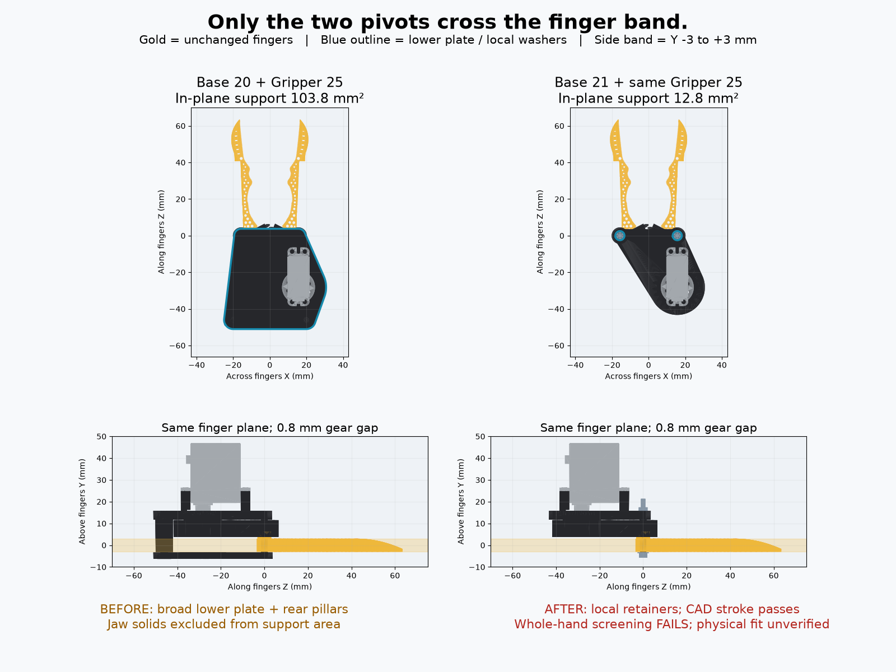
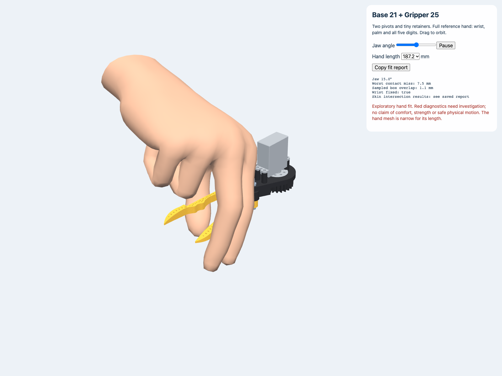

# Two-pivot support acceptance — voice-550038ca

The current review geometry is **Base 21 (from Base 20) + unchanged Gripper 25** in `Two Finger Gripper/versions/v322_generalist_two_pivot_support`. CAD geometry checks pass. **Whole-hand acceptance does not pass.** This is a prototype for human review, not a fit/strength-qualified product.




## Tests first, then design

Jake's final clarification superseded the earlier four-post-cap goal. `check_finger_plane_constraints.py` first reproduces the failure on Base 20: **89.694 mm² off-pivot material in the actual Y=-3..3 finger slab**, plus a broad adjacent lower plate. Jaws are excluded from this metric. Two pivot journals and small local retainers are allowed; extra supports must be justified. This test does not prescribe four pegs, reduce jaw surfaces, or pretend collision freedom proves structural minimality.

Base 21 deletes the lower plate and rear pillars. Within the slab, occupied projected stationary material falls **103.808 → 12.799 mm²** (87.7% reduction); the conservative two outer journal discs cover 14.114 mm². The hollow printed sleeves have steel bolt cores. The 5 mm local washers/head envelopes below the slab are reported separately. Overhead tooth gap stays 0.8 mm; fingers remain byte-identical. See the version README for retention, real hardware, assembly sequence and strength limitations.

An earlier four-post cap candidate was already in progress before the tests-first steering. It is preserved under `Two Finger Gripper/studies/voice-550038ca-four-post-cap`, outside gallery discovery. It reduces the cap outline but **fails pinion clearance, screw and driver access**; it is not Base 21, is not published, and must not be printed. `unpublished-candidate.json` records its failures rather than suppressing them.

## Reproduce

From repository root:

```sh
cad/blender/.venv/bin/python -m unittest Scripts.test_finger_plane_constraints -v
cad/blender/.venv/bin/python Scripts/check_finger_plane_constraints.py --strict
cad/blender/.venv/bin/python Scripts/check_finger_plane_constraints.py --folder 'Two Finger Gripper/versions/v322_generalist_two_pivot_support' --strict
cad/blender/.venv/bin/python -m Scripts.check_two_pivot_hand
cad/blender/.venv/bin/python cad/validation/voice-550038ca/render_evidence.py
```

Eleven regression tests pass: they reproduce the two older failures and verify the new support, unchanged jaws, outside CAD approaches, overhead drive and full stroke. The default strict checker on Base 20 **must return 1** for its excessive footprint; the Base 21 strict checker returns 0. The whole-hand checker **must currently return 1** for the failed fit. A green regression suite is not a green ergonomic acceptance result.

From the Base 21 folder, run `python3 export_models.py`, then `../../../cad/blender/.venv/bin/python genus.py` and `../../../cad/blender/.venv/bin/python check_geometry.py`. These are CAD exports/tests, not an application build. The detailed checker includes 121 poses, 105 body/probe pairs each, and both collision-positive controls and axial escape-stop controls. Two motor-ear screws still require a tilted driver whose physical engagement is unverified.

## Full hand: failed acceptance, visible and measurable

Open **`two_pivot_acceptance.html`** at the root of the published Live Preview catalog. It animates the actual CAD and unmodified full WebXR skin through 0–30°, with wrist, palm and all other fingers present. Orbit, pause, scrub, select hand length, and Copy fit report. `whole-hand-motion.gif` and the three PNG frames show the actual scene; `browser-smoke.json` records a Chrome desktop run with no page errors. No phone check was made.

`two_pivot_case.js` is the common CAD/hand pose owner for this acceptance view and the saved-mesh screen. It imports the existing `human_hand.js` and `fingerContacts`; it does not implement a competing anatomical solver. Right reference hands at **181.1 and 193.3 mm** length are uniformly scaled from WebXR generic-hand (MIT). That mesh is narrow: about 78 mm breadth at the 187.2 mm adult setting. It is not Jake's measured hand. Contact station is **50% down each outside finger surface**, pad radius 8 mm, wrist locked from the first pose. Jaws open 0–30° with 37.5° servo travel.

All 26 sampled hand poses fail the explicit 2 mm contact-residual budget: worst misses are **12.04 / 11.98 mm**. Complete deformed skin vertices lie inside actual closed CAD at **5/13 / 7/13** poses. Hits include pivot screws, the overhead base and a jaw. No physical CAD body is excluded. The body-containment screen samples vertices; it can miss an edge crossing and does not prove continuous clearance. Existing live box/joint diagnostics are also exploratory. `whole-hand.json` names the assumptions, source hashes, misses, intersected bodies and pose angles. `hand-frames.json` contains the actual skinned surfaces for 0/15/30°.

The animation visibly misses the intended pads under these solver settings. It must not be interpreted as a successful human grasp. The next hand-study pass needs measured pose/contact calibration and investigation of these hits; a fixed generic IK result cannot establish physical impossibility or comfort. Do not shrink the jaws to make this screen green.

## Coordination contract for voice-3f6ae8e1

CAD/catalog/versions remain owned by voice-550038ca. The existing hand-study thread received the Base 21 location and this unchanged pose contract, and acknowledged it without editing CAD/catalog. No other pebble was edited. The hand study owns subsequent anatomical solver corrections and should consume these meshes rather than create a second CAD variant.

- Units mm; +Y above the working finger band; slab Y=-3..3.
- Jaw pivots X=±15.675, Y=0, Z=0. Exported jaw pose 15°; right +1 / left -1 about Y, range 0–30°.
- Pinion and stock plate pivot [15.675,0,-28.215], ratio -1.25 relative to jaw swing.
- Contacts come only from semantic Left/Right finger meshes via `fingerContacts`; thumb/index on opposing outside surfaces. Palm and other digits are modeled, not placed inside the grasp gap by an invented fixture.
- New physical reference meshes `pivot_screws`, `pivot_washers`, `pivot_nuts` are fixed, included in collision screening. No lower cap mesh remains.

No physical actuation, human trial, force test, sleeve crush/bending test, wear, nut-locking verification, resin calibration, tool-handle clearance or actual cable bend test was performed.
